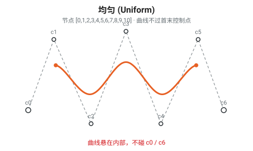
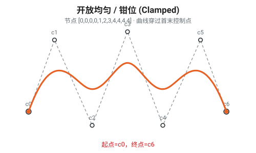
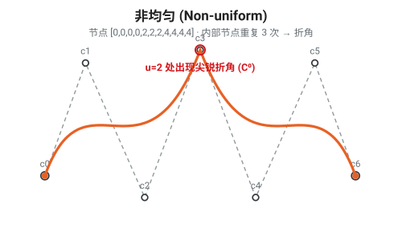
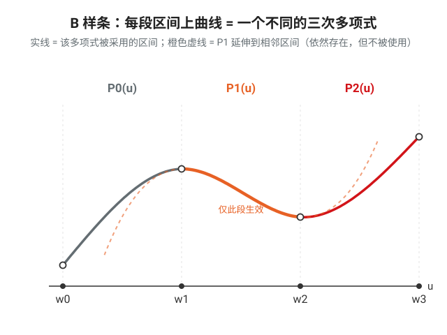
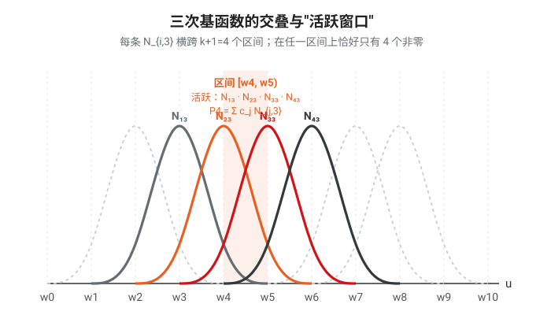

# B 样条（B-spline）入门总结

> 原文：[An intro to B-splines](https://rohangautam.github.io/blog/b_spline_intro)（Rohan Gautam）
> 本文是为理解 Kolmogorov-Arnold Networks (KANs) 打基础而写的 B 样条介绍。

---

## 1. 出发点：为什么需要样条（Spline）

给定一组数据点，我们希望找到一条光滑曲线来拟合/插值它们。

- **朴素做法**：用一个高次多项式去穿过所有点。
- **问题（Runge 现象，Runge's phenomenon）**：单个高次多项式会在**区间边缘产生剧烈振荡**（oscillations at the edges），使插值结果不可靠。次数越高越严重。

**样条（Spline）的思路**：不用一个高次多项式，而是用**多段低次多项式**（通常是三次 / cubic）分段拼接起来。

样条的优点：

- **局部控制（local control）**：修改一个点只影响它附近的区间，不会牵动整条曲线。
- **避免振荡**：不再有高次多项式的振荡伪影。
- **计算高效**：对大规模数据点也能高效处理。

---

## 2. 三个核心要素

一条 B 样条曲线的形状由三样东西决定：

| 要素                                | 记号           | 作用                                                                 |
| ----------------------------------- | -------------- | -------------------------------------------------------------------- |
| **控制点（control points）**  | $c_i$        | 用户指定，决定曲线的几何形状（曲线被它们"吸引"，但不一定穿过它们）。 |
| **节点（knots）**             | $w_i$        | 决定各段分段多项式在参数轴上**在哪里连接**。                   |
| **基函数（basis functions）** | $N_{i,k}(x)$ | 量化每个控制点在曲线各处的**影响权重**。                       |

---

## 3. B 样条曲线的定义

$$
S_{k,t}(x) = \sum_{i=0}^{n} c_i \, N_{i,k}(x)
$$

- $c_i$：控制点，共 $n+1$ 个（下标从 $0$ 到 $n$）。
- $N_{i,k}(x)$：第 $i$ 个、次数为 $k$ 的基函数。
- $k$：样条的**次数（degree）**，多项式的最高次数。

即：**曲线 = 控制点以基函数为权重的加权和**。

---

## 4. Cox–de Boor 递推公式（计算基函数）

基函数通过 **Cox–de Boor 递推**计算：从 0 次的阶梯函数出发，逐级向上组合出高次基函数。

**基础情形（$k=0$，0 次）** —— 就是节点区间上的阶梯函数：

$$
N_{i,0}(u) =
\begin{cases}
1 & \text{if } w_i \le u < w_{i+1} \\
0 & \text{otherwise}
\end{cases}
$$

**递推情形（$k \ge 1$）** —— 由两个相邻的低一次基函数加权组合：

$$
N_{i,k}(u) = \frac{u - w_i}{w_{i+k} - w_i}\, N_{i,k-1}(u)
\;+\; \frac{w_{i+k+1} - u}{w_{i+k+1} - w_{i+1}}\, N_{i+1,k-1}(u)
$$

- 两个分式即所谓的 $\alpha$ 系数，是关于 $u$ 的**线性权重**。
- 高次基函数由低次基函数线性组合而成 —— 这是递归的精髓。

---

## 5. 节点数、控制点数与次数的关系

若有 $n+1$ 个控制点（下标 $0..n$），次数为 $k$，则节点数为：

$$
\text{节点数} = n + k + 2
$$

（等价于常见写法 $m = n + p + 1$，只是对"$m$、$n$ 是从 0 还是从 1 计数"的约定不同。）

---

## 6. 节点向量（Knot Vector）的三种类型

$w_i$ 表示第 $i$ 个节点位置。**基函数的形状只取决于节点的相对间距，而非绝对数值。**

### 6.1 均匀（Uniform）

节点等间距。基函数是彼此**平移后的相同副本（shifted copies）**。

```
[0, 1, 2, 3, 4, 5, 6, 7, 8]
```

缺点：曲线一般**不穿过**首末控制点。



> 下面三张图使用**同一组 7 个控制点**（虚线为控制多边形），只改节点向量，以便直接对比。为凑够 7 个控制点，此处均匀向量取 11 个等距节点 `[0..10]`；文中 `[0..8]` 是同样构造、控制点较少（5 个）的版本。橙色曲线只定义在有效参数域 $[w_k, w_{n+1}]$ 上，所以两端"缩"在内部，明显够不到 $c_0$、$c_6$。

### 6.2 开放均匀 / 钳位（Open Uniform / Clamped）

**首末节点各重复 $k+1$ 次**，强制曲线**穿过第一个和最后一个控制点**。

```
[0, 0, 0, 0, 1, 2, 3, 4, 4, 4, 4]
```

（示例为三次样条，故两端各重复 4 次。）



> 两端节点各重复 $k+1=4$ 次后，曲线的起点被"钉"在 $c_0$、终点被钉在 $c_6$（图中橙色端点与端控制点重合）。中间部分与均匀情形形状相近，差别只在两端是否被钳住。

### 6.3 非均匀（Non-uniform）

自定义节点间距，可通过**局部降低连续性**来制造**尖锐的折角（sharp bends）**。

```
[0, 0, 0, 0, 2, 2, 2, 4, 4, 4, 4]
```

中间节点的重复会在该处降低光滑度。



> 这里内部节点 $u=2$ **重复 3 次（$=k$）**，把该处的连续性从 $C^{k-1}=C^2$ 降到 $C^0$：曲线在此**仅位置连续、切向突变**，于是出现尖锐**折角**，并恰好被拉过控制点 $c_3$。两端仍重复 $k+1$ 次，故同样钳在 $c_0$、$c_6$。对比：重复 1 次降到 $C^{k-2}$，重复 $k$ 次降到 $C^0$（折角），重复 $k+1$ 次则断开/钳位。

---

## 7. 关键性质

### 7.1 局部支撑（Local Support）

每个基函数**只在固定的一小段区间内非零**。对三次样条（$k=3$），单个基函数**只跨越 $k+1 = 4$ 个节点**。

> 意义：移动一个控制点，只会改变曲线的局部一小段 —— 这正是"局部控制"的数学来源。

### 7.2 单位分解（Partition of Unity）

在任意参数位置上，所有基函数之和恒为 1：

$$
\sum_i N_{i,k}(u) = 1
$$

> 意义：保证曲线是控制点的**凸组合**，曲线始终落在控制点的凸包内，且与光滑性约束相关。

### 7.3 连续性（Continuity, $C^n$）

- $C^n$ 连续：指在拼接点处**直到第 $n$ 阶导数都连续**。
- B 样条（三次）通常达到 **$C^2$ 连续** —— 即位置、速度、加速度都连续（加速度变化平滑）。
- 在某个节点处**重复节点**会**降低该处的连续性**，用于制造折角。

---

## 8. 一句话总结

B 样条把一条曲线表示成**控制点**在一组由**节点向量**决定、通过 **Cox–de Boor 递推**生成的**基函数**下的加权和；它以低次分段多项式换取了**局部控制**、**高连续性**和**无振荡**，节点向量的设计（均匀 / 钳位 / 非均匀）则灵活控制曲线是否过端点、以及在何处保持光滑或产生折角。

---

## 附录：补充问答

### Q1. 次数 $k$ 指的是什么？是多项式的最高次数吗？

是的，$k$ 就是**每一段分段多项式的最高次数**。

| 次数 $k$ | 每段多项式形式 | 常见叫法 |
|---------|--------------|---------|
| 0 | $a$ | 阶梯函数（Cox–de Boor 基础情形 $N_{i,0}$） |
| 1 | $a + bu$ | 线性 / 折线 |
| 2 | $a + bu + cu^2$ | 二次 |
| 3 | $a + bu + cu^2 + du^3$ | **三次（cubic）**，最常用 |

要点：

- $k$ 描述的是**分段**多项式的次数，整条 B 样条是许多段 $k$ 次多项式在节点处拼接而成，而非一个 $k$ 次多项式。
- **次数（degree）$k$** vs **阶（order）** $= k+1$。三次样条：次数 3，阶 4。（`scipy` 等库里的参数 `k` 指次数。）
- $k$ 同时决定多个量：基函数**局部支撑宽度** $= k+1$ 个节点区间；曲线最高**连续性** $= C^{k-1}$；钳位节点向量两端各重复 $k+1$ 次。

### Q2. 节点是干嘛用的？

节点 $w_i$ 是**参数轴 $u$ 上的一串分界点**，作用有三层：

1. **划定每段多项式的地盘**：每段 $k$ 次多项式只在相邻两节点之间 $[w_i, w_{i+1})$ 上有效，节点即分段边界。
2. **控制参数化节奏**：节点的**相对间距**决定曲线在各段上"走多快 / 占多少参数"（只看相对间距，绝对数值无关）。
3. **局部调节连续性**：同一位置重复节点会降低该处光滑度 —— 重复 $k+1$ 次可把曲线钳到端点（钳位），中间重复可制造折角。

> 一句话：**控制点管"曲线长什么样"，节点管"曲线怎么被切段、各段怎么衔接"。**

#### 图解："每段 $k$ 次多项式只在相邻两节点之间生效"



上图是一条真实算出来的**自然三次样条**（$M_1=-3.52,\ M_2=3.28$）。读法：

- 横轴是参数 $u$，节点 $w_0,w_1,w_2,w_3$ 把参数轴切成 3 段。
- 曲线由三段**颜色不同的实线**组成，每段各自是一个**独立的三次多项式**：$P_0$ 只在 $[w_0,w_1]$ 生效、$P_1$ 只在 $[w_1,w_2]$ 生效、$P_2$ 只在 $[w_2,w_3]$ 生效。
- **橙色虚线**是把 $P_1(u)$ 延伸到左右相邻区间画出来的：它很快就偏离了灰、红两段。这说明 $P_1$ 作为多项式在整条轴上都有定义，但**只有 $[w_1,w_2]$ 之间那一段真正被采用**，越过节点后就交给别的多项式。
- 三段在节点处 $C^2$ 光滑相接，所以看不出折角。

一句话：**"每段只在相邻两节点之间生效" = 曲线在每个节点区间上换用一个不同的多项式，节点就是"换公式"的切换点。**

### Q3. 为什么节点数一定等于 $n + k + 2$？

关键约束：**基函数个数必须正好等于控制点个数 $n+1$**（曲线定义中两者一一对应）。

而一组节点能生成多少个 $k$ 次基函数，被 Cox–de Boor 递推锁死。设节点数为 $m$（即 $w_0,\dots,w_{m-1}$）：

- **0 次基函数**定义在每个区间 $[w_i,w_{i+1})$ 上，$i=0\dots m-2$，共 $m-1$ 个。
- **每升一次，个数减 1**：因为 $N_{i,k}$ 需要 $N_{i,k-1}$ 和 $N_{i+1,k-1}$ 两个相邻低次基函数，末尾那个配不到右邻居。

| 次数 | 基函数个数 |
|------|-----------|
| 0 | $m-1$ |
| 1 | $m-2$ |
| $k$ | $m-(k+1)$ |

令其等于 $n+1$：

$$
m - (k+1) = n + 1 \;\Longrightarrow\; m = n + k + 2
$$

**直观记忆：**

$$
\underbrace{m}_{\text{节点数}} = \underbrace{(n+1)}_{\text{控制点数}} + \underbrace{(k+1)}_{\text{阶}}
$$

即 **节点数 = 控制点数 + 阶**。多出的 $k+1$ 个节点正好对应钳位样条两端各重复 $k+1$ 次。

### Q4. 分段多项式 $P_i$ 和基函数 $N_{i,k}$ 是什么关系？为什么 $P_i$ 只在 $[w_i,w_{i+1}]$ 生效？

先分清两个下标含义**不同**的对象：

| 对象 | 下标指什么 | 是什么 | 定义域 |
|------|-----------|--------|--------|
| $N_{i,k}$ | 第 $i$ 个**控制点** | 一个基函数，本身也是**分段多项式**，跨越 $k+1$ 个节点区间 | 只在 $[w_i,\,w_{i+k+1})$ 非零 |
| $P_i$ | 第 $i$ 个**节点区间** | 描述整条曲线**在这一段**上的**单个** $k$ 次多项式 | 只在 $[w_i,\,w_{i+1})$ 被采用 |

一个跨越多段，一个只占一段 —— 别被同一个字母 $i$ 骗了。

#### 关系式

曲线定义对**全部**控制点求和：$S(u)=\sum_j c_j N_{j,k}(u)$。锁定区间 $[w_i,w_{i+1})$，由**局部支撑**，此段上只有 $k+1$ 个基函数非零（即 $N_{i-k,k},\dots,N_{i,k}$），求和塌缩为：

$$
\boxed{\,P_i(u) = \sum_{j=i-k}^{i} c_j \, N_{j,k}(u), \qquad u \in [w_i, w_{i+1})\,}
$$

即 $P_i$ **不是某一个 $N$**，而是该区间上 $k+1$ 个"活跃"基函数、以对应控制点为权重的**加权和**。三次样条（$k=3$）每段由 4 个基函数、4 个控制点共同决定。

#### 图解：基函数交叠 + 活跃窗口



上图是均匀节点向量下真实的三次基函数 $N_{i,3}$（Cox–de Boor 算出）。读法：

- 每条 $N_{i,3}$ 是一个"钟形"，**横跨 $k+1=4$ 个节点区间**，其余地方恒为 0（局部支撑）。
- 橙色高亮的区间 $[w_4,w_5)$ 上，**恰好只有 4 条基函数非零**：$N_{1,3},N_{2,3},N_{3,3},N_{4,3}$（其余基函数虚线示意，在此段为 0）。它们加权求和即得该段的 $P_4$。
- 已验证：这 4 条在该区间内处处**相加等于 1**（单位分解）。

#### 为什么 $P_i$ 只在一段生效？两层原因

1. **每个 $N_{j,k}$ 天生是局部的（根源在 Cox–de Boor）**：0 次基函数 $N_{j,0}$ 只在 $[w_j,w_{j+1})$ 非零；递推每升一次向右多并一个区间，归纳得 $N_{j,k}\neq 0 \iff u\in[w_j,w_{j+k+1})$，恰好 $k+1$ 段。
2. **相邻区间的活跃集"滑动一格"**：从 $[w_i,w_{i+1})$ 到 $[w_{i+1},w_{i+2})$，踢掉 $N_{i-k,k}$、加入 $N_{i+1,k}$，留下的基函数也各自切换到下一段多项式弧。参与者变了 → 加权和成了**另一个多项式** $P_{i+1}\neq P_i$。

> $P_i$ 作为多项式在整条轴上都有定义（这正是前一张图里橙色虚线能画出去的原因），但**只有在 $[w_i,w_{i+1})$ 上它才恰好等于曲线**；越过节点，活跃窗口一滑动，就由另一组基函数拼出的 $P_{i+1}$ 接管。

**一句话**：$N_{i,k}$ 是"零件"（每个横跨 $k+1$ 段、只在局部非零），$P_i$ 是"某段上把 $k+1$ 个活跃零件按控制点权重装配好的成品"；区间一换，活跃零件集滑动一格，成品就变了。

### Q5. $N_{i,k}$ 由哪几个控制点决定？

**不由任何控制点决定** —— 基函数只由**节点向量**和**次数 $k$** 决定，与控制点完全无关。

#### 只取决于节点

回看 Cox–de Boor 递推，右边**只出现节点 $w$，没有任何 $c$**：

$$
N_{i,k}(u) = \frac{u - w_i}{w_{i+k} - w_i}\, N_{i,k-1}(u) + \frac{w_{i+k+1} - u}{w_{i+k+1} - w_{i+1}}\, N_{i+1,k-1}(u)
$$

$N_{i,k}$ 只用到 $k+2$ 个节点 $w_i, w_{i+1}, \dots, w_{i+k+1}$（正好覆盖其支撑区间 $[w_i, w_{i+k+1})$）。所以**移动控制点，基函数一根都不变**；只有改动节点向量或次数才会改变基函数形状。

#### 与控制点是"相乘"而非"决定"关系

$$
S(u) = \sum_j \underbrace{c_j}_{\text{几何位置}} \cdot \underbrace{N_{j,k}(u)}_{\text{权重（只由节点定）}}
$$

- $N_{j,k}$：由节点决定的"混合权重曲线"，回答"在 $u$ 处第 $j$ 个控制点占多大比重"。
- $c_j$：你放在空间里的点，决定曲线"往哪拉"。

#### 若问"$N_{i,k}$ 对应哪个控制点"

恰好**一个**：$N_{i,k}$ 是**专属于 $c_i$** 的权重（求和式里它只乘 $c_i$）。注意别和 Q4 混淆：

- "一个 $N_{i,k}$ 配一个控制点 $c_i$" —— 求和式里的一一配对；
- "一段 $P_i$ 由 $k+1$ 个控制点决定" —— 某*区间*上有 $k+1$ 个基函数非零，故 $k+1$ 个控制点共同影响该段。

两句都对、视角不同；而无论哪个视角，**基函数本身始终只由节点决定**。
