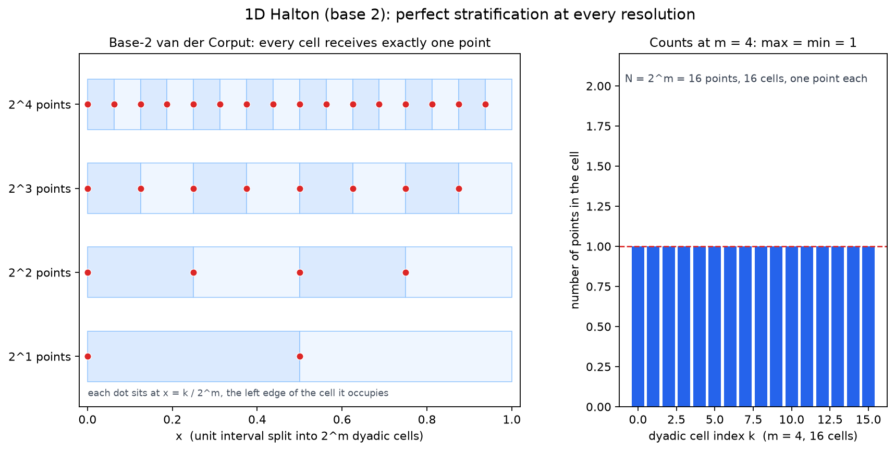
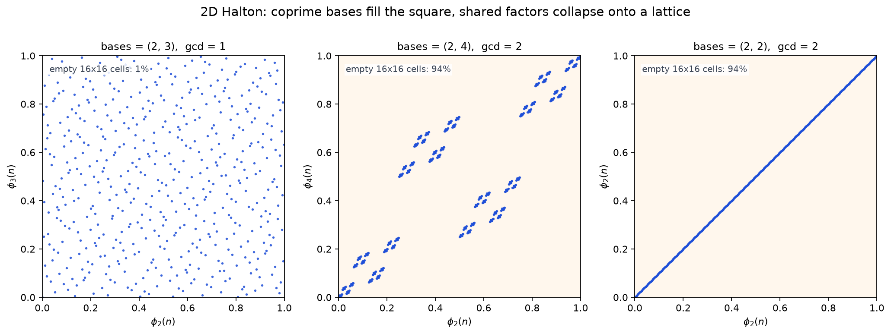
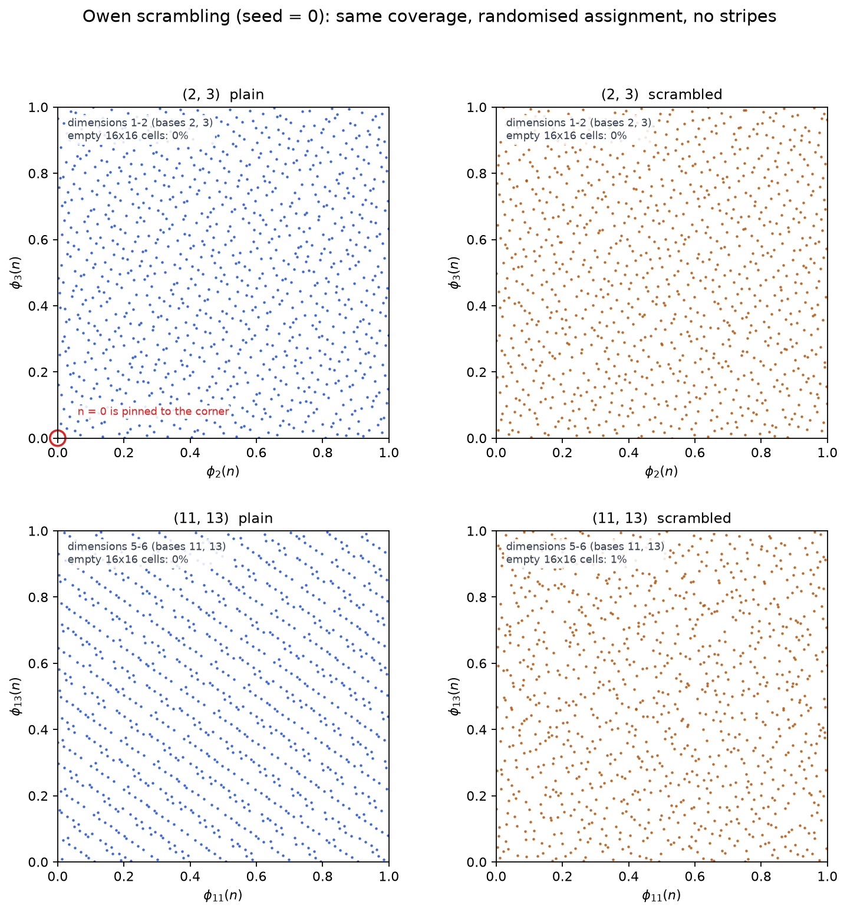
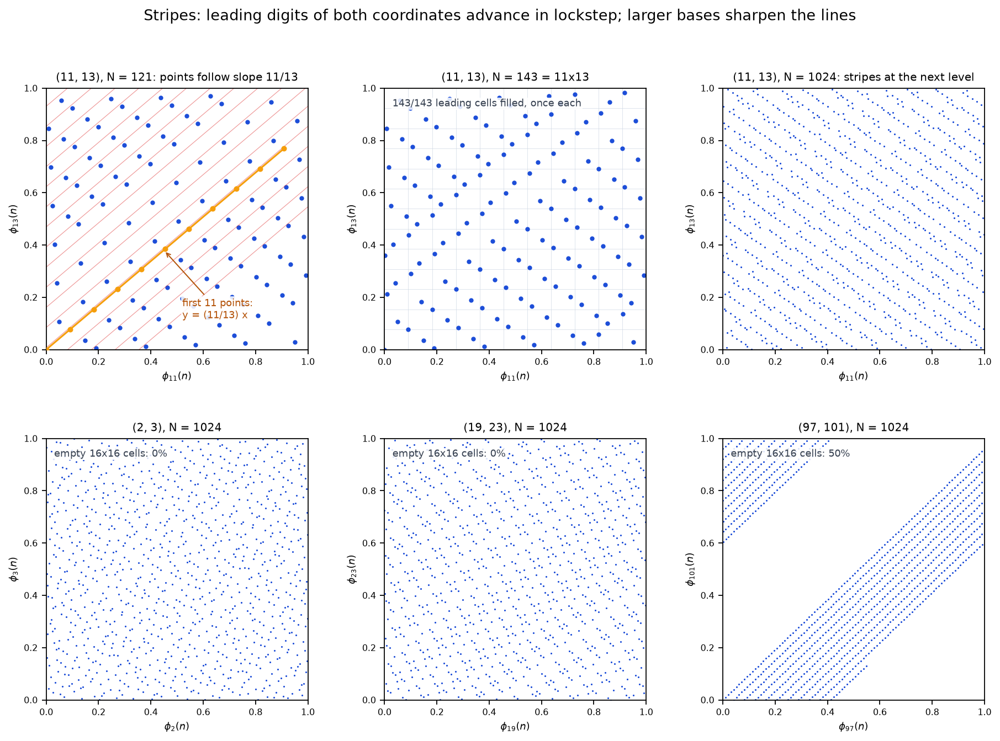
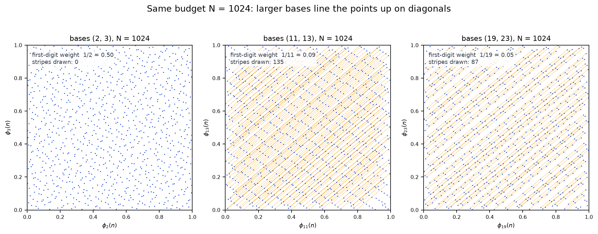

# Halton 序列原理与在 cuRobo 中的用法

> 阅读笔记。围绕 `curobo/_src/util/sampling/` 下的采样实现，梳理 Halton（低差异序列）的数学原理、工程变体，以及在 cuRobo 中的具体作用。

---

## 0. 摘要（TL;DR）

Halton 序列把“整数 $n$ 按质数进制拆位、左右翻转、再拼成坐标”：

$$
x_n=\bigl(\phi_{b_1}(n),\phi_{b_2}(n),\dots,\phi_{b_d}(n)\bigr),
\qquad b_1=2,b_2=3,b_3=5,\dots
$$

$$
\phi_b(n)=0.a_0a_1a_2\ldots_{\,(b)},\qquad n=\sum_{k\ge 0}a_k b^k
$$

它的低差异性质来自一个干净的事实：**前 $b^m$ 个点恰好是 $b^m$ 等分网格的一个排列**，因此对任意分辨率都“完美分层”；多维靠**互质基**保证联合等分布（同基会坍缩到对角线）。

未加扰时高维会出现条纹和原点偏置，所以工程上用 **Owen 加扰**（scipy 的 `scramble=True`）把它随机化。cuRobo 用它做“候选生成器”——IK 种子、MPPI 粒子、PRM/RRT 节点、离线统计——靠**前缀稳定 + 预生成**把采样成本从热路径上彻底移走。

---

## 1. 出发点：为什么要“低差异”

普通蒙特卡洛（MC）用伪随机点估计积分：

$$
I=\int_{[0,1]^d} f(x)\,\mathrm{d}x \;\approx\; \frac{1}{N}\sum_{i=0}^{N-1} f(x_i)
$$

误差是 $O(N^{-1/2})$。问题是：**随机点会扎堆、会留洞**。$N$ 个点撒在 $[0,1]^d$ 里，某些区域可能一个点都没有——而这对“给局部优化器找初值”是致命的：只要有一个种子落进吸引域就够了，扎堆的点等于浪费预算。

准蒙特卡洛（QMC）换一个思路：不用随机点，用**按构造均匀铺开的确定性点列**。

---

## 2. 一维基石：van der Corput 序列

### 2.1 定义

任取整数基 $b\ge 2$。把整数 $n$ 写成 $b$ 进制：

$$
n=\sum_{k\ge 0}a_k b^k,\qquad a_k\in\{0,1,\dots,b-1\}
$$

定义**根式反函数（radical inverse）**：

$$
\phi_b(n)=\sum_{k\ge 0}a_k\,b^{-(k+1)}=0.a_0a_1a_2\ldots_{\,(b)}
$$

一句话：**把 $n$ 的 $b$ 进制数字左右翻转，再放到小数点右边**。

伪代码：

```python
def radical_inverse(n, b):
    result = 0.0
    f = 1.0 / b
    while n > 0:
        result += f * (n % b)
        n //= b
        f /= b
    return result
```

### 2.2 具体算一遍

基 $2$（即**二进制位翻转**）：

| $n$ | 二进制 | 翻转 | $\phi_2(n)$   |
| --- | ------ | ---- | ------------- |
| 0   | 000    | 000  | $0$           |
| 1   | 001    | 100  | $1/2=0.5$     |
| 2   | 010    | 010  | $1/4=0.25$    |
| 3   | 011    | 110  | $3/4=0.75$    |
| 4   | 100    | 001  | $1/8=0.125$   |
| 5   | 101    | 101  | $5/8=0.625$   |
| 6   | 110    | 011  | $3/8=0.375$   |
| 7   | 111    | 111  | $7/8=0.875$   |
| 8   | 1000   | 0001 | $1/16=0.0625$ |

基 $3$：

| $n$ | 三进制 | $\phi_3(n)$ |
| --- | ------ | ----------- |
| 0   | 0      | $0$         |
| 1   | 1      | $1/3$       |
| 2   | 2      | $2/3$       |
| 3   | 10     | $1/9$       |
| 4   | 11     | $4/9$       |
| 5   | 12     | $7/9$       |
| 6   | 20     | $2/9$       |
| 7   | 21     | $5/9$       |
| 8   | 22     | $8/9$       |

### 2.3 直观理解：不断二分最大的空隙

把基 $2$ 的前几个点画在数轴上：

```text
n=0: [0]
n=1: [0]-------[1/2]-------[1]
n=2: [0]---[1/4]---[1/2]-------[1]
n=3: [0]---[1/4]---[1/2]---[3/4]---[1]
n=4: [0]-[1/8]-[1/4]---[1/2]---[3/4]---[1]
n=5: [0]-[1/8]-[1/4]---[1/2]-[5/8]-[3/4]---[1]
```

每来一个新点，它总是**落在当前最大的空隙正中间**。所以任意时刻点集都“尽量均匀”，不会出现一个大洞。

### 2.4 关键性质：前 $b^m$ 个点恰好是一个等分网格

证明只需一行。设 $n<b^m$，则 $n$ 最多 $m$ 位，于是

$$
\begin{aligned}
\phi_b(n)&=0.a_0a_1\ldots a_{m-1}\big|_{\,(b)}=\frac{k}{b^m} \\
&k=b^{m} \phi_b(n) \\
&=\sum_{k=0}^{m-1}a_kb^{m-(k+1)} \\
&=\sum_{i=0}^{m-1}a_{m-i-1}b^i \\
&=a_{m-1}b^0+a_{m-2}b^1+\cdots+a_0b^{m-1} \\
&=a_0a_{1}\cdots a_{m-1} \big|_{\,(b)}
\end{aligned}
$$

所以 $k$ 的 $b$ 进制表示正是 $a_0 a_1 \ldots a_{m-1}$。**数字反转是双射**，所以

$$
\bigl\{\phi_b(n): n=0,\dots,b^m-1\bigr\}
=\bigl\{k/b^m: k=0,\dots,b^m-1\bigr\}
$$

也就是说：**前 $b^m$ 个点正好是 $b^m$ 等分网格点的一个排列**（只是顺序被打乱）。这直接给出逐层“完美分层”：

> 对任意 $m$，任意区间 $\bigl[k/b^m,(k+1)/b^m\bigr)$ 中**恰好有 1 个**点。

QMC 术语叫**一维 $(0,m,1)$-net in base $b$**：每个基本区间恰好一个点，且对**所有分辨率** $m$ 同时成立。

---

## 3. 升到多维：Halton 序列

### 3.1 定义

取前 $d$ 个质数 $b_1=2,\,b_2=3,\,b_3=5,\,b_4=7,\dots$，定义

$$
x_n=\bigl(\phi_{b_1}(n),\;\phi_{b_2}(n),\;\dots,\;\phi_{b_d}(n)\bigr)\in[0,1)^d,
\qquad n=0,1,2,\dots
$$

**每个维度用不同的质数作基**，其余照搬一维的根式反函数。

二维前几个点：

| $n$ | $\phi_2(n)$ | $\phi_3(n)$ | 点                 |
| --- | ----------- | ----------- | ------------------ |
| 0   | $0$         | $0$         | $(0,\,0)$          |
| 1   | $1/2$       | $1/3$       | $(0.500,\,0.333)$  |
| 2   | $1/4$       | $2/3$       | $(0.250,\,0.667)$  |
| 3   | $3/4$       | $1/9$       | $(0.750,\,0.111)$  |
| 4   | $1/8$       | $4/9$       | $(0.125,\,0.444)$  |
| 5   | $5/8$       | $7/9$       | $(0.625,\,0.778)$  |
| 6   | $3/8$       | $2/9$       | $(0.375,\,0.222)$  |
| 7   | $7/8$       | $5/9$       | $(0.875,\,0.556)$  |
| 8   | $1/16$      | $8/9$       | $(0.0625,\,0.889)$ |

可以看到点在一层层往里填，而不是成团。

### 3.2 为什么必须用**互质**的基

如果两个维度用了**同一个基**：

$$
x_n=\bigl(\phi_b(n),\,\phi_b(n)\bigr)
\quad\Longrightarrow\quad
\{x_n\}\subseteq\{(t,t)\}
$$

所有点都落在直线 $y=x$ 上，完全退化。如果两个基有公因子（比如 $2$ 和 $4$），两条序列的周期不互质，点会落在若干条直线上，出现明显条纹。

用不同质数时，两个维度在任意分辨率 $m$ 下**联合**也是均匀的。严格说，由中国剩余定理：$\gcd(b_i,b_j)=1$ 时映射

$$
n\;\longmapsto\;\bigl(n\bmod b_i^m,\; n\bmod b_j^m\bigr)
$$

是 $\mathbb{Z}_{b_i^m}\times\mathbb{Z}_{b_j^m}$ 上的**双射**。而 $\phi_b(n)\bmod b^{-m}$ 只由 $n\bmod b^m$ 决定（就是那 $m$ 位的反转）。所以

> 在 $n=0,\dots,b_i^m b_j^m-1$ 这段里，点对 $\bigl(\phi_{b_i}(n),\phi_{b_j}(n)\bigr)$ 恰好**每个 $b_i^m\times b_j^m$ 小格各落一次**。

这就是二维的“联合分层”。三维及以上需要 $\prod_j b_j^m$ 个点才能铺满一次，实际取不到——这就是高维退化的根源（见 §4）。

### 3.3 一点提醒：第 0 个点是原点

未加扰的 Halton 第一点是 $(0,0,\dots,0)$，前几十个点还贴着坐标面。实践中要么 **burn-in**（丢掉前若干个点），要么**加扰**（§6）。scipy 默认 `scramble=True`，正是为此。

---

## 4. 它到底“好”在哪：差异界，以及高维为什么退化

## 4.1 常数随维度爆炸

实践中的经验分界线大约是：

- $d\lesssim 10$：Halton 明显优于伪随机；
- $d$ 到 $20\sim 30$：优势变弱，未加扰时肉眼可见条纹；
- 更高维：QMC 的收益主要来自**有效维度**（effective dimension）——如果被积函数只对少数几个坐标敏感，高维 QMC 仍然有效；如果所有维度同等重要，就基本退化成随机。

> 这一点很重要：cuRobo 在 MPPI 里用的维度是 $\text{horizon}\times\text{action\_dim}$（可能上百维），它选择 Halton **不是**指望理论误差界，而是买三件事：确定性、无聚集、前缀稳定可预生成（§8）。

### 4.2 不是随机，所以没有“方差”

Halton 是确定性的，误差有界但不随机，理论上存在“和序列共振”的对抗函数。加扰就是为了恢复随机性（§6）。

---

## 5. 未加扰 Halton 的典型毛病与补救

| 问题             | 现象                                     | 补救                                    |
| ---------------- | ---------------------------------------- | --------------------------------------- |
| 原点和坐标面偏置 | 前几十个点贴在 $x=0$ 附近                | burn-in；或加扰                         |
| 高维条纹相关     | 取第 10、11 维做二维投影，能看到明显斜线 | 加扰；换 Sobol；或换格点序列（Roberts） |
| 计算随维度增长   | 每维都要做一次进制分解                   | 预生成后缓存（cuRobo 就是这么做的）     |
| 精度             | $b^{-m}$ 在 $m$ 大时下溢                 | 用 float64 生成；$N$ 不大时无影响       |

**Leapfrog / 跳步变体**：只取 $n=0,s,2s,\dots$ 的子序列，能削弱相邻点相关性，但会牺牲低维分层。cuRobo 没有用这个，而是用加扰 + 预生成。

### 5.1 条纹的成因：前导数字的“锁步”

条纹不是“点不够所以不均匀”，而是两条序列的**前导数字被同一个 $n$ 同步驱动**。

第 $k$ 位数字是 $a_k(n)=\lfloor n/b^k\rfloor\bmod b$，第一位 $a_0(n)=n\bmod b$ 随 $n$ 每步加 1，只是回绕周期不同。在一段“两个第一位都没有回绕”的区间里，$a_0=c_0=n-\text{const}$，于是

$$
y\approx\frac{c_0}{b_2}=\frac{b_1}{b_2}\cdot\frac{a_0}{b_1}=\frac{b_1}{b_2}\,x
$$

即**点沿斜率 $b_1/b_2$ 的直线前进**；每 $b_1$ 步 $x$ 回绕、每 $b_2$ 步 $y$ 回绕，回绕后高位数字改变、截距跳变，于是得到一族平行短线段。

用 $(11,13)$ 验证：前 11 个点精确落在 $y=\tfrac{11}{13}x$ 上，第 12 个点跳到 $(0.008,\ 0.846)$；$N=1024$ 时 1024 个点聚成 **165 条**斜率 $11/13$ 的线，每条约 6 个点。

**为什么基大才明显。** 展开式的权重按 $1/b$ 衰减：第一位贡献 $1/b$，第二位 $1/b^2$，所以第二位对“线”的相对扰动约为 $1/b$。$b=2$ 时是 $1/2$，线结构被彻底抹匀；$b=97$ 时是 $0.01$，线细得像尺子画的。第 $j$ 维用第 $j$ 个质数，所以“高维”坐标天然是大基——**根源是大基，不是维度本身**。

**和 $N$ 的关系。** 第 $m$ 层联合网格是 $b_1^m\times b_2^m$，要每格恰好一个点需要 $N=(b_1b_2)^m$，远大于单维的 $b^m$。$N=11^2=121$ 时 $x$ 的单维分层已经完美，二维仍有条纹；$N=11\times13=143$ 时前导数字对恰好铺满 $11\times13$ 的每一格，粗条纹消失；$N=1024\approx7\times143$ 又出现下一层的细条纹。所以$N$决定了看到第几层的条纹。

**条纹的影响。** 有效样本数坍塌。以基为$(11,13)$为例，对条纹方向常数的函数$f(x,y)=g(y-\frac{b_1}{b_2}x)$，$N=1024$个点只提供越165个（条纹数）不同的函数郅，误差按条纹数而非点数收敛，相当于有效样本数从1024坍缩到165。对与IK/RRT等算法，种子沿特定方向共线，同一个条纹上多个种子携带近似重复的信息（局部优化从它们出发容易收敛到同一个极小值），有效种子数$<N$，吸引域如果比较小且“横在条纹中间”，命中概率由横向间隙决定，而不是由$N$决定。

---

## 6. 加扰（Owen scrambling）：Halton 的“随机化版本”

### 6.1 做法

对每一维，把“数字反转”换成“**带随机置换的数字反转**”。设

$$
x=0.a_0a_1a_2\ldots_{\,(b)}
$$

定义

$$
b_k=\pi_{b_0b_1\ldots b_{k-1}}(a_k),\qquad
y=0.b_0b_1b_2\ldots_{\,(b)}
$$

其中：

- $\pi_{\varnothing}$ 是 $\{0,\dots,b-1\}$ 上的随机置换，给出第一位 $b_0=\pi_{\varnothing}(a_0)$；
- $\pi_{b_0}$ 是**以上一位 $b_0$ 为条件**的另一个独立随机置换，给出第二位；
- 依此类推，第 $k$ 位用哪张置换表，只取决于**已经产出的前缀** $b_0\ldots b_{k-1}$。

也就是说：**每个节点上的分支顺序都被独立随机打乱**。这就是 Owen（嵌套均匀）加扰。用原始前缀 $a_0\ldots a_{k-1}$ 作索引在分布上等价（前缀映射本身是双射），实现里用的是已加扰前缀（`owen_scramble_digits` 中的 `prefix`）。

> 脚本中这些置换由 `np.random.default_rng(seed)` 逐前缀抽取（`_permutation_table`）；换一个 `seed` 得到另一组置换，但上面的双射性质对任何一组都成立。

### 6.2 为什么它不破坏均匀性

置换是双射，所以“前 $b^m$ 个点是一个网格的排列”这个性质**逐位保持**：加扰后，前 $b^m$ 个点仍然每个 $\bigl[k/b^m,(k+1)/b^m\bigr)$ 恰好一个。加扰改变的只是“哪个 $n$ 对应哪个格子”，不改变覆盖结构。

同时带来两个实际好处：

1. **打散高维条纹**：不同维度的置换独立，相关结构被破坏；
2. **随机化 QMC**：可以用不同 seed 跑 $R$ 次独立加扰，取平均并**估计误差**——纯确定性 Halton 做不到。

### 6.3 cuRobo / scipy 的实现

`curobo/_src/util/sampling/sequencer_halton.py:38`：

```python
self.qmc = Halton(d=ndims, seed=seed, scramble=scramble)   # scramble 默认 True
```

scipy 文档称之为 Owen scrambling，`seed` 决定置换表，所以**同 seed 完全可复现**。`SampleBuffer` 再把它转成 float32 放到 GPU 上（`curobo/_src/util/sampling/sample_buffer.py:96`）。

不过要注意：**scipy 的置换表是“每个数位一张”，而不是 6.1 里“每个前缀节点一张”**。它只抽 $K$ 张表（$K=\lceil 54/\log_2 b\rceil-1$，保证 $b^{-K}$ 小到不再影响双精度表示），第 $k$ 位统一用第 $k$ 张表，**与前面已产出的前缀无关**：

$$
b_k=\pi_k(a_k)\qquad(\text{scipy 的变体})
$$

这仍然是一个合法的随机化 Halton（Owen 2017 的 randomized Halton 就是这么做的），每一位的置换仍是双射，所以 1D 分层、维度间去相关都保住了；只是随机性弱于嵌套版本。两者的区别：

|                              | 表数量                              | 索引方式                 | 随机性                 |
| ---------------------------- | ----------------------------------- | ------------------------ | ---------------------- |
| 嵌套 Owen（本文 6.1 / 脚本） | $\sum_{k<K} b^k=\dfrac{b^K-1}{b-1}$ | 每个前缀节点独立         | 更强，满足嵌套均匀加扰 |
| scipy（cuRobo 用的）         | $K$                                 | 每个数位一张，所有点共用 | 够用、更省内存         |

脚本里用的是嵌套版，所以附录 A.3 的条纹消除效果对应的是嵌套版；若改用 scipy 版，条纹同样会消失，只是统计性质略弱。关于“置换表怎么生成、能不能换”，见 6.4。

---

## 7. 与其他采样方案的对比

| 方法                                     | 每点成本         | 1D 分层                   | 中高维表现                      | 前缀稳定               | 随机化            |
| ---------------------------------------- | ---------------- | ------------------------- | ------------------------------- | ---------------------- | ----------------- |
| 伪随机（`RandomSequencer`）              | $O(d)$           | 无                        | 无结构、会扎堆                  | 是                     | 是                |
| **Halton**                               | $O(d\log_b N)$   | **完美**（所有 $b^{-m}$） | 低维很好，$\gtrsim 15$ 维有条纹 | **是**                 | 需加扰            |
| Sobol                                    | $O(d)$（方向数） | 是（base-2 数字网）       | 通常优于 Halton                 | 是（建议 $2$ 的幂）    | 需加扰            |
| Roberts / 格点（`sequencer_roberts.py`） | $O(d)$           | 无严格分层                | 参数无关、中高维不错            | 是                     | 可 toroidal shift |
| Latin Hypercube                          | $O(Nd)$          | 每维 1D 分层              | 无联合结构                      | **否**（需先知道 $N$） | 是                |

cuRobo 三种都实现了（Halton / Random / Roberts），默认用 Halton。

---

## 8. 回到 cuRobo：这些性质分别对应什么

| Halton 性质                | 在 cuRobo 里的体现                                                                                          |
| -------------------------- | ----------------------------------------------------------------------------------------------------------- |
| 前缀稳定：$x_n$ 只依赖 $n$ | 预生成 $2000$ 个点存进 buffer，之后只做切片（`sample_buffer.py:137`）——**热路径零 RNG 开销**，可 CUDA graph |
| 确定性 + seed              | 同参数同结果，回归测试、论文复现可用                                                                        |
| 均匀覆盖                   | 同样 $32\sim128$ 个种子，更可能有一个落进局部优化的吸引域（Seed IK）                                        |
| 无聚集                     | MPPI 粒子不会“抱团”，协方差更新更稳                                                                         |
| 加扰                       | 避免原点偏置与高维条纹；`scramble=True`                                                                     |
| 输出 $[0,1]^d$             | 线性映射到关节限位：$q=x\cdot(\mathrm{up}-\mathrm{low})+\mathrm{low}$                                       |
| 均匀 → 高斯                | 逆 CDF 变换：$g=\sqrt{2}\,\operatorname{erfinv}(1.98u-0.99)\,\sigma$（`sample_buffer.py:242`）              |
| `fast_forward`             | 跳过若干点；但 `fixed_samples=True` 时被禁用以避免语义冲突（`sample_buffer.py:117`）                        |

维度选择也很有讲究：

- IK / PRM / RRT：$d=\text{dof}$（$7\sim48$），Halton 的舒适区；
- MPPI：$d=\text{horizon}\times\text{action\_dim}$（几十到几百），理论优势很弱，主要买“确定性 + 无聚集 + 可预生成”；
- 离线统计：`store_buffer=None` 直接流式生成，因为要几万个点。

### 8.1 三条使用路径

**路径一：有界均匀**（Seed IK、PRM、RRT、离线统计）

$$
q=x\cdot(\mathrm{up}-\mathrm{low})+\mathrm{low}
$$

**路径二：高斯化**（MPPI 粒子噪声）——先均匀，再逆 CDF

$$
g=\sqrt{2}\,\operatorname{erfinv}(1.98u-0.99)\,\sigma
$$

之所以写成 $1.98u-0.99$，是为了避开 $\operatorname{erfinv}(\pm 1)=\infty$。

**路径三：单位球 / 椭球**（informed 采样）——高斯化后归一化到单位球面，再投影到以 start–goal 为焦点的椭球（`node_sampling_strategy.py:189`）。

---

## 9. 复杂度小结

| 项目          | 复杂度                                                               |
| ------------- | -------------------------------------------------------------------- |
| 单点生成      | $O\!\left(d\log_b N\right)$（每维一次进制分解，位数 $\sim\log_b N$） |
| 生成 $N$ 个点 | $O\!\left(N d\log_b N\right)$，$N=2000$ 时位数 $\le 11$              |
| 内存          | $O(Nd)$，$N=2000,d=224$ → 约 $1.8\ \mathrm{MB}$（float32）           |
| 取用          | $O(1)$ 切片，或 `randint` 索引 + gather                              |

对 cuRobo 的规模来说，生成成本是**毫秒级、一次性**的，完全可以忽略。

---

## 10. 一句话总结

Halton 的构造是“**把整数按质数进制拆位、左右翻转、再拼成坐标**”：

$$
x_n=\bigl(\phi_2(n),\phi_3(n),\phi_5(n),\dots\bigr),
\qquad
\phi_b(n)=0.a_0a_1a_2\ldots_{\,(b)},\quad n=\sum_{k\ge0}a_k b^k
$$

它的低差异来自一个干净的事实——**前 $b^m$ 个点恰好是 $b^m$ 等分网格的一个排列**，因此对任意分辨率都完美分层；多维靠**互质基**保证联合等分布（同基会坍缩到对角线）。未加扰时高维会出现条纹和原点偏置，所以实践中用 **Owen 加扰**（scipy `scramble=True`）把它随机化。cuRobo 用它做“候选生成器”（IK 种子、MPPI 粒子、PRM/RRT 节点、离线统计），靠**前缀稳定 + 预生成**把采样成本从热路径上彻底移走。

---

## 附录：五张可视化图的详细说明

配套脚本 [`script/halton.py`](./script/halton.py) 用 NumPy 从零实现了 Halton 与 Owen 加扰（不依赖 scipy，因此可以通过 `mypy --strict` 检查），把本文最重要的结论画成五张图：

```bash
python note/script/halton.py                 # 交互显示
python note/script/halton.py --save-dir out  # 导出 PNG
```

五张图分别对应 §2.4（一维分层）、§3.2（互质基）、§6（Owen 加扰）、§5.1（条纹成因，A.4 与 A.5 两图）的结论。

### A.1 一维基 2 的完美分层



**怎么读**

- 左图：横轴是单位区间，四行分别对应 $m=1,2,3,4$；第 $m$ 行被切成 $2^m$ 个二进区间（浅蓝 / 白交替），红点就是前 $2^m$ 个 van der Corput 点 $x_n=\phi_2(n)$。
- 右图：$m=4$ 时每个区间的落点数柱状图。

**现象与结论**

- 红点恰好落在 $x=k/2^m$，也就是它所属区间的左端点；因此第 $m$ 行的 $2^m$ 个点与 $2^m$ 个区间一一对应。
- 右图 16 根柱子全部等于 1，`max = min = 1`：**任意分辨率下每个二进区间恰好一个点**——这就是 §2.4 的 $(0,m,1)$-net 性质。
- 随着 $m$ 增大，新点总是插进当前最大的空隙，对应 §2.3 的“递归二分”。

### A.2 二维：互质 vs 不互质



**怎么读**

三个面板都是 $N=512$ 个点，坐标轴为 $\phi_{b_1}(n)$ 与 $\phi_{b_2}(n)$；右上角标注 16×16 网格的空格率。

**现象与结论**

| 基    | $\gcd$ | 空格率 | 每格最多点数 | 形态                           |
| ----- | ------ | ------ | ------------ | ------------------------------ |
| (2,3) | 1      | 1%     | 3            | 均匀铺满（253/256 个格子非空） |
| (2,4) | 2      | 94%    | 32           | 塌成 16 个小团簇，大块空白     |
| (2,2) | 2      | 94%    | 32           | 完全退化为对角线 $y=x$         |

- 互质时两个维度“互不干扰”，联合分布接近均匀（§3.2 的 CRT 论证）。
- 不互质时，两条序列的周期出现公约数，点被锁在少数格子里；同基则直接把所有点压到对角线上。
- 注意空格率是**粗网格**指标：(2,4) 的 512 个点只占 16 个格子、平均每格 32 个点——这不是“覆盖不足”，而是**结构性聚集**。

### A.3 二维：加扰 vs 不加扰



**怎么读**

2×2 面板，每行一组基；左列未加扰，右列 Owen 加扰（`seed=0`），$N=1024$。

**现象与结论**

- 上排 $(2,3)$：两者都均匀（空格率均为 0%）。**低维下加扰对覆盖几乎没有影响**；唯一显眼的差别是未加扰序列的第 0 个点被钉在 $(0,0)$（图中红圈），加扰后它是随机的。
- 下排 $(11,13)$（第 5、6 维）：未加扰出现强烈的**对角条纹**，点密集排在若干条斜线上，这是未加扰 Halton 在高维的经典相关性伪影；加扰后条纹完全消失，分布接近蓝噪声。
- 两排的空格率都接近 0，说明**加扰去掉的是相关性，不是覆盖率**——这正是 §6.2 说的“置换是双射，分层结构逐位保持”。
- 代价：可复现性依赖 `seed`；收益：可以用多组独立加扰做随机化 QMC 的误差估计。

**复现**

```bash
python note/script/halton.py --save-dir out
```

### A.4 条纹的成因



**怎么读**

上排是 $(11,13)$ 随 $N$ 的变化，下排固定 $N=1024$、只改基数。

- (a) $N=121$：前 11 个点（橙色）精确落在 $y=\tfrac{11}{13}x$ 上；红色细线是斜率 $11/13$ 的参考线，点阵的每一行都与它平行。
- (b) $N=143=11\times13$：前导数字对恰好铺满 $11\times13$ 的每一格（143/143，每格 1 点），粗条纹消失；浅灰线画在 $1/11$ 与 $1/13$ 处。
- (c) $N=1024\approx7\times143$：每格又落进约 7 个点，沿下一层的线排列，于是出现更细的条纹。
- (d)(e)(f) 固定 $N=1024$，基数 $(2,3)\to(19,23)\to(97,101)$：$b=2$ 时第二位与第一位权重相当，线被抹平（空格率 0%）；$b=97$ 时第二位只有 $1/97$，线极锐利，16×16 网格有 50% 是空的。

**结论**

条纹 = 前导数字锁步 × 权重按 $1/b$ 衰减。$N$ 只决定看到第几层——单维阈值 $b^m$，二维联合阈值 $(b_1b_2)^m$，实际 $N$ 远小于后者，所以总能看到某一层。

**复现**

```bash
python note/script/halton.py --save-dir out   # halton_2d_stripes.png
```

### A.5 相同采样数下不同基的条纹对比



**怎么读**

三个面板都是 $N=1024$ 个点，**只有基不同**。橙色折线把落在同一条条纹上的连续点连起来（只连长度 $\ge 3$ 点的运行）；左上角标注第一位权重 $1/b$ 和实际画出的条纹数。

- $(2,3)$：第一位贡献 $1/2$，第二位 $1/4$，同量级——线结构被抹平，**一条条纹也画不出来**（数字每隔一步就回绕，凑不出连续两段）。
- $(11,13)$：第一位 $1/11\approx0.09$，第二位只有 $1/121$——画出 **135 条**清晰的斜线。
- $(19,23)$：第一位 $1/19\approx0.05$，第二位只有 $1/19^2\approx0.003$——画出 **87 条**（每条更长、间距更密），更锐利。
- 回绕发生在模为0的时候，以基$(11,13)$为例，其条数计算如下：

$$
\lfloor\frac{1024}{11}\rfloor + \lfloor\frac{1024}{13}\rfloor - \lfloor\frac{1024}{11 \cdot 13}\rfloor = 164
$$

**结论**

在相同预算下，“条纹看不看得见”由基决定：$b$ 越大，第一位越主导，第二位越抹不平。这与 A.4 下排的结论一致，只是把 $(97,101)$ 换成 $(19,23)$，便于和 $(2,3)$、$(11,13)$ 并排比较。

**复现**

```bash
python note/script/halton.py --save-dir out   # halton_2d_stripe_bases.png
```

---

## 附：参考文献

- Halton, J. H. (1960). *On the efficiency of certain quasi-random sequences of points in evaluating multi-dimensional integrals*. Numerische Mathematik, 2, 84–90.
- Niederreiter, H. (1992). *Random Number Generation and Quasi-Monte Carlo Methods*. SIAM.
- Owen, A. B. (1997). *Monte Carlo variance of scrambled net quadrature*. SIAM Journal on Numerical Analysis, 34(5), 1884–1910.
- Roberts, M. (2018). *The Unreasonable Effectiveness of Quasirandom Sequences*. <https://extremelearning.com.au/unreasonable-effectiveness-of-quasirandom-sequences/>
- SciPy `scipy.stats.qmc.Halton` 文档：<https://docs.scipy.org/doc/scipy/reference/generated/scipy.stats.qmc.Halton.html>

---

## 附：单射、满射和双射

- 映射$f: A \to B, x \mapsto f(x)$。
- 集合$A$称为定义域，其中的元素$x$称为原像，可以理解为“箭”。
- 集合$B$称为陪域，其中的元素称为目标，可以理解为“靶”。
- $B$中被实际命中的元素$f(x)$称为像，可以理解为“中箭的靶”。

|                    定义                    |                                比喻                                |            正例             |                     反例                     |
| :----------------------------------------: | :----------------------------------------------------------------: | :-------------------------: | :------------------------------------------: |
| 单射：$A$中不同的元素映射到$B$中不同的元素 |     不撞靶：不同的箭必须射中不同的靶。$A=\{1,2\}, B=\{x,y,z\}$     | $ 1 \mapsto x, 2 \mapsto y$ |          $1 \mapsto x, 2 \mapsto x$          |
|  满射：$B$中的任意元素都能在$A$中找到原像  |      不漏靶：每个靶上都至少有一只箭。$A=\{1,2,3\},B=\{x,y\}$       | $1 \mapsto x, 2 \mapsto y$  |          $1 \mapsto x, 2 \mapsto x$          |
|             双射：即单射又满射             | 完美命中：所有的箭都不一样，且命中所有的靶。$A=\{1,2\}, B=\{x,y\}$ | $1 \mapsto x, 2 \mapsto y$  | 既不单射也不满射：$1 \mapsto x, 2 \mapsto x$ |

## 附：运算

- 取模运算$n\bmod m$：二元运算，计算结果是一个数。$n$除以$m$所得的余数，$m$叫做模（modulus），就是那个除数。

$$
n \bmod m = n-m \lfloor\frac{n}{m}\rfloor \in \{0, 1, \cdots, m-1\}
$$

- 同余关系$n \equiv r \pmod{m}$：读作“$n$与$r$模$m$同余”，也即$m$整出两者的差$m-r$，等价与两者除以$m$的余数相同。同余是模$m$意义下的相等，余数相同的东西被看成同一类。

$$
n \equiv r \Leftrightarrow m \left|\right. (n-r) \Leftrightarrow n \bmod m = r \bmod m
$$

- 整除符号$m \left|\right. n$：$m$整除$n$，也即$n \bmod m = 0$。

- 剩余类集合$\mathbb{Z}_{m}$：模$m$的全部余数组成的集合。

$$
\mathbb{Z}_{m}=\{0, 1, \cdots, m-1\}, a \oplus b \coloneqq (a+b) \bmod m
$$

- 余数对$(\mathbb{Z}_{m}, \mathbb{Z}_{n})$，第一分量取自$\{0, 1, \cdots, m-1\}$，第二分量取自$\{0, 1, \cdots, n-1\}$，总共$m \cdot n$个对。

## 附录：中国剩余定理

- 设$m_1$和$m_2$**互质**，记$M=m_1 \cdot m_2$，中国剩余定理的含义是，映射$f$是**双射**：

$$
f: \mathbb{Z}_M \to \mathbb{Z}_{m_1} \times \mathbb{Z}_{m_2}, n \mapsto (n \bmod m_1, n \bmod m_2),
$$

- 等价表述为：对任意余数对$(r_1, r_2)$，同余方程$n \equiv r_1 \pmod{m_1}, n \equiv r_2 \pmod{m_2}$在$\mathbb{Z}_M$中有唯一解。可以直观理解为两把互质刻度的“尺子”各读出一个余数，这个余数组合唯一定位$M$以内的一个数，两个独立坐标确定一个位置。
