# cuRoboV2 精读笔记

> **论文**:*cuRoboV2: Dynamics-Aware Motion Generation with Depth-Fused Distance Fields for High-DoF Robots*
> **作者**:Balakumar Sundaralingam, Adithyavairavan Murali, Stan Birchfield (NVIDIA)
> **arXiv**:2603.05493v2 [cs.RO](2026-04-16)
> **代码**:https://github.com/NVlabs/curobo(本笔记的代码对照基于本地仓库 `/home/mujin/MotionPlanning/curobo` 的当前快照;v2 包布局为仓库根下 `curobo/`,内部实现在 `curobo/_src/`,CUDA/Warp kernel 在 `curobo/_src/curobolib/` 与 `curobo/_src/perception/mapper/kernel/`)

---

## 0. 总览(TL;DR)

cuRoboV2 是一个**统一的、动力学感知的 GPU 原生运动生成栈**,从 7-DoF 单臂扩展到 48-DoF 人形机器人。它针对现有方法的三大瓶颈给出三大核心贡献,并展示各能力如何**层层复合**:

| 瓶颈                                                           | 贡献                                   | 关键机制                                                                                                                                                                                            | 关键结果                                                                                                                                  |
| -------------------------------------------------------------- | -------------------------------------- | --------------------------------------------------------------------------------------------------------------------------------------------------------------------------------------------------- | ----------------------------------------------------------------------------------------------------------------------------------------- |
| **可行性鸿沟**(快规划器输出的轨迹违反力矩极限)           | **B-spline 轨迹优化空间**(§4)   | 优化变量 = 均匀三次 B-spline 控制点;$\Theta_t = \mathrm{B}(\alpha)U_k$ 解析给出位置/速度/加速度/jerk;梯度反传 = 基矩阵转置;边界条件经虚控制点隐式满足                                             | 3 kg 负载下规划成功率**99.7%**(基线 72–77%),能量最低,端到端仅 +7 ms                                                                |
| **感知—反应性权衡**(安全控制器 vs 高保真深度感知二选一) | **GPU 原生 TSDF/ESDF 管线**(§5) | 块稀疏 TSDF(8³ block、CAS 哈希、fp16 双通道)+ voxel-project 零原子积分 + frustum 衰减 + PBA+ 按需生成**覆盖全工作空间的稠密 ESDF** + adjacent-voxel 符号恢复,全流水线可捕获为单个 CUDA graph | 比 nvblox 快**2–10×**、省内存 **2–8×**、碰撞召回最高 **99%**;5 mm 分辨率下 nvblox OOM 而 cuRoboV2 正常工作          |
| **可扩展性之墙**(单臂方法在人形上不收敛/无法运行)        | **可扩展全身计算**(§6)          | 拓扑感知 FK + CSR 祖先链缓存反传 + 两级过滤稀疏 Jacobian;map-reduce 自碰撞(162k 对);紧凑 12-float 空间代数的可微 RNEA(VJP$O(n)$)                                                                  | 人形上 kinematics+自碰撞快**61×**;48-DoF 无碰 IK **99.6%**(cuRobo/PyRoki 均 0%);重定向约束满足 **89.5%**(PyRoki 61.2%) |

**能力复合的逻辑链**(§9):快速 RNEA → 力矩约束可以放进优化循环 → B-spline 的解析加速度使力矩梯度可信 → 轨迹在负载下真正可执行;稠密 ESDF → O(1) 碰撞查询 → 规划提速 19% 且支持真机 MPC 实时避障;可扩展运动学 + 自碰撞 → 人形无碰 IK → 物理有效的重定向参考动作 → 下游 locomotion 策略 MPJPE 最低、跨种子方差降 **12×**。

此外论文用一整章(§8 + 附录)论证:**为"可发现性"重构的代码库使 LLM 编码助手写出了新模块最高 73% 的代码**(含手工优化级 CUDA kernel),整个开发周期人机贡献约五五开。

**目录**:§1–3 引言/相关工作/问题建模(§3.7 GPU vs RRT · §3.8 求解器栈)· §4 B-spline 优化空间 · §5 TSDF/ESDF 感知(§5.y 障碍物建模与动态注入)· §6 高自由度扩展 · §7 实验(§7.5.0 重定向机制)· §8 LLM 辅助开发 · §9 结论 · 附录 A 框架设计 · 附录 B LLM Prompts · 附录 C 术语表 · 附录 D 批判性阅读与 v1→v2 总表

**全局图景**:下图把全文串成一条端到端数据流——左侧三类输入(深度流、URDF 经 RobotBuilder 预处理、多 link 位姿目标)进入 GPU 原生的感知通路(§5)与计算核心(§6),二者作为可微算子被 §3.5 的六步优化循环反复调用,同一优化公式经不同特例化(§3.4)产出右侧四种产品形态。

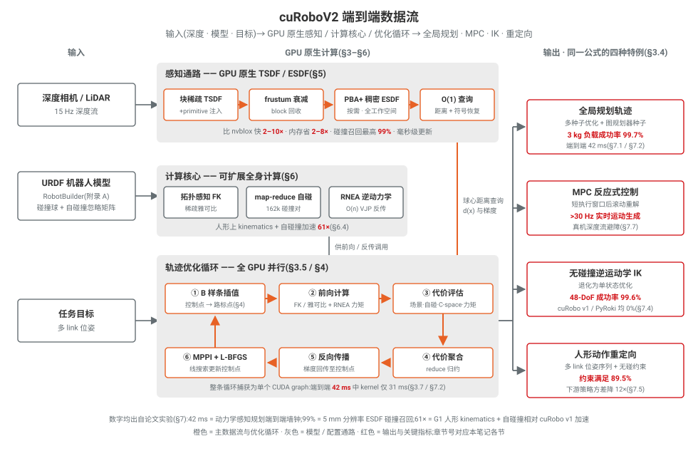

*图 0:cuRoboV2 端到端数据流。橙色为主数据流与优化循环,红色为输出与关键指标;整条循环可捕获为单个 CUDA graph,端到端 42 ms、>30 Hz 实时运动生成。*

**阅读路径指南**(按读者背景选择切入点,各条均可先读本节 TL;DR 表格建立坐标系):

| 你在做什么 | 推荐路径 | 建议先看的例子 / 图 |
| --- | --- | --- |
| 感知 / 建图(TSDF、ESDF、深度融合) | §5.0 → §5.1–5.4 → §5.x 小结,再看 §5.y 的障碍物注入 API 与 §7.6 毫米级分辨率实验 | 先看 §5.1 开头"稠密网格存不下"的 24 GB 显存算例,以及 `figures/projective_distance.svg`(投影距离与真实 SDF 的差别) |
| 规划 / 轨迹优化 | §3.1–3.5(统一优化公式与六步循环)→ §4(B-spline 空间,重点 §4.2 式 10–12 与 §4.4 梯度)→ §3.7/3.8(为什么 GPU 优化式比采样式快) | 先看 §3.5 的六步循环(对应上图中央的环),再看 §4.5 虚控制点满足边界条件的推导 |
| GPU / CUDA 性能优化 | §6.0–6.4(拓扑感知 FK、map-reduce 自碰撞、RNEA)→ §6.5 论文↔代码速查表,配合 §4.6 的 kernel 代码对照与 §3.7 的 CUDA graph 讨论 | 先看 §6.4"61× 加速从哪里来"的逐项分解,再看 §7.2 运行时间分解表(42 ms 里 kernel 只占 31 ms) |
| 人形 / 动作重定向 | §6(高 DoF 为什么难)→ §7.4 无碰 IK(48-DoF 99.6% vs 基线 0%)→ §7.5 重定向与下游 locomotion 消融 | 先看 §7.5 的约束满足率对比(89.5% vs PyRoki 61.2%)与跨种子方差降 12× 的结论 |
| LLM 辅助开发 / 代码库设计 | §8.1 可发现性重构 → §8.2–8.3 案例研究 → 附录 A 框架设计 + 附录 B Prompts | 先看 §8.3 的 RNEA kernel 案例(LLM 写出手工优化级 CUDA 代码),再看附录 A.1.2 的 RobotBuilder 四阶段流水线 |

> 笔记约定:公式编号沿用论文(式 1–18,Algorithm 1–5);代码引用格式为 `path:line`,均基于本仓库快照实际核读;与论文行文不一致的实现细节在各节以"备注/差异说明"标出。

---

## 1. Introduction

### 1.1 背景与问题定位

论文全名 **《cuRoboV2: Dynamics-Aware Motion Generation with Depth-Fused Distance Fields for High-DoF Robots》**。机器人自主运动生成的研究历史上分裂为两个子领域：

1. **全局运动规划（Global Motion Planning）**：从静态起始状态计算到达目标的全局路径；
2. **反应式运动生成（Reactive Motion Generation）**：对移动目标进行高频跟踪。

两者的底层需求其实相同——**满足硬件极限的同时避免碰撞**（与场景碰撞 + 机器人自碰撞）。但现有方法无法同时满足这些需求。作者归纳出阻碍统一、高性能自主运动生成的**三大根本性瓶颈**：

### 1.2 三大瓶颈

#### 1) 可行性鸿沟（The Feasibility Gap）

- 无碰撞运动规划可以做得很快，但速度往往以**忽略动力学**为代价，产生物理上不可执行的运动。
- 多数规划器输出**分段线性关节路径**，隐含假设"无限力矩"，忽略机器人的质量与动量。
- 结果是所谓"时间最优"的规划**经常违反力矩极限**（尤其在重载荷下），需要激进的后处理（post-processing），而后处理又会**破坏原规划的安全性保证**。
- 反过来，动力学轨迹优化方法虽然尊重这些极限，却**难以扩展到 mesh 或深度图碰撞避免带来的非凸约束**。

#### 2) 感知—反应性权衡（The Perception-Reactivity Trade-off）

- 现有反应式方法迫使用户在"安全性"与"高保真感知"之间二选一：
  - **解析式控制器**（如 RMPs、MPC）有安全保证，但处理原始深度数据太慢，只能退化为**简化几何基元**（primitives）；
  - **学习类方法**能快速处理视觉观测，但**无法提供部署所需的严格碰撞保证**，且泛化能力差，换环境需要大量重训练。

#### 3) 可扩展性之墙（The Scalability Wall）

- 在单臂平台上成功的方法，扩展到**高自由度系统（双臂、人形机器人）时失效**。
- 作者发现 SOTA 规划器（如 cuRobo [67]）在这些高维空间中**收敛缓慢甚至不收敛**，特别是**杂乱场景中的无碰撞逆运动学（collision-free IK）**——而这正是真实世界双臂操作与人形动作重定向（motion retargeting）的关键需求。

### 1.3 三大核心算法贡献

1. **B 样条优化公式（B-Spline Optimization Formulation）** → 解决**可行性鸿沟**：

   - 以 B 样条**控制点**为优化变量，平滑性被表示本身自动保证；
   - 使求解器能在全局规划中满足**力矩极限**，并支持**非静态边界条件**用于反应式控制；
   - 为运动生成提供**统一表示**（全局规划与反应式控制共用）。
2. **GPU 原生感知管线（GPU-native Perception Pipeline）** → 解决**感知—反应性权衡**：

   - 将多种输入（深度图、mesh、长方体）融合为**毫米级分辨率的块稀疏 TSDF**，采用**以体素为中心（voxel-centric）的投影策略**，消除原子操作竞争（atomic contention）；
   - 与 nvblox [51] 不同（nvblox 只在稀疏分配的 block 内计算距离，工作空间其余部分无距离信息），cuRoboV2 通过 **Parallel Banding Algorithm（PBA+）** 配合 **gather-based seeding** 按需生成覆盖**全工作空间的稠密 ESDF**，并支持**完整 CUDA graph capture**；
   - 提供工作空间内任意点 **O(1) 距离查询**。
   - **量化结果**：比 nvblox 快 **10×**、在操作（manipulation）尺度下内存少 **8×**，碰撞召回率高达 **99%**，支持**毫秒级更新**，满足反应式控制需求。
3. **可扩展的运动学、动力学与自碰撞（Scalable Kinematics, Dynamics & Self-Collision）** → 解决**可扩展性之墙**：

   - GPU 原生构建块：**拓扑感知运动学 + 稀疏雅可比计算**、**可微逆动力学**、**map-reduce 自碰撞检测**；
   - 可扩展到既有 GPU 实现失效的人形机器人规模，**最高 40× 加速**；
   - 高吞吐加速优化迭代，使求解器在高自由度双臂/人形机器人上**快速收敛并同时强制力矩极限**。

### 1.4 论文结构

Sec. 2 相关工作；Sec. 3 运动优化问题形式化；三大核心模块：Sec. 4 B 样条轨迹优化、Sec. 5 TSDF/ESDF 感知管线、Sec. 6 高自由度机器人的可扩展运动学/动力学/自碰撞；Sec. 7 基准测试与真机操作实验；Sec. 8 报告由代码库彻底重构（ground-up redesign）所支撑的 **LLM 辅助开发**；Sec. 9 结论。

---

## 2. Related Work

### 2.1 全局规划（Global Planning）

运动规划算法分三类：

| 类别                                                     | 特点                              | 局限                                                                          |
| -------------------------------------------------------- | --------------------------------- | ----------------------------------------------------------------------------- |
| **搜索式（search-based）** [21,40,43]              | 离散化状态空间                    | 高维空间中表现差                                                              |
| **采样式（sampling-based）** [19,33,39,45]         | 概率完备                          | 难以纳入 cost 项；需要后处理，可能违反动力学约束                              |
| **轨迹优化（trajectory optimization）** [32,61,66] | 联合优化平滑性、避碰与自定义 cost | 轨迹参数化为**关节位置路标点（waypoints）**，靠加速度正则化间接实现平滑 |

- **STOMP** [32] 是最早将**力矩约束**纳入轨迹优化的方法之一，但从未被移植到 ROS 1 之外，现代框架中缺席；且它本质是**局部优化器**而非全局规划器——在本文基准上即使不加动力学约束也只有 **60% 运动学成功率**。
- **B 样条**是另一条路线：曾用于轨迹平滑 [54]、移动机器人 [10] 与无人机 [37] 路径规划。但现有面向机械臂的 B 样条公式**仅限于凸约束**（如多面体障碍 [30,68]），不能处理深度图碰撞表示、三角 mesh 或力矩极限等**非凸约束**。
- **cuRoboV2 的差异**：提出面向高自由度机械臂的 B 样条轨迹优化公式，可容纳力矩极限等附加约束而**不牺牲收敛性**。

### 2.2 反应式运动生成（Reactive Motion Generation）

- **基于模型（model-based）**：势场法 [35]、黎曼运动策略 RMP [9,62]、geometric fabrics [73]、MPC [2,71]——有安全保证，但**易陷局部极小**且需要简化几何基元。
- **基于学习（learning-based）** [12,16,17,24,74]：将经典规划器蒸馏为神经策略或为优化器热启动 [6,27,29,76]；RL 也训练过多臂到达策略 [38]。缺点：**缺乏分布外（OOD）泛化能力、每个机器人本体（embodiment）需单独重训练、无法保证无碰撞执行**。
- cuRoboV2 走的是"GPU 加速优化 + 高保真感知"路线，兼得安全保证与原始深度输入的反应性。

### 2.3 硬件加速（Hardware Acceleration）

- FPGA/ASIC [45,47,70] 与 SIMD [69] 加速采样式规划；GPU 用于 MPC [2,26] 和优化 [28,67]。
- **cuRobo** [67]（本文前身）引入了 GPU 并行化轨迹优化和碰撞感知 IK；**PyRoki** [36] 提供跨平台运动学优化。
- **共同缺陷**：这些方法都面向**单臂**机器人；扩展到高自由度时**收敛性退化、计算时间增加**。
- **Table 1 特性对比**（MoveIt / cuRobo / mink / PyRoki / cuRoboV2）的关键差异点：
  - 优化空间：其余为 Position（waypoint）空间或无，**cuRoboV2 为 B-Spline**；
  - 只有 cuRoboV2 支持**力矩极限**约束（同时支持自定义 cost、运动学雅可比、质心 CoM）；
  - 数值求解器：cuRoboV2 支持 NLLS(LM)、拟牛顿（L-BFGS）、粒子式（MPPI）；
  - 规划/IK 模式：cuRoboV2 全部为 **Whole-Body**（轨迹优化、全局规划、MPC、Local/Global-IK 含避碰、人形重定向含避碰），其余框架多为 Single-Arm 或不支持（脚注指出 PyRoki 声称支持无碰撞规划但在 Global-IK 上不收敛且碰撞检测实现低效）；
  - 感知：cuRoboV2 有外参相机标定 + **ESDF** 积分器（MoveIt 只有 Voxel，cuRobo 无）；
  - 易用性：pip 安装、启动 <5s、机器人模型导入简单准确、支持批量场景接口。

### 2.4 视觉表示（Visual Representations）

- **几何式**：KinectFusion [48] 用 TSDF 表示场景，但**不提供规划所需的碰撞查询**；nvblox [51] 提供 GPU 加速 ESDF 支持梯度规划，但**只在已分配 block 内计算 ESDF**（非稠密场），且毫米分辨率下**内存开销高**；CPU 方法 [20,53] 无实时性。
- **神经式** [13,34,44]：碰撞检查快，但学习编码器 [12,16,17,24,59,74] 在**分布外场景经常失效**。
- **cuRoboV2 的差异**：GPU 原生感知管线，为操作任务提供**毫米级分辨率碰撞查询**。

### 2.5 人体→人形动作重定向（Human-to-Humanoid Motion Retargeting）

- 将人类动作迁移到人形机器人对 locomotion 策略训练至关重要。
- **端到端学习** [18,22,23,31]：直接用重定向数据训练 RL 策略，训练中过滤不可行动作，但依赖策略**隐式**处理自碰撞与关节极限。
- **优化式重定向框架**：GMR [1] 用 mink [77] 做逐帧局部 IK，**只有关节极限约束**；PyRoki [36] 支持全局无碰撞 IK 但在高自由度机器人上**不收敛**。
- 后果：重定向动作常含**自穿透与关节极限违反**，传播进策略训练，导致**训练不稳定与高跨种子方差（cross-seed variance）**。
- **cuRoboV2 的差异**：为高自由度机器人提供无碰撞、满足关节极限的 IK，产出可行参考动作，**无需修改学习管线**即可直接提升策略质量。

---

## 3. Problem Formulation

### 3.1 问题描述与符号定义

将运动生成形式化为**轨迹优化**问题：找到一个动作序列，把机器人从起始状态驱动到目标位姿（更准确地说，是一个或多个 link 的目标位姿）。轨迹应最小化目标函数（通常关于运动平滑性与能量），同时满足一组**硬约束**：避免自碰撞、避免与环境碰撞、遵守机器人的运动学与动力学极限。

**符号定义**：

| 符号                                                                      | 含义                                                                                                       |
| ------------------------------------------------------------------------- | ---------------------------------------------------------------------------------------------------------- |
| $\theta_t \in \mathbb{R}^d$                                             | 时刻$t$ 的关节角向量，$d$ 为关节数                                                                     |
| $\Theta_t = [\theta_t,\ \dot\theta_t,\ \ddot\theta_t,\ \dddot\theta_t]$ | 机器人状态：角度、速度、加速度、加加速度（jerk）                                                           |
| $\Theta_0$                                                              | 初始状态                                                                                                   |
| $X_g^m \in SE(3),\ m=1,\dots,M$                                         | 一个或多个 link 的目标位姿                                                                                 |
| $U$                                                                     | 待优化的轨迹（B 样条控制点，见 Sec. 4：$U \in \mathbb{R}^{d\times K}$，每个关节 $K$ 个控制点 $u_k$） |
| $T$                                                                     | 时间步总数（终端时刻）                                                                                     |
| $\tau_t \in \mathbb{R}^d$                                               | 时刻$t$ 的关节力矩                                                                                       |
| $\gamma_s, \gamma_\ell, \gamma_e$                                       | 平滑、长度、能量三项的权重                                                                                 |
| $\eta_m$                                                                | 第$m$ 个目标位姿的收敛阈值                                                                               |
| $\odot$                                                                 | Hadamard（逐元素）积                                                                                       |
| $\preceq$                                                               | 逐元素不等式                                                                                               |

### 3.2 优化问题（完整公式）

**目标函数（Eq. 1）**：

$$
\arg\min_{U}\ \sum_{t=0}^{T}\ \underbrace{\gamma_s\,\|\ddot\theta_t\|^2}_{\text{smooth}}\ +\ \underbrace{\gamma_\ell\,\|\dot\theta_t\|^2}_{\text{length}}\ +\ \underbrace{\gamma_e\,\|(\dot\theta_t \odot \tau_t)\,dt\|^2}_{\text{energy}} \tag{1}
$$

**约束（Eqs. 2–9）**：

$$
\text{s.t.}\quad \Theta_t = \mathrm{BsplineEval}(U,\ \Theta_0,\ t) \tag{2}
$$

$$
\Theta^{-} \preceq \Theta_t \preceq \Theta^{+} \tag{3}
$$

$$
\mathrm{C_{scene}}\big(\mathrm{FwdKin}(\theta_t)\big) \preceq 0 \tag{4}
$$

$$
\mathrm{C_{robot}}\big(\mathrm{FwdKin}(\theta_t)\big) \preceq 0 \tag{5}
$$

$$
\|X_g^m - \mathrm{FwdKin}(\theta_T)\| < \eta_m \tag{6}
$$

$$
\tau_t = \mathrm{InvDyn}(\Theta_t) \tag{7}
$$

$$
\tau^{-} \preceq \tau_t \preceq \tau^{+} \tag{8}
$$

$$
\dot\theta_T,\ \ddot\theta_T = 0 \tag{9}
$$

> 论文脚注：**绿色高亮标注了本文引入新公式化（new formulations）的部分**——包括 Eq. (1) 中的 energy 项，以及 Eqs. (2)、(4)、(5)、(6)、(7)、(8)（即 B 样条求值、场景/自碰撞约束的新实现、目标位姿约束以及逆动力学与力矩极限约束）。Eqs. (2)–(8) 对**所有时间步 $t$ 和所有 link $m$** 生效。

### 3.3 逐项物理含义解释

**目标函数 Eq. (1)** —— 鼓励平滑且高效（省能）的运动，由三项加权组成：

- **smooth 项** $\gamma_s\|\ddot\theta_t\|^2$：惩罚关节**加速度**的平方范数，抑制轨迹的剧烈变化，得到平滑运动（B 样条表示本身已保证 $C^2$ 连续，此项进一步在数值上压低加速度幅值）。

  > **什么是 $C^2$ 连续性?** 指轨迹 $\theta(t)$ 本身、一阶导数（速度）和二阶导数（加速度）都**处处连续**。逐级理解:
  >
  > | 级别    | 要求                      | 物理含义               | 违反时的表现                                                      |
  > | ------- | ------------------------- | ---------------------- | ----------------------------------------------------------------- |
  > | $C^0$ | $\theta(t)$ 连续        | 位置不跳变             | 关节瞬移(物理不可能)                                              |
  > | $C^1$ | $\dot\theta(t)$ 也连续  | 速度不跳变             | 速度突变 = 无穷大加速度,需要无穷大力矩                            |
  > | $C^2$ | $\ddot\theta(t)$ 也连续 | **加速度不跳变** | 加速度突变 = 无穷大 jerk,表现为撞击式力矩阶跃、机械振动、传动磨损 |
  >
  > 由动力学方程 $\tau = M(\theta)\ddot\theta + \dots$,加速度连续直接意味着**关节力矩连续**——电机指令不会瞬间阶跃,这是轨迹能在真机上平稳执行的前提。
  >
  > **为什么 B-spline "天然"保证 $C^2$**:$p$ 次 B-spline 在结点处有 $C^{p-1}$ 连续性(结点不重复时),三次($p=3$)因此自动 $C^2$。每段轨迹是三次多项式(内部无限光滑),而基函数的构造保证相邻段在拼接点的 0/1/2 阶导数值精确相等,只有三阶导(jerk)允许跳变——这就是 §4.2 中"jerk 在每段内是分段常值"的原因。对比 waypoint 参数化(cuRobo v1):优化变量是离散位置,导数靠有限差分近似,**没有任何结构保证连续性**,平滑只能靠正则项去"劝",容易出现论文 Fig. 12 那种锯齿状加速度/jerk 曲线。B-spline 把 $C^2$ 编码进表示本身:无论控制点被优化器挪到哪里,轨迹都自动光滑(§4.3 所说"平滑性是**结构性**保证")。因此本 smooth 项不再承担"制造连续性"的职责,只是进一步压低加速度幅值。
  >
- **length 项** $\gamma_\ell\|\dot\theta_t\|^2$：惩罚关节**速度**的平方范数。对固定时间离散化的轨迹，速度平方的时间积分近似度量了轨迹在关节空间中的"长度/动能"，避免绕远路。
- **energy 项** $\gamma_e\|(\dot\theta_t \odot \tau_t)\,dt\|^2$（**新引入**）：$\dot\theta_t \odot \tau_t$ 是各关节的**机械功率**（力矩 × 角速度，逐关节 Hadamard 积），乘以 $dt$ 即该时间步各关节做的**功（能量）**。惩罚其平方范数意味着显式最小化**能耗**——这是动力学感知（dynamics-aware）目标函数的核心体现，依赖 Eq. (7) 的逆动力学计算出 $\tau_t$。

**约束逐条解释**：

- **Eq. (2) B 样条求值（新）**：$\Theta_t = \mathrm{BsplineEval}(U, \Theta_0, t)$。轨迹状态不是自由变量，而是由控制点 $U$ 与初始状态 $\Theta_0$ 通过 B 样条基函数在时刻 $t$ 求值得到（位置、速度、加速度、jerk 由样条的解析导数直接给出）。这就是 Sec. 1 贡献 1 的"统一表示"：优化变量是控制点，平滑性由表示内生保证；$\Theta_0$ 作为边界条件可以是**非静态**的（支持反应式控制中"从运动中重规划"）。
- **Eq. (3) 状态极限**：$\Theta^{-} \preceq \Theta_t \preceq \Theta^{+}$，对状态的每个分量（关节角、速度、加速度、jerk）逐元素施加上下界，即**运动学极限**（joint limits / velocity limits / acceleration & jerk limits）。
- **Eq. (4) 场景避碰（新）**：$\mathrm{C_{scene}}(\mathrm{FwdKin}(\theta_t)) \preceq 0$。先经正运动学 $\mathrm{FwdKin}$ 得到各 link 位姿，再由场景碰撞函数（基于 Sec. 5 的 TSDF/ESDF 距离场，配合 swept-sphere 表示）评估与环境的穿透量；$\preceq 0$ 表示所有碰撞代价（穿透深度）非正，即**与环境无碰撞**。
- **Eq. (5) 自碰撞（新）**：$\mathrm{C_{robot}}(\mathrm{FwdKin}(\theta_t)) \preceq 0$。同理，约束机器人**自身 link 之间不发生碰撞**（Sec. 6 的 map-reduce 自碰撞核）。
- **Eq. (6) 终端目标位姿（新）**：$\|X_g^m - \mathrm{FwdKin}(\theta_T)\| < \eta_m$。终端时刻 $T$ 时，第 $m$ 个 link 的正运动学位姿必须与目标位姿 $X_g^m \in SE(3)$ 的距离小于阈值 $\eta_m$；支持**多个 link 同时给定目标**（$m=1,\dots,M$，如双臂各自的末端），这是 whole-body / 双臂 / 人形重定向的基础。
- **Eq. (7) 逆动力学（新）**：$\tau_t = \mathrm{InvDyn}(\Theta_t)$。由状态（含加速度）通过**逆动力学**（Sec. 6 中可微的 Recursive Newton-Euler Algorithm, RNEA）计算实现该运动所需的关节力矩 $\tau_t \in \mathbb{R}^d$。
- **Eq. (8) 力矩极限（新）**：$\tau^{-} \preceq \tau_t \preceq \tau^{+}$。要求全轨迹力矩逐元素处于执行器上下限之内——这是解决 Sec. 1 "可行性鸿沟"（重载下"时间最优"轨迹违反力矩极限）的直接手段。
- **Eq. (9) 终端静止**：$\dot\theta_T, \ddot\theta_T = 0$。终端速度与加速度为零，确保机器人**完全停止**（对全局规划的静态终点边界条件；反应式模式下边界条件可放宽为非静态）。

> **贯穿式数值例子：2-DoF 平面臂搬运 3 kg 负载,把式 (1)–(9) 每一项都算一遍**
>
> **场景设定**（竖直平面内的 2 关节臂,关节角从水平 $+x$ 轴逆时针度量）:
>
> | 参数 | 数值 |
> | ---- | ---- |
> | 杆长 | $\ell_1 = 0.4$ m,$\ell_2 = 0.3$ m(均匀杆,质量 4 kg / 2.5 kg) |
> | 末端负载 | $m_p = 3$ kg(点质量,固连在杆 2 末端) |
> | 起始位形 | $\theta_0 = (-90°,\ 0°)$,自然下垂,末端在 $(0,\ -0.7)$ m |
> | 目标位姿 $X_g$(单目标 $M=1$) | 末端到侧方 $(0.606,\ 0.282)$ m,姿态角 $45°$(对应 $\theta_T = (10°,\ 35°)$) |
> | 障碍物 | 圆盘,圆心 $(0.32,\ -0.25)$ m,半径 $R_{obs}=0.07$ m,恰好挡在"直线抄近路"上 |
> | 离散化 | $dt = 0.02$ s,$T = 100$ 步(轨迹总时长 2 s) |
>
> **取一个中间时刻 $t$ 的状态**(式 (2):它不是自由变量,而是 $\mathrm{BsplineEval}(U,\Theta_0,t)$ 在该时刻的求值结果——手臂已抬到接近水平,正绕过障碍物上方):
>
> $$
> \Theta_t:\quad \theta_t = (-15°,\ 40°),\quad \dot\theta_t = (1.2,\ -0.6)\ \mathrm{rad/s},\quad \ddot\theta_t = (0.8,\ -0.5)\ \mathrm{rad/s^2},\quad \dddot\theta_t = (15,\ -10)\ \mathrm{rad/s^3}
> $$
>
> 此时正运动学给出:肘部在 $(0.386,\ -0.104)$ m,末端在 $(0.658,\ 0.023)$ m——手臂近乎水平伸直,是**重力力矩最大**的姿态。
>
> **式 (7) 先行——逆动力学算出 $\tau_t$**(后面 energy 项要用)。对该状态跑一遍 2 连杆动力学 $\tau = M(\theta)\ddot\theta + C(\theta,\dot\theta)\dot\theta + G(\theta)$:
>
> $$
> \tau_t = (41.5,\ 12.2)\ \mathrm{N\cdot m},\quad \text{其中重力项就占}\ G(\theta_t) = (39.8,\ 11.3)\ \mathrm{N\cdot m}
> $$
>
> **式 (1) 目标函数三项**(取 $\gamma_s=\gamma_\ell=\gamma_e=1$ 便于对比量级):
>
> - **smooth**: $\|\ddot\theta_t\|^2 = 0.8^2 + 0.5^2 = 0.89$;
> - **length**: $\|\dot\theta_t\|^2 = 1.2^2 + 0.6^2 = 1.80$;
> - **energy**: 逐关节机械功率 $\dot\theta_t \odot \tau_t = (1.2\times 41.5,\ -0.6\times 12.2) = (49.8,\ -7.3)$ W(肘关节为负——它在做**负功**减速,重力在"帮忙"),乘 $dt=0.02$ 得该步各关节做功 $(0.997,\ -0.147)$ J,故 energy 项 $= 0.997^2 + 0.147^2 \approx 1.02$。
>
> 该时刻总代价 $\approx 0.89 + 1.80 + 1.02 = 3.70$,对 $t=0\dots T$ 求和即式 (1)。注意 energy 项数值与前两项同量级,是因为 $\tau$ 高达几十 N·m 被 $dt$ 压回来了——实际调参时 $\gamma_e$ 决定"省电"与"走得快"的折中。
>
> **式 (3) 状态极限**(逐元素检查,全部通过):
>
> | 分量 | 当前值 | 界 $[\Theta^-,\Theta^+]$ | 结论 |
> | ---- | ------ | ------------------------ | ---- |
> | $\dot\theta$ | $(1.2, -0.6)$ | $\pm 2.0$ rad/s | 肩关节用到 60% 速度余量 |
> | $\ddot\theta$ | $(0.8, -0.5)$ | $\pm 10$ rad/s² | 远未饱和 |
> | $\dddot\theta$ | $(15, -10)$ | $\pm 500$ rad/s³ | B 样条下 jerk 分段常值,轻松满足 |
>
> **式 (4) 场景避碰**:取包裹肘部的 swept sphere(半径 $r=0.05$ m),其球心到障碍圆心距离 $0.161$ m,故 ESDF 距离场值 $d = 0.161 - 0.07 = 0.091$ m。碰撞代价按 $C_{scene} = (r + \epsilon_{act}) - d$(activation 余量 $\epsilon_{act}=0.02$ m)计:$C_{scene} = 0.07 - 0.091 = -0.021 \le 0$,**满足但已激活梯度**——正是障碍物把轨迹"顶"成绕行弧线的时刻。反例:若走直线抄近路使 $d=0.04$,则 $C_{scene} = +0.03 > 0$,即穿透 3 cm,硬约束违反。
>
> **式 (5) 自碰撞**:上臂中点球与前臂中点球(各 $r=0.05$)间距 $0.329$ m,$C_{robot} = 0.05+0.05-0.329 = -0.229 \le 0$,余量很大(2-DoF 平面臂只有肘部反折才可能自碰)。
>
> **式 (6) 终端目标位姿**:终端时刻 $\mathrm{FwdKin}(\theta_T)$ 给出末端 $(0.603,\ 0.281)$ m,与 $X_g=(0.606,\ 0.282)$ m 的位置误差约 $3$ mm $< \eta_m = 5$ mm,约束满足(姿态部分同理用加权四元数距离并入范数)。$\eta_m$ 就是"多准算到"的工程旋钮:抓取取 1–5 mm,粗放置可放到 1 cm。
>
> **式 (8) 力矩极限——3 kg 负载为什么让肩关节逼近饱和**。设执行器上限 $\tau^+ = (44,\ 13)$ N·m:
>
> | 关节 | 无负载 $\tau$ | 带 3 kg 负载 $\tau_t$ | 上限 $\tau^+$ | 饱和率 |
> | ---- | ---- | ---- | ---- | ---- |
> | 肩 | $21.1$ N·m(48%) | $41.5$ N·m | $44$ N·m | **94%** |
> | 肘 | $3.6$ N·m(28%) | $12.2$ N·m | $13$ N·m | **94%** |
>
> 粗算即可看穿:负载对肩关节的重力力矩 $\tau_g \approx m_p\, g\, x_{ee} = 3 \times 9.81 \times 0.658 \approx 19.4$ N·m(力臂 = 末端的水平坐标),恰好等于两行之差 $41.5-21.1 \approx 20.4$ N·m 的主体(其余来自负载的惯性/科氏项)。也就是说手臂一伸平,**光扛住负载就吃掉近一半肩关节力矩预算**。此时若像"时间最优"方法那样把 $\ddot\theta$ 推到运动学上限 10 rad/s²,惯性力矩 $M_{11}\ddot\theta_1$ 将再添约 20 N·m,直接冲破 $\tau^+$——这就是 Sec. 1 所说的"可行性鸿沟":只看式 (3) 的运动学极限会规划出真机执行不了的轨迹,必须由式 (7)+(8) 在优化内闭环把守。
>
> **式 (9) 终端静止**:$\dot\theta_T = (0,0)$,$\ddot\theta_T = (0,0)$——B 样条通过末端重复结点/控制点结构把这一边界条件直接编码进表示,末端稳稳停在目标球内,而不是"擦着目标飞过去"。
>
> 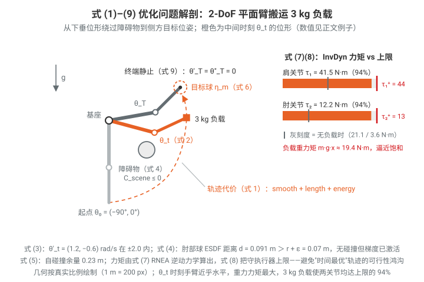

### 3.4 该公式的统一性：一个公式覆盖多个核心问题

论文指出该公式与先前轨迹优化方法 [61, 67] 一脉相承，并**包纳（subsume）多个核心机器人问题**：

- **局部轨迹优化** [61,65]：以粗糙初始轨迹为种子，局部收敛到无碰撞轨迹；
- **全局无碰撞运动规划**（Sundaralingam et al. [67]，即 cuRobo v1 的做法）：**并行运行多个种子**的轨迹优化，并利用无碰撞的**图规划器（graph-based planner）结果作为种子**；

> **代码考察:graph planner 种子从哪来(`curobo/_src/graph_planner/`)**。是一个**惰性增长、跨查询复用的 PRM**(`PRMGraphPlanner`,`graph_planner_prm.py:39`),GPU/CPU 分工明确:
>
> - **建图(GPU 批量)**:节点可行性用批量 rollout 一次算完——采样出的配置整批过碰撞+限位检查(`check_samples_feasibility`,`graph_planner_prm.py:149-187`);边由 `LinearConnector` 在 c-space 直线上按 `cspace_similarity_threshold` 分辨率整批采点检查(`connector_linear.py:75-153`)。采样不是全空间均匀撒点,而是 **informed**:在以 start–goal 为焦点、半径 = 加权 c-space 距离 × `exploration_radius` 的椭球内采(`graph_planner_prm.py:400-425`);找不到路则半径、每轮新节点数、k-NN 邻居数按增长因子逐轮放大(`:446-455`)。
> - **查询(CPU)**:roadmap 存成 NetworkX 图,双向 Dijkstra 找最短路(`path_finder_networkx.py:81-88`),再 `PathPruner` 做 shortcut 剪枝直到路径只剩 ≤2–3 个 waypoint(`graph_planner_prm.py:379-384`);节点数超过 `max_nodes` 的 75% 才重置 roadmap(`:330-331`),同场景多次查询摊销建图成本。
> - **变成 trajopt 种子**:剪枝后的 waypoints 逐关节插值到 trajopt 的 `action_horizon` 个点(`get_interpolated_trajectory`,`graph_planner_prm.py:516-562`),调用处用 LINEAR 插值、且跳过再验证(`motion_planner.py:407-413`),得到 `(1, n_{成功}, horizon, dof)` 的纯位置种子直接喂给 `solve_pose`/`solve_cspace` 的 `seed_traj`(`motion_planner.py:281-288`)。
> - **何时启用**:不是与优化并行,而是**串行 fallback**——重试循环里 `current_attempt >= enable_graph_attempt`(默认 1)才调用(`motion_planner.py:270-279`):第 0 次尝试用普通种子(IK 解直连),trajopt 失败后的重试才换图规划种子;每个 IK seed 配一个 start–goal 对批量查询(`motion_planner.py:404-413`)。换种子的同时把 `finetune_attempts` 1→3、`finetune_dt_scale` 0.55→0.75——绕障路径更长,时间预算也相应放宽。
- **逆运动学（IK）**：退化为优化**单个状态**、去掉时间维约束的特例；
- **模型预测控制（MPC）**：在短执行窗口后**重新求解**该优化问题，即得反应式控制策略。

### 3.5 求解流程（Figure 1：轨迹优化循环）

每次迭代六步，全部 GPU 并行：

1. **B 样条插值**：由控制点生成轨迹路标点（waypoints）；
2. **前向计算**：(2a) 正运动学计算 link 位姿与雅可比；(2b) **RNEA 前向**额外计算关节力矩；
3. **代价评估**（不同 CUDA stream 上并行）：(3a) 场景碰撞（swept sphere）、(3b) 自碰撞、(3c) C-space（边界 + 正则化）；
4. **代价聚合**：reduce kernel 归约出每条轨迹的总代价；
5. **反向传播**：(5a) 运动学梯度、(5b) RNEA 反向、(5c) B 样条梯度（梯度穿过全部前向运算回传到控制点）；
6. **L-BFGS 步 + 线搜索**：更新 B 样条控制点，回到第 1 步。

### 3.6 与仓库代码的对应（简要）

本仓库（cuRoboV2 官方代码，包根为 `curobo/_src/`）中与该优化问题直接对应的模块：

- **Eq. (2) B 样条状态转移**：`/home/mujin/MotionPlanning/curobo/curobo/_src/transition/robot_state_transition.py`（CUDA 端在 `/home/mujin/MotionPlanning/curobo/curobo/_src/curobolib/cuda_ops/trajectory.py`）；
- **Eq. (3) / Eq. (1) 平滑与长度项（C-space 代价）**：`/home/mujin/MotionPlanning/curobo/curobo/_src/cost/cost_cspace_base.py` 及 `cost_cspace_*.py` 系列；
- **Eq. (4) 场景碰撞**：`/home/mujin/MotionPlanning/curobo/curobo/_src/cost/cost_scene_collision.py`（碰撞后端在 `curobo/_src/collision/`，感知管线在 `curobo/_src/perception/`）；
- **Eq. (5) 自碰撞**：`/home/mujin/MotionPlanning/curobo/curobo/_src/cost/cost_self_collision.py`；
- **Eq. (6) 目标位姿**：`/home/mujin/MotionPlanning/curobo/curobo/_src/cost/cost_tool_pose.py`；
- **Eq. (7)–(8) 逆动力学与力矩**：`/home/mujin/MotionPlanning/curobo/curobo/_src/robot/dynamics/dynamics.py`；
- **步骤 6 的 L-BFGS + 线搜索**：`/home/mujin/MotionPlanning/curobo/curobo/_src/optim/gradient/lbfgs.py`、`line_search_strategy.py`（粒子式 MPPI 在 `curobo/_src/optim/particle/`）；
- **求解器封装（轨迹优化 / IK / MPC 三种"特例"）**：`/home/mujin/MotionPlanning/curobo/curobo/_src/solver/solver_trajopt.py`、`solver_ik.py`、`solver_mpc.py`，上层规划接口在 `curobo/_src/motion/motion_planner.py` 与 `motion_retargeter.py`（人形重定向）。

### 3.7 补充:为什么能用 GPU 加速?为什么比 RRT 等采样式算法"快"?(概念考察)

> 本小节回答两个贯穿全文的概念问题:**为什么这类计算适合 GPU**,以及**为什么"优化"这条路在 GPU 上能与采样式算法竞争甚至胜出**。先说结论:GPU 快不是魔法,而是 cuRoboV2 把运动生成改写成了 GPU 擅长的计算形态;而对 RRT,诚实的答案是"单次规划的墙钟时间 RRT 其实更快,但它输出的轨迹不可执行——补上可执行性之后就输了"。

#### 为什么这类计算能被 GPU 加速

GPU 的本质是"上万条并行车道,但每条车道很笨":同一条指令同时作用于大量数据(SIMT)。一个算法能否被 GPU 加速,取决于三个结构性条件,cuRoboV2 的轨迹优化全部满足:

**1. 海量数据并行。** 轨迹优化的每次迭代是"对一大批同构数据做同样的数学运算",并行维度可以相乘:

$$
\underbrace{\text{几百个种子}}_{\text{并行优化多条初始轨迹}} \times \underbrace{\text{几十个时间步}}_{\text{horizon}} \times \underbrace{\text{几十个关节/几百个碰撞球}}_{\text{机器人}} \times \underbrace{\text{几十万碰撞对/体素}}_{\text{代价评估}}
$$

一次迭代就有百万级的独立算术单元可以同时铺开——正好喂饱 GPU。cuRobo 系的核心思想:**全局规划 = 几百个种子的轨迹优化并行跑,总有一批收敛到好解**,用并行度替代全局搜索(§3.4)。

**2. 计算图结构固定。** 每次迭代都是同一串 kernel(§3.5 Figure 1 的六步),没有数据依赖的分支、没有动态增长的数据结构。两个 GPU 专属红利:整条流水线可被 **CUDA graph** 一次捕获、之后零启动开销重放(§7.2:端到端 42 ms 里 kernel 只占 31 ms,其余固定开销被 graph 摊掉);访存可以做到合并(coalesced)——相邻线程读相邻内存。

**3. 每个环节都被重写成了 GPU 原生形态**(论文三大贡献的工程本质):

| 环节 | 传统形态(GPU 不友好) | cuRoboV2 形态 |
|---|---|---|
| 碰撞查询 | 对 mesh 做几何求交/最近点(分支多、指针跳转) | **ESDF 查表**:O(1) 三线性插值,纯内存读 + 少量乘加(§5) |
| TSDF 积分 | 逐像素 raycast,原子写冲突 | 体素为中心,每体素一线程零原子(§5.2) |
| FK/反传 | 沿运动学树串行递推 | 拓扑分层并行 + CSR 祖先链 + warp 归约(§6.1) |
| 自碰撞 | 162k 对塞单 block 串行循环 | map-reduce 摊到多 SM,变 compute-bound(§6.2) |
| 逆动力学 | 6×6 矩阵、O(n²) 反传 | 12-float 紧凑表示、层并行、O(n) VJP(§6.3) |

#### 为什么比 RRT 采样式算法"快"——需要拆开说

§7.1 的诚实数字(Franka,2600 个杂乱场景问题):

| | VAMP-RRTC(采样) | cuRoboV2(优化) |
|---|---|---|
| **规划时间** | **0.004 s** ← 采样更快! | 0.048 s |
| 运动时间 | 5.79 s | **1.55 s** |
| 能耗 | 160 J | **106 J** |
| 3 kg 负载下成功率 | 71.5% | **99.7%** |

**单次出一条运动学路径,RRT 就是快**——VAMP 用 SIMD 把碰撞检查压到极致,4 ms 出解。cuRoboV2 的"更快/更好"体现在三个别的维度:

**1. 算法范式:梯度 vs 盲搜。** RRT 对空间没有方向感,只能靠随机采样"撞"出通路;轨迹优化每次迭代都从 ESDF 拿到解析梯度——"障碍物在哪个方向、离多远、往哪边推"——一步把整条轨迹(所有时间步同时)朝好的方向挪。在"大部分空间可行、梯度信息丰富"的操作场景里,一两百次迭代收敛;非凸性由几百个并行种子兜底。(公平地说:极窄通道、迷宫式环境仍是采样式的主场,梯度会被局部极小卡住——所以 cuRobo 还留了 graph planner 生成种子的后手,§3.4。)

**2. 计算形态:RRT 天生难上 GPU。** 这是问题的核心对偶:RRT 把上面三个 GPU 友好条件**全部违反**——树的每次扩展依赖当前树的状态(**串行依赖链**),树是动态增长的指针结构(**访存不规则**),最近邻查询/碰撞判定充满分支(**warp 发散**)。所以 RRT 的加速上限在 CPU SIMD(VAMP 即这条路的极致),而优化式方法的加速上限在整块 GPU 的上万个核——两者的"可并行天花板"差两个数量级。批量场景下更明显:GPU 上 100 个规划问题几乎"免费"并行(batch 维度),RRT 要跑 100 遍。

**3. 可执行性:RRT 的 4 ms 不是全部成本。** RRT 输出分段线性路径——速度不连续、假设无限力矩,必须再做平滑 + 时间参数化后处理;而后处理不知道碰撞约束,拉时间又可能违反力矩。3 kg 负载下这条链路的真实成功率只有 71.5%,失败就要重规划、重执行。cuRoboV2 把动力学约束(RNEA 力矩)直接放进优化(多花 7 ms,§7.2),换来 99.7% 一次可执行,且运动时间短 3.7 倍——**把"规划 4 ms + 执行 5.79 s + 27% 概率返工"和"规划 48 ms + 执行 1.55 s + 0.3% 返工"放在一起比,快的是谁就很清楚了**。

**一句话总结**:GPU 加速的前提是把问题改写成"固定结构的、海量同构的、有梯度的数值计算"——cuRoboV2 的 B-spline/ESDF/层并行运动学都是为此服务的表示选择;RRT 输在它的计算形态(串行、动态、分支)吃不到并行红利,更输在它的输出还欠一笔"变成可执行轨迹"的债,而这笔债在负载下经常还不上。

### 3.8 求解器栈:MPPI 粒子 + L-BFGS 梯度 + 并行种子(代码考察)

> §3.5 的六步循环把第 6 步写成"L-BFGS 步 + 线搜索",§3.6 只给了文件名。本节把这个黑盒拆开:**种子从哪来、MPPI 与 L-BFGS 怎么串接、每个种子如何独立优化、最后怎么选优**,全部以仓库代码实读为准。这也正对应论文 Table 1 的"数值求解器"一行——cuRoboV2 同时支持 **NLLS(LM)、拟牛顿(L-BFGS)、粒子式(MPPI)** 三族求解器(§1 Table 1 对比项),三者在代码里不是三个孤立选项,而是一条**接力管线**:LM 出种子 → MPPI 全局探索 → L-BFGS 局部精修。求解器注册表在 `/home/mujin/MotionPlanning/curobo/curobo/_src/optim/optim_factory.py:50-60`(`_SOLVER_MAP`:lbfgs / lsr1 / conjugate_gradient / mppi / es 等)。
>
> 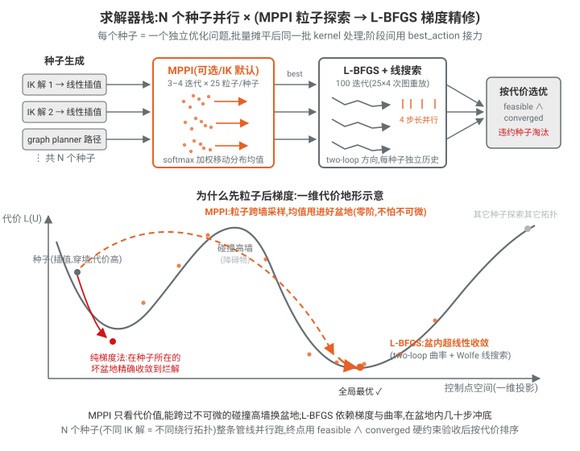

#### 3.8.1 组织方式:种子 = 并行问题,阶段 = 顺序接力

**并行的实现只有一行 reshape**。TrajOpt 求解时把 `batch_size × num_seeds` 摊平成优化器的 `num_problems`(`/home/mujin/MotionPlanning/curobo/curobo/_src/solver/solver_core.py:322-331`,`_get_problem_batch_size` 返回 `batch * num_trajopt_seeds`),从此**每个种子就是一个独立的优化问题**:它有自己的控制点张量、自己的梯度、自己的 L-BFGS 历史、自己的"历史最优解"。所有优化器内部张量都带 `num_problems` 前导维,几百个种子的迭代在 GPU 上是同一批 kernel——这就是 §3.7 "并行度替代全局搜索"的落地。

**种子从哪来**(`/home/mujin/MotionPlanning/curobo/curobo/_src/solver/manager_seed.py:136-213`,`prepare_trajectory_seeds` 按优先级三选):

1. **外部整条轨迹种子** `seed_traj`——上层 `MotionPlanner` 在重试若干次失败后调 **graph planner(PRM)** 生成无碰路径喂进来(`/home/mujin/MotionPlanning/curobo/curobo/_src/motion/motion_planner.py:270-276`),即 §3.4 说的"图规划器结果作为种子"的后手;
2. **线性插值种子**:`current_state → seed_config` 逐时间步 `linspace` 插值(`/home/mujin/MotionPlanning/curobo/curobo/_src/util/trajectory_seed_generator.py:23,62`)。`seed_config` 通常是 **IK 求解器返回的 top-k 个目标构型**——`motion_planner.py:250-262`:先 `ik_solver.solve_pose(return_seeds=num_seeds)` 拿 4 个不同的 IK 解,每个解插值成一条直线轨迹,4 条轨迹各自往下优化;
3. **常值种子**:原地不动的轨迹(`generate_constant_seeds`),兜底。

**阶段串接**由 `MultiStageOptimizer` 完成(`/home/mujin/MotionPlanning/curobo/curobo/_src/optim/multi_stage_optimizer.py:127-186`):按列表顺序跑每个优化器,**上一阶段的 `best_action` 直接作为下一阶段的种子**。各任务的默认栈(YAML 在 `curobo/content/configs/task/`):

| 任务 | 阶段栈(顺序执行) | 出处 |
|---|---|---|
| **IK** | LM 种子求解器 → **MPPI**(4 迭代×25 粒子)→ **L-BFGS**(100 迭代) | `solver_ik_cfg.py:133-136` 默认 `["ik/particle_ik.yml", "ik/lbfgs_ik.yml"]`;LM 在栈外前置(见 3.8.6) |
| **TrajOpt** | (可选 **MPPI**,`particle_trajopt.yml`:3 迭代×25 粒子)→ **L-BFGS**(100 迭代,B-spline 控制点) | `solver_trajopt_cfg.py:118-120` 默认仅 `lbfgs_bspline_trajopt.yml`;论文计时表按 "TrajOpt (MPPI+L-BFGS)" 报告(§7.2) |

TrajOpt 还有一层 **dt 微调外循环**(`/home/mujin/MotionPlanning/curobo/curobo/_src/solver/solver_trajopt.py:337-459`):第一轮解完后把轨迹时间步 `dt × 0.55` 压紧再解一轮(时间最优化),warm start 复用上一轮的解与 L-BFGS 历史(`solver_trajopt.py:399`,`reinitialize(..., clear_optimizer_state=False)`);且从第二轮起**关掉 MPPI 阶段**(`solver_trajopt.py:383-385`,`optimizers[0].disable()`)——探索只需要一次,精修不需要再撒粒子。

**最终选优**:所有种子解完后,`process_metrics_and_rank_seeds`(`/home/mujin/MotionPlanning/curobo/curobo/_src/solver/solver_trajopt_result.py:143-199`)先算两个布尔量——**feasible**(全 horizon 所有硬约束满足,式 3–5/8)与 **converged**(终端位置/姿态误差小于 `position_tolerance`/`orientation_tolerance`,式 6),`success = feasible ∧ converged`;再在 success 的种子里按代价排序,`get_topk_seeds` 取前 k 条返回。**代价最低但不可行的种子会被直接淘汰**(见 3.8.5 的例子)。

#### 3.8.2 MPPI:采样—加权—移动分布

MPPI 不用梯度,它维护一个动作序列上的高斯分布 $\mathcal{N}(\mu, \Sigma)$(每个种子/问题各一个),每次迭代三步(`/home/mujin/MotionPlanning/curobo/curobo/_src/optim/components/particle_opt_core.py:345-349`:sample → rollout 评代价 → 更新分布):

**(1) 采样 25 个粒子**(`particle_opt_core.py:392-442`,`sample_actions`):

$$
a^{(k)} = \mu + L\,\epsilon^{(k)},\qquad k = 1,\dots,P,\quad L = \sqrt{\Sigma}\ (\text{对角})
$$

噪声 $\epsilon$ 不是白噪声:TrajOpt 用 **STOMP 相关噪声**(`particle_trajopt.yml` 的 `sample_ratio: {stomp: 1.0}`;STOMP 协方差 = 有限差分加速度矩阵的逆,见 `sample_strategies/stomp_covariance.py:17`)——采出来的扰动在时间上平滑,不会给轨迹注入锯齿;IK 是单点问题,用 Halton 低差异序列(`particle_ik.yml`)。采样后 clamp 回关节界。

**(2) softmax 加权**(`/home/mujin/MotionPlanning/curobo/curobo/_src/optim/particle/mppi.py:631-648`,`jit_calculate_exp_util_from_costs`):

$$
c^{(k)} = \sum_{t} \gamma^{t} c_t\big(a^{(k)}\big),\qquad
w^{(k)} = \frac{\exp\!\big(-c^{(k)}/\beta\big)}{\sum_{j=1}^{P} \exp\!\big(-c^{(j)}/\beta\big)}
$$

- $\gamma$:时间折扣(两个 YAML 均取 1.0,即普通求和);
- $\beta$:**温度,MPPI 最重要的旋钮**(`mppi.py:118` 注释原话)。$\beta$ 小 → 权重几乎全押在最低代价粒子上(贪婪);$\beta$ 大 → 权重摊平(探索)。TrajOpt 取 $\beta=0.01$(很贪),IK 取 $\beta=1.0$。

**(3) 指数滑动平均更新分布**(`mppi.py:703-757`,`jit_blend_mean` / `jit_blend_cov` / `jit_mean_cov_diag_a`):

$$
\mu \leftarrow (1-\alpha_\mu)\,\mu + \alpha_\mu \sum_{k} w^{(k)} a^{(k)},\qquad
\Sigma \leftarrow (1-\alpha_\Sigma)\,\Sigma + \alpha_\Sigma \underbrace{\overline{\sum_k w^{(k)}\big(a^{(k)}-\mu\big)^2}}_{\text{加权方差(对角,按 horizon 平均)}} + \;\kappa
$$

- $\alpha_\mu$(`step_size_mean`,TrajOpt 0.98):均值几乎完全跳到加权平均处;
- $\alpha_\Sigma$(`step_size_cov`,0.1):协方差慢更新——好粒子聚在一起时分布自动收窄,起到"自适应步长"的作用;
- $\kappa$(0.001):**协方差下限**,防止分布塌缩成一个点、探索死掉(`mppi.py:126`);
- 输出用 `sample_mode: BEST`:不返回均值,而是返回**采样史上代价最低的那条粒子轨迹**(`mppi.py:214-218`),保证输出不比任何见过的样本差。

每次迭代的代价评估就是 §3.5 六步循环的前 4 步(rollout,不做反传),25 粒子 × 4 种子 = 100 条轨迹一批算完。

#### 3.8.3 L-BFGS:批量 two-loop recursion

L-BFGS 用最近 $m$ 步的位移/梯度差对来隐式近似逆 Hessian。每步先由线搜索(3.8.4)得到新点 $x_k$ 与梯度 $g_k$(梯度来自 §3.5 第 5 步的整链反传,`gradient_opt_core.py:445-480`:rollout 求和代价后 `cost.backward()` 直接回传到控制点),然后更新历史环形缓冲(`/home/mujin/MotionPlanning/curobo/curobo/_src/optim/gradient/lbfgs_jit_helpers.py:49-78`):

$$
s_k = x_k - x_{k-1},\qquad y_k = g_k - g_{k-1},\qquad \rho_k = \frac{1}{y_k^\top s_k}
$$

再跑 **two-loop recursion** 求步方向 $d_k \approx -H_k^{-1} g_k$(`lbfgs_jit_helpers.py:11-44`,`jit_lbfgs_compute_step_direction`;CUDA 融合 kernel 版 `LBFGScu` 在 `lbfgs.py:215-229`):

$$
\begin{aligned}
&\textbf{第一循环(从新到旧)}: && \alpha_i = \rho_i\, s_i^\top q,\qquad q \leftarrow q - \alpha_i\, y_i \qquad (q \text{ 初始为 } g_k)\\[2pt]
&\textbf{初始 Hessian 缩放}: && \gamma_k = \frac{s_{k-1}^\top y_{k-1}}{y_{k-1}^\top y_{k-1}},\qquad r = \gamma_k\, q\\[2pt]
&\textbf{第二循环(从旧到新)}: && r \leftarrow r + \big(\alpha_i - \rho_i\, y_i^\top r\big)\, s_i\\[2pt]
&\textbf{步方向}: && d_k = -\,r
\end{aligned}
$$

逐项直觉:第一循环把梯度中"历史曲率方向已解释掉的分量"逐个剥离;$\gamma_k$ 是最近一步的曲率估计(相当于 $H_0 = \gamma_k I$),决定天然步长量级;第二循环把剥掉的分量按曲率修正后加回去。总开销 $O(md)$,不存 $d\times d$ 矩阵。

**cuRobo 的三处工程化改造**(相对教科书版):

1. **数值护栏**(`stable_mode`,强制开启,`lbfgs.py:110-111`):$\rho_k$ 与 $\gamma_k$ 分别做 `nan_to_num` 与 `ReLU`(`lbfgs_jit_helpers.py:36-38,65-66`)——非凸碰撞代价下 $y^\top s \le 0$(曲率条件破产)时,坏历史对被静默置零而不是让整个批崩掉;另有阻尼 $\epsilon = 0.01$ 兜底,把步方向往最速下降偏。
2. **批量独立历史**:缓冲区形状为 $(m,\ B,\ \text{opt\_dim},\ 1)$(`/home/mujin/MotionPlanning/curobo/curobo/_src/optim/components/quasi_newton_buffers.py:43-51`)——$B$ = 种子数×batch,**每个种子有自己独立的 $(s, y, \rho)$ 历史**,two-loop 里的所有点积都是 batched matmul,几百个种子的拟牛顿迭代一次算完。历史长度 $m$:TrajOpt 27(`lbfgs_bspline_trajopt.yml`)、IK 7(`lbfgs_ik.yml`)。
3. **单 kernel 融合 two-loop**:整个双循环(含缓冲更新)塞进一个 CUDA kernel,中间量放 shared memory,需求 $\big((2\,\text{opt\_dim}+2)\,m + 33\big)\times 4$ 字节,超过 64 KB 或 `opt_dim`≥1024 时自动回落到 PyTorch JIT 路径(`lbfgs.py:174-187`)。论文 §7.2 计时表里 "L-BFGS + line search" 单次迭代 15.2 µs 就是这个 kernel。

#### 3.8.4 线搜索:4 个候选步长并行试

串行 CPU 优化器的线搜索是"试一个步长 → 不满足条件 → 缩小再试"的循环;GPU 上分支循环是毒药,cuRobo 改成**一次并行评估固定的一组步长**(`/home/mujin/MotionPlanning/curobo/curobo/_src/optim/gradient/line_search_strategy.py:281-298`,`jit_get_x_set`):

$$
x_{set} = \{\, x + l\, d \mid l \in [\,0,\ 0.1,\ 0.5,\ 1.0\,]\,\}
$$

4 个候选点作为"粒子维"一批 rollout(所以 L-BFGS 的 `num_particles` = 步长数,`lbfgs.py:101-103`),拿到各自的代价与梯度后**逐问题**挑最大的可接受步长。$l=0$ 那个点就是当前点,免费提供条件判断所需的 $c(x), g(x)$。判据(`line_search_strategy.py:28-38` 文档):

- **Armijo(充分下降)**:$c(x+l d) \le c(x) + c_1\, l\, g^\top d$,$c_1 = 10^{-5}$;
- **弱 Wolfe(曲率)**:$g(x+ld)^\top d \ge c_2\, g^\top d$,$c_2 = 0.9$;
- **强 Wolfe**:$|g(x+ld)^\top d| \le c_2\, |g^\top d|$。

五种策略(`line_search_strategy.py:102-108` + 各子类):Greedy(直接取代价最小点)、Armijo、Wolfe、Strong Wolfe、**Approx Wolfe(默认)**。Approx Wolfe 的降级链(`line_search_strategy.py:864-876`):Wolfe 两条件都满足 → 取之;不满足 → 只用 Armijo;还不满足 → 硬取 $l = 0.1$(索引 1)前进——**永不返回零步长**,保证 CUDA graph 里没有"卡住重试"的分支。文档建议(`line_search_strategy.py:22-26`):TrajOpt/IK 用 Approx Wolfe,MPC 这类"中间解也要可行"的场景用 Strong Wolfe。步方向还会按关节步长上限整体缩放(`scale_action`,`line_search_strategy.py:300-328`,`step_scale=0.98`)。整个选择同样有 CUDA kernel 路径(`wolfe_line_search`,`line_search_strategy.py:673-704`)。

每步结束后 `update_best_solution` 逐问题记录历史最优 $(x^\star, c^\star)$,`optimize()` 最终返回的是 **best_action 而非最后一步**(`/home/mujin/MotionPlanning/curobo/curobo/_src/optim/components/gradient_opt_core.py:316-332`)——非凸问题上迭代后期可能变差,这是免费的单调性保险。

#### 3.8.5 数值直觉:3 个种子/粒子怎么选

> **MPPI 一次加权更新**(3 个粒子,好懂起见):粒子代价 $c = (10,\ 12,\ 30)$。
>
> - $\beta = 1$(贪):$w \propto e^{0}, e^{-2}, e^{-20} \Rightarrow w \approx (0.881,\ 0.119,\ 0.000)$——均值几乎跳到最好粒子上,第三个粒子等于不存在;
> - $\beta = 10$(探索):$w \propto e^{0}, e^{-0.2}, e^{-2} \Rightarrow w \approx (0.512,\ 0.419,\ 0.069)$——均值移到前两个粒子之间,坏粒子也保留一点话语权。
>
> 同样三个数,温度决定了"移动分布"是贪婪下山还是稳健探索。TrajOpt 取 $\beta=0.01$、迭代仅 3 次:MPPI 在这里的角色不是收敛,而是**快速把均值甩进最有希望的盆地**。
>
> **终选 3 个种子**(L-BFGS 收敛后):
>
> | 种子 | 最终代价 | feasible(式 3–5/8) | converged(式 6) | success | 结果 |
> |---|---|---|---|---|---|
> | A(IK 解 1 插值) | 4.2 | ✓ | ✓ | ✓ | **胜出** |
> | B(IK 解 2 插值) | **3.1** | ✗(肘部擦碰 2 mm) | ✓ | ✗ | 淘汰 |
> | C(graph 种子) | 5.0 | ✓ | ✓ | ✓ | 备选(top-2) |
>
> B 代价最低却出局:排序只在 $success=\text{feasible}\wedge\text{converged}$ 的种子中进行(`solver_trajopt_result.py:197-199`)。这就是"几百个种子兜底非凸性"的另一半——**不但要有种子掉进好盆地,还要在终点用硬约束验收**。TrajOpt 的 dt 微调轮次里还会再比一层:只有"success 且轨迹总时间更短"的新解才覆盖旧解(`solver_trajopt.py:449-456`)。

#### 3.8.6 为什么"先粒子后梯度":代价地形视角

式 (1)–(9) 惩罚化后的总代价 $\mathcal{L}(U)$ 是**强非凸**的:每个障碍物在控制点空间里凿出一道高墙,墙间是一个个盆地,不同盆地对应"从障碍物哪边绕"的不同拓扑。两族求解器在这张地形上的能力恰好互补:

| | MPPI(粒子) | L-BFGS(梯度) |
|---|---|---|
| 信息来源 | 只要代价值(零阶) | 需要梯度(一阶)+ 历史曲率(拟二阶) |
| 视野 | 采样半径内的**全局**(能跨墙看) | 当前盆地内的**局部** |
| 收敛速度 | 慢($1/\sqrt{P}$ 级噪声) | 快(超线性,盆地内几十步到底) |
| 被卡住的方式 | 温度过低提前塌缩 | 初始点在坏盆地 → 出不来 |
| 对代价的要求 | 可不可微都行(碰撞硬截断也吃) | 要求平滑(靠 ESDF/激活距离软化) |

所以顺序必然是**粒子在前、梯度在后**:MPPI 的 3–4 次迭代用 25 个粒子把分布均值从"直线插值种子"(往往穿墙,代价极高、梯度方向还可能指向墙内)甩到某个低代价盆地;L-BFGS 接手一个已经"位置不错"的初始点,用曲率信息在盆地内超线性冲到底。反过来排(先 L-BFGS)则会在种子所在的坏盆地里精确地收敛到一个烂解——精修一个错误答案。图 `figures/solver_stack.svg` 下半的代价地形示意了这两段:橙色粒子云负责"换盆地",红色箭头(单独的梯度法)示意卡死,橙色下降轨迹是 L-BFGS 的盆内收敛。而**并行种子是第三重保险**:MPPI 也可能全体掉进同一坏盆地,4–32 个不同种子(不同 IK 解 = 不同绕行拓扑)各自跑一遍整条管线,终选时用硬约束验收(3.8.5)。

#### 3.8.7 IK 的 LM → L-BFGS 接线(补 §7.4 结论的机制)

§7.4 给了结论(自碰撞 IK 上 cuRoboV2 99.6% vs 其它 0%),机制在 `/home/mujin/MotionPlanning/curobo/curobo/_src/solver/solver_ik.py`:

1. **LM 种子阶段**(`solver_ik.py:143-165, 707-724`;实现在 `curobo/_src/solver/seed_ik/seed_ik_solver.py`):`use_lm_seed=True`(默认)时,先用 **Levenberg–Marquardt** 解"纯位姿"的非线性最小二乘(§6.1.3 Algorithm 3:$(J^\top J + \lambda I)\delta = -J^\top r$,Warp tile 级分解,`curobo/_src/optim/util/levenberg_marquardt_step.py:176-177` 的 `tile_cholesky`;`seed_ik_solver.py:56-59` 注明另备 QR/SVD 路径应对病态 Jacobian),**不带碰撞约束**,32–128 个随机初始点、16–30 次迭代、亚毫秒出解(§7.2 计时表 Seed IK 0.74 ms)。输出 `num_seeds` 个"已经到达目标位姿附近"的构型,替换随机种子(`solver_ik.py:722-724`);
2. **MPPI 阶段**(`particle_ik.yml`,4 迭代):在 LM 种子附近撒 Halton 粒子,带上碰撞/自碰撞代价粗筛;
3. **L-BFGS 阶段**(`lbfgs_ik.yml`,100 迭代):完整约束(自碰 + 场景 + 关节界)下精修。

分工与 3.8.6 同构:LM 利用**最小二乘结构**($J^\top J$ 近似 Hessian)在光滑的位姿目标上超快收敛,但它处理不了非凸的碰撞项;L-BFGS 擅长非凸但怕烂初始点。LM 把"到达目标"这件事先解决,L-BFGS 只需在目标附近小幅腾挪躲开碰撞——这正是式 (6) 与式 (4)(5) 的求解责任分离。

#### 3.8.8 CUDA graph 怎么捕获这些迭代

§3.7 说"计算图结构固定"是 CUDA graph 的前提,求解器侧的具体做法:

- **捕获单元是 `_opt_iters`**:L-BFGS 把 `inner_iters = 25` 次"线搜索 + two-loop"打包成一个函数被 graph 捕获(`gradient_opt_core.py:149-161` 建 executor;`_opt_iters` 在 `:334-355`);MPPI 同理打包 `inner_iters` 次"采样—评估—更新"(`particle_opt_core.py:179-186, 320-388`)。外层 Python 循环只做 `num_iters/inner_iters = 4` 次**图重放**(`gradient_opt_core.py:306-314`),每次重放零 kernel 启动开销;
- **迭代数必须固定**:`fixed_iters: true` 时构造函数强制把代价收敛阈值清零(`lbfgs.py:105-107`),图内没有任何依赖数据的提前退出;收敛检查只允许发生在两次图重放**之间**(`gradient_opt_core.py:309-314`,且默认关闭)。Approx Wolfe 的"永不零步长"降级(3.8.4)同样是为了消灭图内分支;
- **形状必须固定**:batch 不足 `max_batch_size` 时垫齐再解、返回时切掉(`solver_trajopt.py:776-793` 的 `_pad_batch_inputs`/`_slice_batch_result`),换 graph 不重录;
- 这就是 §7.2 计时表里 TrajOpt "42 ms 端到端、kernel 只占 31 ms"的另一半来源:整条 MPPI+L-BFGS 迭代链以 graph 重放运行,固定开销被摊掉。

**一句话总结**:求解器栈 = "LM/插值/graph 造种子 → 每种子一个独立优化问题批量摊平 → MPPI 撒粒子换盆地 → L-BFGS 批量 two-loop + 并行 4 步长线搜索盆内冲底 → 硬约束验收后按代价(和 dt)选优",每一环都被改写成定形状、定迭代数、无分支的 GPU 形态,整段被 CUDA graph 一次捕获反复重放。

---

## 4. B-Spline 轨迹优化空间

> 对应论文 Section 4(第 7-9 页):B-Spline Basis as Optimization Space。
> 核心思想:**把优化变量从"每个时间步的关节位置(waypoints)"换成"均匀三次 B-spline 的控制点"**,轨迹及其速度/加速度/jerk 全部由控制点解析生成,梯度通过基函数矩阵的转置精确反传。

### 4.0 问题设定与整体流程

每个关节轨迹表示为 $U \in \mathbb{R}^{d\times K}$:$d$ 个关节,每个关节 $K$ 个控制点 $u_k \in \mathbb{R},\ k=0,\dots,K-1$。这些控制点就是式 (2) 优化问题的决策变量。论文 Figure 1 给出每次迭代的六步循环:

1. **B-Spline 插值**:控制点 → 轨迹 waypoints(位置/速度/加速度/jerk);
2. 前向运动学 + RNEA 前向(算力矩);
3. 并行代价评估(场景碰撞 swept-sphere、自碰撞、C-space 边界/正则);
4. 代价聚合(reduce kernel);
5. 反向:运动学梯度 ∇ + RNEA 反向 + **B-Spline ∇**(梯度反传回控制点);
6. L-BFGS 步 + 线搜索,更新控制点。

度数 $\geq 3$ 的 B-spline 天然保证 $C^2$ 连续;**局部支撑**(local support)性质使得扰动单个控制点只影响相邻少数几段曲线(Figure 2:三次样条中扰动 $u_3$ 只影响 4 个相邻 segment)。

---

### 4.1 B-spline 基函数:Cox–de Boor 递推(论文未展开,此处补全推导)

给定结点序列(knot vector)$t_0 \le t_1 \le \cdots \le t_{m}$,B-spline 基函数由 Cox–de Boor 递推定义:

$$
N_{i,0}(t) =
\begin{cases}
1, & t_i \le t < t_{i+1} \\
0, & \text{否则}
\end{cases}
$$

$$
N_{i,p}(t) = \frac{t - t_i}{t_{i+p} - t_i}\, N_{i,p-1}(t) + \frac{t_{i+p+1} - t}{t_{i+p+1} - t_{i+1}}\, N_{i+1,p-1}(t)
$$

对**均匀**结点($t_{i+1} - t_i = dt_u$ 恒定,即 uniform B-spline),把参数归一化到每段的局部坐标 $\alpha = (t - t_i)/dt_u \in [0,1]$,逐阶递推:

- $p=1$(线性):$N_{i,1}$ 是宽度为 2 段的三角帽函数;
- $p=2$(二次):支撑 3 段的分段二次函数;
- $p=3$(三次):支撑 4 段。在任一段内,恰有 4 个基函数非零,其局部多项式为

$$
b_0(\alpha) = \frac{(1-\alpha)^3}{6},\quad
b_1(\alpha) = \frac{3\alpha^3 - 6\alpha^2 + 4}{6},\quad
b_2(\alpha) = \frac{-3\alpha^3 + 3\alpha^2 + 3\alpha + 1}{6},\quad
b_3(\alpha) = \frac{\alpha^3}{6}.
$$

验证配分性(partition of unity):$\sum_j b_j(\alpha) = \frac{1}{6}\left[(1-\alpha)^3 + (3\alpha^3-6\alpha^2+4) + (-3\alpha^3+3\alpha^2+3\alpha+1) + \alpha^3\right] = 1$,且 $b_j \ge 0$——所以曲线落在控制点凸包内(这也是速度/加速度界可以直接由控制点差分界住的原因)。

**轨迹参数化**:某关节的轨迹为

$$
\theta(t) = \sum_{k} u_k\, N_{k,3}(t),
$$

在第 $k$ 段($t \in [t_k, t_{k+1}]$)内只涉及局部 4 个控制点 $U_k = [u_{k-1}, u_k, u_{k+1}, u_{k+2}]^\top$:

$$
\theta(\alpha) = b_0(\alpha)\,u_{k-1} + b_1(\alpha)\,u_k + b_2(\alpha)\,u_{k+1} + b_3(\alpha)\,u_{k+2}.
$$

### 4.2 矩阵形式:论文式 (10)–(12)

论文把每个采样点的**全状态向量** $\Theta_t = [\theta_t, \dot\theta_t, \ddot\theta_t, \dddot\theta_t]^\top$ 一次性写成矩阵乘法(式 10):

$$
\Theta_t \;=\; \underbrace{\mathrm{T}\,\mathrm{P}(\alpha)\,\mathrm{C}}_{\mathrm{B}(\alpha)}\; U_k,
$$

recall每个关节轨迹表示为 $U \in \mathbb{R}^{d\times K}$。联系优化变量$U_k$和状态变量$\Theta_k$。其中三个因子分别是:

**(1) 时间缩放矩阵** $\mathrm{T} = \mathrm{diag}\!\left(1,\ dt_u^{-1},\ dt_u^{-2},\ dt_u^{-3}\right)$,$dt_u$ 为固定的结点间时间间隔。它来自链式法则 $\frac{d}{dt} = \frac{1}{dt_u}\frac{d}{d\alpha}$:对 $\alpha$ 求 $r$ 阶导后要除以 $dt_u^r$ 才是对物理时间 $t$ 的导数。

**(2) 单项式及其导数矩阵**(式 11):

$$
\mathrm{P}(\alpha) =
\begin{bmatrix}
\alpha^3 & \alpha^2 & \alpha & 1 \\
3\alpha^2 & 2\alpha & 1 & 0 \\
6\alpha & 2 & 0 & 0 \\
6 & 0 & 0 & 0
\end{bmatrix}
$$

第一行是三次单项式 $[\alpha^3, \alpha^2, \alpha, 1]$,**每一行都是上一行对 $\alpha$ 的逐项求导**(位置 → 速度 → 加速度 → jerk)。三次样条的 jerk 行为常数,说明 jerk 在每段内是分段常值。

**(3) 三次 B-spline 系数矩阵**(式 12):

$$
\mathrm{C} = \frac{1}{6}
\begin{bmatrix}
-1 & 3 & -3 & 1 \\
3 & -6 & 3 & 0 \\
-3 & 0 & 3 & 0 \\
1 & 4 & 1 & 0
\end{bmatrix}
$$

它就是把 Cox–de Boor 得到的 4 个局部基多项式按 $[\alpha^3,\alpha^2,\alpha,1]$ 展开的系数排成的矩阵:$\mathrm{C}$ 的第 $j$ 列是 $b_j(\alpha)$ 的系数。验证第 0 列:$[\alpha^3,\alpha^2,\alpha,1]\cdot\frac{1}{6}[-1,3,-3,1]^\top = \frac{-\alpha^3+3\alpha^2-3\alpha+1}{6} = \frac{(1-\alpha)^3}{6} = b_0(\alpha)$ ✓。

**导数与控制点的线性关系**:由式 (10),各阶导数都是控制点的**线性函数**:

$$
\theta^{(r)}(\alpha) = \frac{1}{dt_u^{\,r}} \sum_{j=0}^{3} b_j^{(r)}(\alpha)\, u_{k-1+j},
\qquad r = 0,1,2,3,
$$

显式写出(即 $\mathrm{P}(\alpha)\mathrm{C}$ 的各行):

$$
\dot\theta(\alpha) = \frac{1}{dt_u}\Big[ -\tfrac{(1-\alpha)^2}{2} u_{k-1} + \tfrac{3\alpha^2-4\alpha}{2} u_k + \tfrac{1+2\alpha-3\alpha^2}{2} u_{k+1} + \tfrac{\alpha^2}{2} u_{k+2} \Big]
$$

$$
\ddot\theta(\alpha) = \frac{1}{dt_u^2}\Big[ (1-\alpha) u_{k-1} + (3\alpha-2) u_k + (1-3\alpha) u_{k+1} + \alpha\, u_{k+2} \Big]
$$

$$
\dddot\theta(\alpha) = \frac{1}{dt_u^3}\Big[ -u_{k-1} + 3u_k - 3u_{k+1} + u_{k+2} \Big]
$$

**采样方式**:每段内取相同数量($N_\text{interp}$,实现中为 4)的均匀 $\alpha$ 采样点,保证速度/加速度/jerk 在一致的时间步上被计算——这对后续 RNEA 力矩计算(式 8 的 torque limits)至关重要。

> **数值例(把式 10–12 的矩阵乘法完整走一遍)**。取 $dt_u = 0.2$ s,局部控制点窗口 $U_k = [u_{k-1}, u_k, u_{k+1}, u_{k+2}]^\top = [0.0,\ 0.2,\ 0.6,\ 0.8]^\top$ rad,在段内中点 $\alpha = 0.5$ 处求 $\Theta_t = \mathrm{T}\,\mathrm{P}(0.5)\,\mathrm{C}\,U_k$(以下全部数字已用 python3 逐一验证,分数为精确值)。
>
> **第 0 步:基函数值**(即 $\mathrm{P}(0.5)\mathrm{C}$ 的第一行):
>
> $$
> b_0(0.5) = \frac{(0.5)^3}{6} = \frac{1}{48},\qquad
> b_1(0.5) = \frac{3(0.125) - 6(0.25) + 4}{6} = \frac{23}{48},
> $$
>
> 对称地 $b_2(0.5) = \frac{23}{48}$、$b_3(0.5) = \frac{1}{48}$。配分性求和:$\frac{1+23+23+1}{48} = 1$ $\checkmark$
>
> **第 1 步:$\mathrm{C}\,U_k$**(把控制点混合成该段多项式的系数,按 $[\alpha^3,\alpha^2,\alpha,1]$ 排列):
>
> $$
> \mathrm{C}\,U_k = \frac{1}{6}
> \begin{bmatrix}-1&3&-3&1\\3&-6&3&0\\-3&0&3&0\\1&4&1&0\end{bmatrix}
> \begin{bmatrix}0\\0.2\\0.6\\0.8\end{bmatrix}
> = \begin{bmatrix}-1/15\\1/10\\3/10\\7/30\end{bmatrix}
> \approx \begin{bmatrix}-0.0667\\0.1000\\0.3000\\0.2333\end{bmatrix},
> $$
>
> 即该段轨迹的显式多项式 $\theta(\alpha) = -\tfrac{1}{15}\alpha^3 + \tfrac{1}{10}\alpha^2 + \tfrac{3}{10}\alpha + \tfrac{7}{30}$。
>
> **第 2 步:左乘 $\mathrm{P}(0.5)$**(每行 = 该多项式在 $\alpha=0.5$ 处的各阶 $\alpha$-导数):
>
> $$
> \mathrm{P}(0.5)\,(\mathrm{C}U_k) =
> \begin{bmatrix}0.125&0.25&0.5&1\\0.75&1&1&0\\3&2&0&0\\6&0&0&0\end{bmatrix}
> \begin{bmatrix}-1/15\\1/10\\3/10\\7/30\end{bmatrix}
> = \begin{bmatrix}0.4\\0.35\\0\\-0.4\end{bmatrix}.
> $$
>
> **第 3 步:左乘 $\mathrm{T} = \mathrm{diag}(1,\ 5,\ 25,\ 125)$**(由 $1/dt_u = 5$;把 $\alpha$-导数换算成物理时间导数):
>
> $$
> \Theta_t = \begin{bmatrix}\theta\\\dot\theta\\\ddot\theta\\\dddot\theta\end{bmatrix}
> = \begin{bmatrix}0.4\ \text{rad}\\ 0.35\times 5 = 1.75\ \text{rad/s}\\ 0\times 25 = 0\ \text{rad/s}^2\\ -0.4\times 125 = -50\ \text{rad/s}^3\end{bmatrix}.
> $$
>
> **交叉验证与观察**:
> - 位置直接用基函数点积:$\theta = \tfrac{1}{48}(0) + \tfrac{23}{48}(0.2) + \tfrac{23}{48}(0.6) + \tfrac{1}{48}(0.8) = \tfrac{19.2}{48} = 0.4$ $\checkmark$(落在窗口凸包 $[0, 0.8]$ 内);
> - 加速度为 0 并非巧合:acc 行在 $\alpha=0.5$ 处为 $[\tfrac12,-\tfrac12,-\tfrac12,\tfrac12]$,点积 $= \tfrac12(0-0.2-0.6+0.8)=0$——本例控制点的一阶差分 $[0.2, 0.4, 0.2]$ 左右对称,段中点处加速度恰好抵消;
> - jerk 行 $[-1,3,-3,1]\cdot U_k = -0.4$ 与 $\alpha$ 无关,除以 $dt_u^3 = 0.008$ 得 $-50$ rad/s³:三次样条的 jerk 在段内是分段常数(对应 $\mathrm{P}$ 最后一行 $[6,0,0,0]$)。
>
> 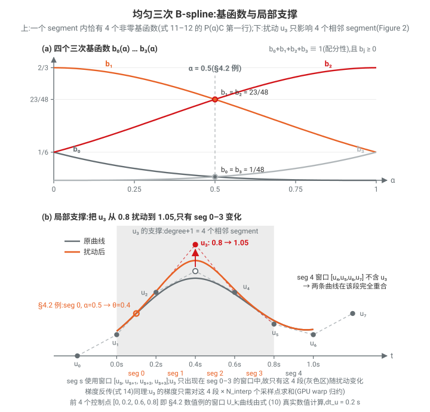
>
> 上图 (a) 为四个基函数的真实曲线,$\alpha=0.5$ 竖线上的取值正是本例的 $b_1=b_2=23/48$、$b_0=b_3=1/48$;(b) 把本例窗口 $[0, 0.2, 0.6, 0.8]$ 延展成 8 个控制点的样条,并演示局部支撑:把 $u_3$ 从 0.8 扰动到 1.05,只有含 $u_3$ 的 4 个相邻 segment(灰色区)变化,seg 4 两条曲线完全重合。

### 4.3 为什么用 B-spline 而不是离散 waypoint 参数化

论文第 7-8 页给出的理由,归纳并补充如下:

1. **平滑性是"结构性"保证**:度数 $\ge 3$ 的 B-spline 轨迹自动 $C^2$ 连续,速度/加速度处处连续。waypoint 参数化要靠有限差分近似导数、靠平滑代价"劝"出来,优化中易产生振荡。
2. **决策变量大幅减少**:$K$ 个控制点即可覆盖 $H = (K + \text{degree}+1)\cdot N_\text{interp} + 1$ 个 waypoints(见下文代码 `fns_state_transition.py:326-330`),即变量数缩小约 $N_\text{interp}$ 倍以上。论文强调这使式 (1) 中的加速度/速度正则项"用远少于逐时间步位置参数化的变量即可满足",且问题对梯度法**条件更好**(well-conditioned)。
3. **导数解析可得且对控制点线性**:$\dot\theta,\ddot\theta,\dddot\theta$ 由式 (10) 精确给出,无差分噪声;梯度反传就是一次转置乘法(见 4.4),无需数值微分。
4. **力矩约束可行**:式 (8) 的 torque limit 依赖逆动力学 $\tau_t = \text{RNEA}(\theta,\dot\theta,\ddot\theta)$,加速度的解析精确性直接决定力矩约束的可信度和梯度质量(Figure 1 中 2b RNEA Forward / 5b RNEA Backward)。差分加速度的噪声会被 RNEA 放大。
5. **局部支撑 → GPU 友好的稀疏梯度**:改一个控制点只影响 degree+1 段(Figure 2),梯度聚合是固定宽度的局部归约,可用 warp shuffle 高效实现(4.4 节)。
6. **边界条件隐式满足**(4.5 节):起点/终点状态编码进虚控制点,消除约束耦合与"振荡纠偏"。

### 4.4 对控制点的梯度(论文 4.1,式 13–14)

> **这一步反向传播的作用是什么?不是加速,而是使能**。回顾 Figure 1 六步循环的结构:(1) 优化变量是控制点 $U$,L-BFGS 更新的是它;(2) 但所有代价都不直接依赖 $U$——碰撞代价看球心位置(经 FK)、力矩代价看 $\tau$(经 RNEA)、C-space 代价看 $\Theta_t$,它们的反传只能给出 $g = \partial\mathcal{L}/\partial\Theta_t$,即"每个采样时刻的**状态**该往哪边挪";(3) 而 L-BFGS 需要的是 $\nabla_U\mathcal{L}$——"每个**控制点**该往哪边挪"。本节的反向传播(式 13–14)就是补上最后这一环:把散布在各采样点上的状态梯度沿 B-spline 映射"收拢"回控制点。没有它,优化器拿不到任何梯度,基于梯度的轨迹优化根本无法进行——它的作用是**使能**优化,不是提速。
>
> "快"体现在两个不同层面,容易混淆:**层面一(算法选择)**——反向模式 vs 前向模式:损失 $\mathcal{L}$ 是标量而输入(全部控制点)有 $d\times K$ 个,反向模式(VJP)一趟算出对所有输入的梯度;前向模式则每个控制点要单独扫一遍,代价乘以变量数。对"多输入、单输出"的优化问题,反向模式是唯一合理方向(与深度学习框架用反向传播是同一个理由)。**层面二(实现选择)**——手写 CUDA kernel vs PyTorch autograd:这才是论文真正做的"加速"工作,见本节末段与 4.6.3。

设总损失 $\mathcal{L}$(式 1),需要 $\nabla_U \mathcal{L}$。上游(碰撞、C-space、RNEA 等 cost 的反传)已给出每个采样点对状态的梯度

$$
g = \frac{\partial \mathcal{L}}{\partial \Theta_t} = \left[\frac{\partial\mathcal L}{\partial \theta_t},\ \frac{\partial\mathcal L}{\partial \dot\theta_t},\ \frac{\partial\mathcal L}{\partial \ddot\theta_t},\ \frac{\partial\mathcal L}{\partial \dddot\theta_t}\right]^\top.
$$

由于 $\Theta_t = \mathrm{B}(\alpha) U_k$ 是**线性**映射,链式法则给出单个采样点对局部控制点向量的梯度贡献(式 13):

$$
\frac{\partial \mathcal{L}}{\partial U_k} = \left(\frac{\partial \Theta_t}{\partial U_k}\right)^{\!\top} \frac{\partial \mathcal{L}}{\partial \Theta_t} = \mathrm{B}(\alpha)^\top g .
$$

> **链式法则推导验证(为什么是 $\mathrm{B}^\top$ 而不是 $\mathrm{B}$)**。逐分量验证(不依赖任何矩阵求导布局约定):分量形式 $\Theta_i = \sum_j \mathrm{B}_{ij}\,u_j$(行 $i$ 对应导数阶 pos/vel/acc/jerk,列 $j$ 对应窗口内 4 个控制点),对某个控制点 $u_j$:
>
> $$
> \frac{\partial\mathcal{L}}{\partial u_j}
> = \sum_{i} \frac{\partial\mathcal{L}}{\partial \Theta_i}\,\frac{\partial \Theta_i}{\partial u_j}
> = \sum_{i} g_i\, \mathrm{B}_{ij}
> = (\mathrm{B}^\top g)_j \quad\checkmark
> $$
>
> 用 $\mathrm{B}$ 的具体结构再核对:$\mathrm{B}_{rj} = b_j^{(r)}(\alpha)/dt_u^r$,故 $(\mathrm{B}^\top g)_j = \sum_r g_r\, b_j^{(r)}/dt_u^r$——正是下方的标量展开式。
>
> **记号陷阱**:若把中间步写成不带转置的 $\frac{\partial \Theta_t}{\partial U_k}\frac{\partial \mathcal{L}}{\partial \Theta_t}$,其正确性取决于布局约定——**分子布局**(numerator layout,深度学习/自动微分文献的主流约定)下 $\left[\frac{\partial \Theta}{\partial U}\right]_{ij} = \frac{\partial \Theta_i}{\partial u_j}$ 即 Jacobian $J=\mathrm{B}$,必须显式转置,漏掉会得到 $\mathrm{B}g$(此处 $\mathrm{B}$ 恰为 4×4 方阵,维度不报错但数值错误,因 $\mathrm{B}$ 不对称);**分母布局**下该矩阵本身定义为 $\mathrm{B}^\top$,不带转置的写法才成立。用 VJP(vector-Jacobian product)的语言最不易出错:**反向传播就是前向线性映射的转置(伴随)作用在上游梯度上**,$\bar U = J^\top \bar\Theta$。直觉检查:前向是"1 个控制点影响 4 个状态分量"(沿 $\mathrm{B}$ 的列),反向必然是"4 个状态梯度汇聚回 1 个控制点"(沿 $\mathrm{B}$ 的行)——信息流动方向反转,矩阵必须转置。这也是代码 backward kernel 做"反向点积"($g_i$ 与 $b_{\text{degree}-i}$ 配对)的数学本质。

即**反向传播就是前向矩阵的转置**,时间缩放 $\mathrm{T}$ 已隐含在 $\mathrm{B}(\alpha) = \mathrm{T}\mathrm{P}(\alpha)\mathrm{C}$ 内。展开成标量形式(对窗口中第 $j$ 个控制点):

$$
\frac{\partial \mathcal{L}}{\partial u_{k-1+j}}
= g_\text{pos}\, b_j(\alpha)
+ \frac{g_\text{vel}\, b_j'(\alpha)}{dt_u}
+ \frac{g_\text{acc}\, b_j''(\alpha)}{dt_u^2}
+ \frac{g_\text{jerk}\, b_j'''(\alpha)}{dt_u^3}.
$$

由局部支撑,控制点 $u_k$ 出现在 degree+1 个相邻 segment 中,每段又有 $N_\text{interp}$ 个采样点,总梯度是所有相关插值点贡献之和(式 14):

$$
\nabla_{u_k} \mathcal{L} = \sum_{i=1}^{N_\text{interp}} \frac{\partial \mathcal{L}}{\partial u_{k,i}},
\qquad N_\text{interp} = 4 \ (\text{实现取值}).
$$

**索引配对细节**(论文未写,代码注释里有):固定控制点 $k$,它参与前向 segment $k+i$($i \in [0,\text{degree}]$),且在该 segment 的局部窗口中位于基函数下标 $\text{degree}-i$ 处。所以反传时须把第 $i$ 个梯度样本与 $b_{\text{degree}-i}$ 配对(即"反向点积")。

> **数值演算(式 13–14,沿用 §4.2 数值例的设定)**。$dt_u = 0.2$、$\alpha = 0.5$ 时,前向矩阵(第 2/3/4 行已含 $1/dt_u^r$ 缩放,如 acc 行 $= [\tfrac12,-\tfrac12,-\tfrac12,\tfrac12]\times 25$):
>
> $$
> \mathrm{B}(0.5) = \mathrm{T}\,\mathrm{P}(0.5)\,\mathrm{C} =
> \begin{bmatrix}
> 1/48 & 23/48 & 23/48 & 1/48\\
> -0.625 & -3.125 & 3.125 & 0.625\\
> 12.5 & -12.5 & -12.5 & 12.5\\
> -125 & 375 & -375 & 125
> \end{bmatrix}.
> $$
>
> 设该采样点的上游梯度 $g = (g_\text{pos},\ g_\text{vel},\ g_\text{acc},\ g_\text{jerk}) = (1.0,\ 0.5,\ 0.1,\ 0)$。式 (13) 即 $\mathrm{B}^\top g$——对 $\mathrm{B}$ 的**列**做点积,得到窗口内 4 个控制点各自的梯度贡献(python3 验证,$g_\text{jerk}=0$ 列省略):
>
> | $j$ | $g_\text{pos}\, b_j$ | $g_\text{vel}\, b_j'/dt_u$ | $g_\text{acc}\, b_j''/dt_u^2$ | 合计 $\partial\mathcal L/\partial u_{k-1+j}$ |
> |---|---|---|---|---|
> | 0($u_{k-1}$) | $+0.0208$ | $-0.3125$ | $+1.25$ | $\mathbf{+0.9583}$ |
> | 1($u_k$) | $+0.4792$ | $-1.5625$ | $-1.25$ | $\mathbf{-2.3333}$ |
> | 2($u_{k+1}$) | $+0.4792$ | $+1.5625$ | $-1.25$ | $\mathbf{+0.7917}$ |
> | 3($u_{k+2}$) | $+0.0208$ | $+0.3125$ | $+1.25$ | $\mathbf{+1.5833}$ |
>
> 若漏掉转置误算 $\mathrm{B}g$,得 $[0.308,\ -1.875,\ 5,\ 25]$——维度不报错但数值完全不同(上方"记号陷阱"的数值实证)。
>
> **式 (14) 的跨样本求和**:换个视角固定一个控制点 $u_k$。它出现在 segment $k+i$($i=0,\dots,3$)的窗口中,配对基函数为 $b_{3-i}$;取 $N_\text{interp}=4$,每段采样 $\alpha \in \{0, 0.25, 0.5, 0.75\}$,共 $4\times 4 = 16$ 项贡献。为便于手算演示,假设这 16 个采样点的上游梯度都等于上面的 $g$(真实优化中各点 $g$ 不同,加法结构不变):
>
> | 贡献来源 | $\alpha=0$ | $\alpha=0.25$ | $\alpha=0.5$ | $\alpha=0.75$ | 行和 |
> |---|---|---|---|---|---|
> | seg $k$(配 $b_3$) | $0$ | $+0.7057$ | $+1.5833$ | $+2.6484$ | $+4.9375$ |
> | seg $k{+}1$(配 $b_2$) | $+3.9167$ | $+2.5807$ | $+0.7917$ | $-1.4974$ | $+5.7917$ |
> | seg $k{+}2$(配 $b_1$) | $-4.3333$ | $-3.5286$ | $-2.3333$ | $-0.7005$ | $-10.8958$ |
> | seg $k{+}3$(配 $b_0$) | $+1.4167$ | $+1.2422$ | $+0.9583$ | $+0.5495$ | $+4.1667$ |
>
> 16 项总和 $\nabla_{u_k}\mathcal{L} = +4.0000$(python3 验证)。两个可以自查的结构性性质:
> - 每一**列**(同一 $\alpha$ 下 4 段的贡献)之和恰为 $g_\text{pos} = 1$:因为 $\sum_j b_j \equiv 1$,而对配分性求导得 $\sum_j b_j' = \sum_j b_j'' = \sum_j b_j''' = 0$,速度/加速度项在列内互相抵消;于是总和 $= N_\text{interp}\, g_\text{pos} = 4$;
> - 左上角为精确的 $0$:$b_3(0) = b_3'(0) = b_3''(0) = 0$(控制点刚进入支撑窗口时影响从零光滑启动)。
>
> 真实实现中这 16 次乘加正是每个 (knot, dof) 由 GPU warp 归约一次性完成的工作(见下段与 §4.6.3);扰动/梯度都只涉及 4 个相邻 segment,可对照 figures/bspline_basis.svg 下半部的灰色支撑区。

论文指出这个求和主导运行时间,因此实现为 GPU 上的高度并行归约:线程按交错模式(interleaved)分配到各控制点,每线程累积局部和,再用 **warp 级归约**(`__shfl_down_sync`)产出最终梯度——计算与归约融合在单个 pass 中,避免中间结果写全局内存。数学上这一步只是一次转置矩阵乘,但若走 PyTorch autograd 图会产生多个中间张量和 kernel launch;手写融合 kernel 的效果见 §7.2 Table 4:B-spline 前向+反向合计仅占 kernel 时间的 **1.9%**(3.6 µs/迭代)——这一步被优化到几乎不可见,真正的大头是 RNEA(28.6%)和 swept-sphere 碰撞(11.1%)。

### 4.5 边界条件(论文 4.2,式 15–17)

样条参数化的关键优点:**边界状态被隐式满足**,不需要额外等式约束,消除了约束耦合和随之而来的振荡纠偏。

- **静态目标(到达后静止)**:只需把**最后一个控制点重复 degree+1 次**(论文说 "repeat the final knot four times"),自动满足式 (9) 的完全停止条件——因为窗口内 4 个控制点相同时,由配分性 $\theta \equiv u_\text{last}$,而速度/加速度/jerk 基函数各自系数和为 0,故导数全为 0。
- **非静态初始状态** $\Theta_0 = (\theta_0, \dot\theta_0, \ddot\theta_0)$:引入 **3 个虚控制点(ghost/virtual control points)** $u_{-3}, u_{-2}, u_{-1}$,由式 (10) 在 $\alpha=0$ 处、令 $\dddot\theta_0 = 0$ 反解得到。

**推导**:在 $\alpha = 0$ 处代入 4.2 节的解析式,记边界窗口为 $[w_0, w_1, w_2, w_3]$:

$$
\theta(0) = \frac{w_0 + 4w_1 + w_2}{6},\qquad
\dot\theta(0) = \frac{w_2 - w_0}{2\,dt_u},\qquad
\ddot\theta(0) = \frac{w_0 - 2w_1 + w_2}{dt_u^2},\qquad
\dddot\theta(0) = \frac{-w_0 + 3w_1 - 3w_2 + w_3}{dt_u^3}.
$$

令其等于 $(\theta_0, \dot\theta_0, \ddot\theta_0, 0)$(三次样条无法独立控制 jerk,取 0),解此 4×4 线性方程组:由第 1、3 式消去 $w_0+w_2$ 得 $w_1$;再由第 2 式拆出 $w_0, w_2$;最后由 jerk=0 得 $w_3 = w_0 - 3w_1 + 3w_2$:

$$
w_0 = \theta_0 - \dot\theta_0\, dt_u + \tfrac{1}{3}\ddot\theta_0\, dt_u^2
$$

$$
w_1 = u_{-3} = -\tfrac{1}{6}\,\ddot\theta_0\, dt_u^2 + \theta_0 \tag{15}
$$

$$
w_2 = u_{-2} = \tfrac{1}{3}\,\ddot\theta_0\, dt_u^2 + \theta_0 + \dot\theta_0\, dt_u \tag{16}
$$

$$
w_3 = u_{-1} = \tfrac{11}{6}\,\ddot\theta_0\, dt_u^2 + \theta_0 + 2\dot\theta_0\, dt_u \tag{17}
$$

式 (15)–(17) 与论文完全一致(代码实际计算的是含 $w_0$ 的完整 4 个固定结点,见下)。可代回验证:$\theta(0)=\theta_0$、$\dot\theta(0)=\dot\theta_0$、$\ddot\theta(0)=\ddot\theta_0$、$\dddot\theta(0)=0$ 全部精确成立。**把这些虚结点锚定在初始状态上后,优化器完全不必再操心边界,专注其余目标即可**。

> **数值例(式 15–17 正反两个方向各算一遍)**。给定初始状态 $\theta_0 = 0.3$ rad、$\dot\theta_0 = 0.5$ rad/s、$\ddot\theta_0 = 1.0$ rad/s²,$dt_u = 0.2$ s(故 $dt_u^2 = 0.04$、$\dot\theta_0\, dt_u = 0.1$)。代入公式(python3 验证,分数为精确值):
>
> $$
> w_0 = 0.3 - 0.1 + \tfrac{1}{3}(0.04) = \tfrac{16}{75} \approx 0.2133,
> \qquad
> w_1 = u_{-3} = 0.3 - \tfrac{1}{6}(0.04) = \tfrac{22}{75} \approx 0.2933,
> $$
>
> $$
> w_2 = u_{-2} = 0.3 + 0.1 + \tfrac{1}{3}(0.04) = \tfrac{31}{75} \approx 0.4133,
> \qquad
> w_3 = u_{-1} = 0.3 + 0.2 + \tfrac{11}{6}(0.04) = \tfrac{43}{75} \approx 0.5733.
> $$
>
> **代回 $\alpha = 0$ 的四个解析式**,全部精确还原、零舍入误差:
>
> $$
> \theta(0) = \frac{w_0 + 4w_1 + w_2}{6} = \frac{(16 + 88 + 31)/75}{6} = \frac{1.8}{6} = 0.3 \quad\checkmark
> $$
>
> $$
> \dot\theta(0) = \frac{w_2 - w_0}{2\,dt_u} = \frac{15/75}{0.4} = \frac{0.2}{0.4} = 0.5 \quad\checkmark
> $$
>
> $$
> \ddot\theta(0) = \frac{w_0 - 2w_1 + w_2}{dt_u^2} = \frac{(16 - 44 + 31)/75}{0.04} = \frac{0.04}{0.04} = 1.0 \quad\checkmark
> $$
>
> $$
> \dddot\theta(0) = \frac{-w_0 + 3w_1 - 3w_2 + w_3}{dt_u^3} = \frac{(-16 + 66 - 93 + 43)/75}{0.008} = 0 \quad\checkmark
> $$
>
> 数字本身也有物理直觉:$u_{-3} < u_{-2} < u_{-1}$ 且相邻差分递增($0.12 \to 0.16$),对应正初速;差分的增量 $(w_3 - w_2) - (w_2 - w_1) = 0.04 = \ddot\theta_0\, dt_u^2$,恰是正初加速度的二阶差分表现。
>
> 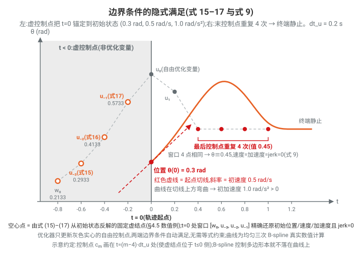
>
> 图中空心点即本例反解出的 4 个固定虚结点 $w_0, u_{-3}, u_{-2}, u_{-1}$(示意地画在 $t \le 0$ 侧);曲线(真实 B-spline 数值计算)在 $t=0$ 处经过 0.3 rad、切线斜率 0.5 rad/s、且在切线上方弯曲($\ddot\theta_0 = 1 > 0$)。右端红色的 4 个重复控制点使末段窗口 4 点相同,曲线以零速度、零加速度、零 jerk 停在目标值(式 9 的"repeat the final knot four times")。

---

### 4.6 代码对照(cuRobo 官方仓库,均为实际阅读过的文件)

B-spline 全部核心实现在 `curobo/_src/curobolib/kernels/trajectory/bspline/` 下(CUDA header-only 模板),Python 侧封装在 `curobo/_src/curobolib/cuda_ops/trajectory.py` 与 `curobo/_src/transition/fns_state_transition.py`。

#### 4.6.1 基矩阵的构建(式 11–12)

三种数学等价的 basis 后端(`BasisBackend` 枚举,`bspline_context.cuh:180-184`),支持度数 3/4/5:

- **MATRIX 后端**:`curobo/_src/curobolib/kernels/trajectory/bspline/basis/bspline_basis_matrix.cuh:22-27` 的 `DEGREE_3_COEFFS` 就是论文 $\mathrm{C}$ 的**转置**(每行 = 一个基函数 $b_j$ 按 $[t^3,t^2,t,1]$ 的系数,如第 0 行 `{-1/6, 3/6, -3/6, 1/6}`)。`compute_position_basis`(`:53-58`)构造 `t_powers = {t³,t²,t,1}` 做矩阵—向量乘;`compute_velocity_basis`(`:60-65`)用 `{3t², 2t, 1}`、`compute_acceleration_basis`(`:67-73`)用 `{6t, 2}`、`compute_jerk_basis`(`:75-80`)用 `{6}`——**正是式 (11) 中 $\mathrm{P}(\alpha)$ 的第 1/2/3/4 行**(逐行求导)。
- **FACTORED 后端**:`basis/bspline_basis_factored.cuh:24-65`,直接写出因式化的 $b_j(\alpha)$,如 `basis[0] = (1-t)³/6`(`:34`),jerk 基为常数 `{-1, 3, -3, 1}`(`:59-65`),与 4.2 节解析式逐项一致。
- **POLYNOMIAL 后端**:`basis/bspline_basis_polynomial.cuh`。

实际编译期默认选 **MATRIX**:`curobo/_src/curobolib/backends/pybind/trajectory_kernel_launch.cu:259` `constexpr BasisBackend defaultBasisImpl = BasisBackend::MATRIX;`,度数在 `:327/:351/:376`(forward)与 `:652-661`(backward)做 3/4/5 模板分发。

**时间缩放 $\mathrm{T}$** 的实现:`bspline_context.cuh:33-105` 的 `BSplineContext` 缓存 `knot_dt, knot_dt_2, knot_dt_3`,在 `compute_velocity/acceleration/jerk` 中分别除以 $dt_u, dt_u^2, dt_u^3$(`:84, :94, :104`)——即论文所说"time scaling handled implicitly by T inside B(α)"。`knot_dt = interpolated_dt × interpolation_steps`(`bspline_interpolation.cuh:126-127`),对应论文 $dt_u = N_\text{interp}\cdot dt$。

#### 4.6.2 前向插值(式 10)

- 核心函数 `interpolate_bspline_trajectory`:`curobo/_src/curobolib/kernels/trajectory/bspline/bspline_interpolation.cuh:95-297`。每个 CUDA 线程处理一个 (batch, timestep, dof) 组合:
  - `knot_idx = h_idx / interpolation_steps`(`:135`)定位 segment;
  - `t_mod = h/steps - ⌊h/steps⌋`(`:258-262`)即论文的 $\alpha \in [0,1)$;
  - 读取局部控制点窗口 `knots[splineSupportSize]`(`:232-242`,`splineSupportSize = Degree+1`,见 `bspline_common.cuh:13-17`)即论文的 $U_k$;
  - `context.compute_position/velocity/acceleration/jerk(knots)`(`:279-282`)完成 $\Theta_t = \mathrm{B}(\alpha)U_k$(点积在 `bspline_context.cuh:72-105`)。
- Kernel 入口 `interpolate_bspline_kernel`:`bspline_kernel.cuh:82-151`,线程分解 `d_idx = tid % dof`(内层,保证 warp 内合并访存)。
- 结点数与 horizon 的关系:`get_total_knots = n_knots + Degree + 1`(`bspline_common.cuh:20-23`);Python 侧文档 `fns_state_transition.py:326-330`:如 BSPLINE_3 时 `horizon = (n_knots+2)*interpolation_steps + 1`,并注明 "A good value for interpolation_steps is 4" —— 即论文的 $N_\text{interp}=4$。

#### 4.6.3 梯度反传(式 13–14):手写 CUDA backward,而非 PyTorch autograd

- Python 侧是自定义 `torch.autograd.Function`:`curobo/_src/curobolib/cuda_ops/trajectory.py:299`(`class BSplineIdxKernel`)。`forward`(`:301-380`)调 `launch_bspline_interpolation_forward_kernel`,`backward`(`:384-431`)**不走 autograd 图**,直接调手写 CUDA kernel `launch_bspline_interpolation_backward_kernel`(`:415`),输入是上游对 pos/vel/acc/jerk 四路梯度 `grad_out_p/v/a/j`,输出 `u_grad`(shape `[batch, n_knots, dof]`)。
- CUDA backward kernel `bspline_backward_kernel`:`bspline_kernel.cuh:333-380`。每线程负责一个 (batch, dof, knot, interpolation_idx):
  1. `load_gradients`(`bspline_gradient_util.cuh:141-223`)把该 knot 支撑窗口内 `Degree+1` 个时间步的 $g$ 装入 `GradientArrays{g_pos,g_vel,g_acc,g_jerk}`(`:29-51`);
  2. `compute_backward_grad_from_basis`(`bspline_context.cuh:133-172`)实现式 (13):对每阶导数重算基函数并做**反向点积** `dot_product_reverse`(把 `gradients[i]` 与 `basis[Degree-i]` 配对,原因见 4.4 节及代码注释 `bspline_context.cuh:141-144`),最后 `grad = Σg_pos·B₀ + Σg_vel·B₁/dt + Σg_acc·B₂/dt² + Σg_jerk·B₃/dt³`(`:170-171`)——正是 $\mathrm{B}(\alpha)^\top g$ 逐分量展开;
  3. 式 (14) 的跨插值点求和用 **warp 归约** `warp_interpolation_reduce_sum`(`bspline_gradient_util.cuh:83-105`,`__shfl_down_sync` 树形归约;kernel 中 `bspline_kernel.cuh:371-373` 调用),线程—knot 的交错布局由 `compute_bspline_backward_thread_info` 计算(`bspline_common.cuh:142-181`,其中 `:177` 重算 `t_mod`)。仅 `interpolation_idx == 0` 的线程写出结果(`bspline_kernel.cuh:377-379`),对应论文"fuses computation and reduction into a single pass"。

#### 4.6.4 边界条件(式 15–17)

- **系数表**:`bspline_boundary_constraint.cuh:53-64` `FixedKnotCoeffsData<3>`:

  ```
  POS  = {1, 1, 1, 1}
  VEL  = {-1, 0, 1, 2}
  ACC  = {1/3, -1/6, 1/3, 11/6}
  JERK = {0, 0, 0, 0}   // cubic 无法独立控制 jerk
  ```

  `compute_fixed_knots`(`:140-155`)按 `fixed_knots[i] = C_pos[i]·p + C_vel[i]·v·dt + C_acc[i]·a·dt² + C_jerk[i]·j·dt³` 计算。**对应关系**:`fixed_knots[1..3]` 恰为 **论文式 (15)(16)(17)** 的 $u_{-3}, u_{-2}, u_{-1}$;代码比论文多算一个 `fixed_knots[0] = p - v·dt + ⅓a·dt²`(即 4.5 节推导中的 $w_0$),使第 0 段 $\alpha=0$ 处四阶状态被完整锚定(代码 padding 为 `Degree+1` 个起始固定结点,论文行文简化为 3 个)。度数 4/5 的系数表在 `:67-92`(quintic 可额外控制 jerk)。这些系数由推导脚本 `derivations/bspline_boundary_coefficients.py:86-203` 通过构造 4×4 基函数系统矩阵 $M$ 并求逆得到(与 4.5 节手工解方程等价)。
- **起点模式** `assign_start_pattern`(`:170-192`):滑动窗口——`knot_idx < Degree+1` 时,窗口前部用 `fixed_knots[knot_idx + i]` 覆盖(`is_start_boundary`,`bspline_common.cuh:26-28`)。
- **静态目标(replicate)** `assign_goal_pattern_replicate`(`:240-297`):`knot_idx > n_knots` 时把最后一个真实控制点值复制填满窗口尾部——即论文"repeat the final knot four times",自动满足式 (9) 完全停止。
- **隐式目标状态** `assign_goal_pattern_implicit`(`:203-228`):`use_implicit_goal_state=True` 时对**终点**同样用 `compute_fixed_knots` 从目标 $(\theta_g,\dot\theta_g,\ddot\theta_g)$ 反解固定结点(这是代码对论文的推广:目标也可以非静态)。
- 分发入口 `apply_boundary_constraints`(`:334-369`),在前向插值中被调用(`bspline_interpolation.cuh:268-276`)。**边界的梯度处理**:虚结点不是优化变量,其梯度直接在 `load_gradients` 中处理——implicit goal 时终段梯度置零(`bspline_gradient_util.cuh:154, :167`),replicate 时把复制结点吸收的梯度累加回最后一个真实控制点(`:174-217`)。

#### 4.6.5 论文符号 ↔ 代码变量对照表

| 论文                                            | 代码                                                                   | 位置                                                                  |
| ----------------------------------------------- | ---------------------------------------------------------------------- | --------------------------------------------------------------------- |
| $u_k$ 控制点 / $U\in\mathbb{R}^{d\times K}$ | `u_position` / `u_act`,shape `[batch, n_knots, dof]`             | `bspline_interpolation.cuh:101`, `trajectory.py:303`              |
| $\alpha$                                      | `t_mod`                                                              | `bspline_interpolation.cuh:258-262`, `bspline_common.cuh:177`     |
| $dt_u$                                        | `knot_dt = interpolated_dt * interpolation_steps`                    | `bspline_interpolation.cuh:127`                                     |
| $\mathrm{T}$                                  | 除以`knot_dt / knot_dt_2 / knot_dt_3`                                | `bspline_context.cuh:84,94,104`                                     |
| $\mathrm{P}(\alpha)$ 各行                     | `t_powers` 数组(pos/vel/acc/jerk 各一)                               | `bspline_basis_matrix.cuh:54,62,69,77`                              |
| $\mathrm{C}$(式 12)                           | `DEGREE_3_COEFFS`($=\mathrm{C}^\top$)                              | `bspline_basis_matrix.cuh:22-27`                                    |
| $\mathrm{B}(\alpha)$                          | `context.basis[]`                                                    | `bspline_context.cuh:48`                                            |
| $U_k$ 局部窗口                                | `knots[Degree+1]`                                                    | `bspline_interpolation.cuh:133`                                     |
| $\Theta_t$                                    | `out_pos/out_vel/out_acc/out_jerk`                                   | `bspline_interpolation.cuh:279-289`                                 |
| $g=\partial\mathcal L/\partial\Theta_t$       | `GradientArrays{g_pos,g_vel,g_acc,g_jerk}`                           | `bspline_gradient_util.cuh:29-51`                                   |
| 式 (13)$\mathrm{B}(\alpha)^\top g$            | `compute_backward_grad_from_basis`                                   | `bspline_context.cuh:133-172`                                       |
| 式 (14) 求和($N_\text{interp}=4$)             | `warp_interpolation_reduce_sum`;`interpolation_steps`(推荐 4)      | `bspline_gradient_util.cuh:83-105`, `fns_state_transition.py:330` |
| 式 (15)-(17) 虚结点                             | `FixedKnotCoeffsData<3>` + `compute_fixed_knots`                   | `bspline_boundary_constraint.cuh:54-64,140-155`                     |
| "repeat final knot ×4"                         | `assign_goal_pattern_replicate`                                      | `bspline_boundary_constraint.cuh:240-297`                           |
| 优化变量入口(式 2)                              | `StateFromBSplineKnot.forward(u_act)`;`ControlSpace.BSPLINE_3/4/5` | `fns_state_transition.py:310-419`, `types/control_space.py:14-16` |

#### 4.6.6 两点实现细节备注

1. **论文以三次(cubic)为主线,代码同时支持度数 3/4/5** 且不少默认值取 4(`ControlSpace.BSPLINE_4` 为 `StateFromBSplineKnot` 默认,`fns_state_transition.py:320`;`get_bspline_interpolation` 默认 `bspline_degree=4`,`trajectory.py:31`)。quartic/quintic 的 $\mathrm{C}$ 矩阵(1/24、1/120 系数)在 `bspline_basis_matrix.cuh:29-44`,quintic 的边界系数可额外精确控制 jerk(`bspline_boundary_constraint.cuh:82-92`)。
2. **梯度是精确解析梯度**而非近似:因为 $\Theta_t$ 对 $U_k$ 严格线性,backward 就是 forward 的转置,单元测试 `curobo/tests/_src/transition/test_transition_gradients.py` 对此有数值校验。整条链路(B-spline → FK/RNEA → cost → 反传 → L-BFGS)对应 Figure 1 的步骤 1→6,B-Spline ∇ 是其中第 5c 步。

---

## 5. ESDF 场景碰撞避障

> 论文位置:cuRoboV2.pdf 第 9–13 页。代码根目录:`/home/mujin/MotionPlanning/curobo/curobo/_src/perception/mapper/`(以下相对路径均基于仓库根 `/home/mujin/MotionPlanning/curobo/`)。

### 5.0 总体设计:两级表示(TSDF → 按需 ESDF)

碰撞查询是运动生成的关键计算瓶颈。近期方法把机器人近似为球集合(sphere approximation),把碰撞检测化为"点到最近表面的有符号距离"查询。但存在两个难点:

1. 如何把**深度观测**与**已知几何 primitive** 融合进一个持久的世界模型;
2. 如何高效生成**任务相关分辨率**的距离场。

cuRoboV2 用两级流水线解决(论文 Fig. 3):

- **Stage A — Block-Sparse TSDF**(Sec. 5.1):用无锁(lock-free)积分 kernel 把深度图和 primitive 融合进块稀疏 TSDF,作为毫米级持久世界模型;
- **Stage B — 按需 Dense ESDF**(Sec. 5.4):在任务需要时,以任务相关(通常更粗)的分辨率生成一个覆盖整个工作空间的稠密 ESDF,并做内部符号恢复(interior-sign recovery)得到水密几何的正负号,支持 O(1) 三线性插值查询。

代码入口:`BlockSparseESDFIntegrator`(`curobo/_src/perception/mapper/integrator_esdf.py:357`),其成员组织与论文完全对应:块稀疏 TSDF(`_tsdf`)+ 稠密 `_site_index` + 稠密 `_dist_field` + PBA 求解器 `_edt`(`integrator_esdf.py:463-484`)。

---

### 5.1 Block-Sparse TSDF 存储

> **一个具体例子:机械臂工作站 + 桌上的马克杯**(用默认参数 `voxel_size=2 mm`、`block_size=8`、`truncation_distance=4 cm` 走一遍整个机制)。
>
> **问题:稠密网格存不下**。工作空间 4 m × 4 m × 2 m,2 mm 体素 → $2000\times2000\times1000 = 40$ 亿个体素 × 6 B ≈ **24 GB 显存**——为了记录一个马克杯,把整个房间的空气也存了下来;而 99% 以上的体素是空气或从未被相机看到的地方。
>
> **做法:只给"表面附近"发房卡**。把体素空间切成 8³ 体素的 block(2 mm 体素下每块 1.6 cm 见方):
>
> 1. **只分配有内容的 block**:相机拍到马克杯和桌面,只有落在观测表面 ±4 cm 截断带内的 block 才被分配——杯壁周围一圈、桌面上下一薄层;杯子内部深处、桌下大片空间、天花板一个字节都不占。粗算:桌面 2 m² + 杯面,截断带厚 8 cm → 约 4 万 block × 3 KB ≈ **120 MB**(vs 稠密 24 GB)。
> 2. **哈希表当"前台登记簿"**:block 池是预分配好的一大排"货架"(`block_data` 张量);查"坐标 (312,205,87) 的 block 在哪" → 哈希算出登记簿页码 → 读到"货架 4721 号"。一条记录压进单个 64 位整数(x/y/z 各 13 bit + 货架号 25 bit),登记新 block 只需**一次原子 CAS**——几千个线程同时发现新表面也不会把登记簿写花。
> 3. **每个体素存"我离最近表面多远"**(截断有符号距离 + 置信度权重)。以杯壁为例:杯壁前方 12 mm 的体素存 **+12 mm**;恰在杯壁上的存 **≈0**;杯壁后方 3 mm(材料内部)存 **−3 mm**;杯壁后方 6 cm 超出截断带,**不更新不分配**——规划器只关心"快撞上了没有",远处的精确距离是 §5.4 ESDF 按需再算的事。深度相机每帧有噪声,所以实际存 `(距离加权和, 权重和)` 两个累加器,读出时相除,相当于对几十帧观测做运行平均。
> 4. **东西挪走了怎么办**:马克杯被拿走,相机的深度射线穿过原来杯子的位置 → 那些 block 的权重每帧被乘衰减系数(视锥内 ×0.5,式 18),几帧后掉到阈值以下即"退房":哈希槽写墓碑,货架号丢回 `free_list` 回收栈,供新表面复用。**显存占用有上界,与运行时长无关**——7×24 小时工作站的刚需。
> 5. **两本账**:动态通道存相机观测(马克杯、路过的人手),静态通道存已知几何的解析 SDF(桌子/货架的 CAD 模型直接"盖章"进去,§5.2.2),查询取 min。静态通道不参与衰减,桌子不会因为被遮挡几分钟就"被遗忘"。
>
> 一句话:Block-Sparse TSDF = **"只在表面附近 4 cm 内开房间的毫米级距离场旅馆"**——哈希表是前台,block 池是货架,free list 是退房回收,双通道是"实测"与"图纸"两本账。它解决"毫米精度 × 米级场景 × 持久运行"三者同时成立时的存储问题。

> **基础概念:体素与 $8^3$ block**
>
> - **体素(voxel)= volume + pixel,"体积像素"**:二维图像把平面切成小方格(像素),每格存一个颜色;体素是三维版本——把空间切成小立方体,每个存一个值。TSDF 中每个体素存"该立方体中心离最近物体表面多远(带符号)"。默认配置下一个体素是 2 mm 见方(`voxel_size=0.002`);体素越小几何越精细,但数量按立方暴涨。
> - **$8^3 = 8\times8\times8 = 512$**:一个 block 沿 x/y/z 各排 8 个体素,共 512 个,组成边长 1.6 cm 的"一小包"(512 × 6 B ≈ 3 KB)。内存分配的最小单位是这个包,不是单个体素。
> - **为什么恰好是 8(2 的幂)**:① 512 线程正好是一个标准 CUDA thread block,积分 kernel "每体素一线程"时一个 block 恰好映射一个线程块;② 2 的幂使全局体素坐标 → (block 坐标, 块内偏移) 的拆分变成位运算(`x >> 3` / `x & 7`),免除除法取模;③ 512×6 B 连续小块对缓存行与向量化读写友好。`block_size` 可配置,默认 8(`storage.py:118`)。
>
> **粒度辨析:块是分配和调度的单位,不是写入的单位**(常见误解:"一个体素更新就重写整块")
>
> | 操作 | 粒度 | 说明 |
> |---|---|---|
> | 分配/回收 | 整块 | 块第一次被表面"碰到"时登记哈希表、占货架位;回收整块退房。**只发生一次**,不是每次更新都重新分配 |
> | 线程调度 | 整块 | 积分 kernel 对每个"本帧可见"的块发射 512 个线程(每体素一个) |
> | 数据写入 | **逐体素** | 每线程只管自己那一个体素:自己投影到深度图,在截断带内就更新自己那 6 字节,不在就什么都不写。不存在"整块重写" |
>
> 一个块里可能只有 30 个体素落在截断带内被更新,其余 482 个线程判断条件不满足后空转退出——线程被"浪费",但没有多余的内存写。(例外恰好印证这一点:§5.3 的权重衰减刻意设计为**整块乘一个系数**——衰减本来就要作用于块内所有体素,整张量融合乘法反而最快。)
>
> **block 大小的权衡**:
> - **块太小** → 哈希表条目暴涨:同一片表面登记更多记录,block discovery 发射更多 key、去重更慢,每次采样要做更多哈希查找 → **管理开销(查询/插入/登记)占主导**;
> - **块太大** → 分配反而更不频繁(一次覆盖更大范围),真正的代价是:① **内存浪费**——表面只擦过 25 cm 大块的一角,整块 26 万体素全占显存,绝大多数是永远不更新的空气,稀疏存储收益被吃光;② **算力浪费**——块越大,判断"我不在截断带内"后空转退出的线程占比越高;
> - **8³ 是甜点位**:截断带 8 cm 厚 ≈ 5 个块,既不被管理开销拖累、也不为空气大量买单,且 512 恰好对齐一个 CUDA 线程块。

**论文要点**:TSDF 需要在米级场景中表达毫米级几何。做法是把体素空间划分为 **8³ 体素的 block**,只为观测到表面附近的 block 分配内存;一张哈希表把 block 坐标映射为 block pool 下标,用 **Compare-And-Swap (CAS)** 处理并发插入;权重衰减到阈值以下的 block 被回收进 free list 复用,使**峰值内存与场景时长无关**。每个体素保留两个独立的有符号距离通道,均以 float16 存储:

- **动态通道**(深度观测):运行加权平均的分子/分母对 `(depth_sum, depth_wt)`,4 字节/体素;
- **静态通道**(解析 primitive):`geom_sdf`,2 字节/体素。

查询时的有效 SDF 是两通道取最小(障碍物的并集,对碰撞避障保守):

$$
\phi(\mathbf{p}) \;=\; \min\bigl(\phi_{\text{depth}}(\mathbf{p}),\; \phi_{\text{geom}}(\mathbf{p})\bigr),
\qquad
\phi_{\text{depth}} = \frac{\texttt{depth\_sum}}{\texttt{depth\_wt}} \ \ (\texttt{depth\_wt} > w_{\min})
$$

典型室内场景 100K 活跃 block 约 **350 MB**,比等效 dense 网格省约 **11×**(代码注释里按具体配置给出 20× 的例子,见下)。

**代码对照(数据结构)**

| 论文概念                                                                        | 代码位置                                                                                                                             |
| ------------------------------------------------------------------------------- | ------------------------------------------------------------------------------------------------------------------------------------ |
| 配置(`block_size=8` 默认、`voxel_size=0.002`、`truncation_distance=0.04`) | `BlockSparseTSDFCfg` — `perception/mapper/storage.py:82`(block_size 默认 8:`storage.py:118`)                                  |
| 所有张量的容器                                                                  | `BlockSparseTSDFData` — `storage.py:506`                                                                                        |
| 哈希表(64 位 packed key+value)                                                  | `hash_table: (capacity,) int64` — `storage.py:523`;条目布局注释 `storage.py:515-519`                                          |
| 动态通道`(depth_sum, depth_wt)` fp16                                          | `block_data: (max_blocks, block_size³, 2) float16` — `storage.py:526`                                                          |
| 静态通道`geom_sdf` fp16(初始化为 +inf = 无障碍)                               | `static_block_data: (max_blocks, block_size³) float16` — `storage.py:534`,初始化 `storage.py:807-813`                        |
| free list(栈式)                                                                 | `free_list` / `free_count` — `storage.py:541-542`                                                                             |
| 逐 block 权重和(用于回收判定)                                                   | `block_sums`(动态)/ `static_block_sums`(静态)— `storage.py:549-550`                                                           |
| frustum 标志与逐 block 衰减系数                                                 | `frustum_flags` / `decay_factor` — `storage.py:551-552`                                                                       |
| 通道 min 组合                                                                   | `sample_combined_sdf` — `perception/mapper/kernel/wp_tsdf_sample.py:78-101`;动态通道 `S/W` 除法在 `wp_tsdf_sample.py:46-52` |

**哈希条目布局(64 bit,单次 CAS 原子写 key+value)**,注释见 `storage.py:515-519` 与 `kernel/builder/builder_hash.py:13-21`:

```
| X (13 bit) | Y (13 bit) | Z (13 bit) | pool_idx (25 bit) |
坐标范围 [-4096, 4095]/轴;pool_idx 上限 33,554,430;空槽 = -1,墓碑 = -2
```

- 位布局定义:`HashLayout` — `perception/mapper/constants.py:392`,默认 `coord_bits_xyz=(13,13,13)` — `constants.py:480`;
- 空间哈希函数(经典三素数 XOR):`spatial_hash` — `builder_hash.py:132`:

$$
h(b_x,b_y,b_z) = \bigl(b_x\, p_x \oplus b_y\, p_y \oplus b_z\, p_z\bigr) \bmod C,\quad
(p_x,p_y,p_z) = (73856093,\ 19349663,\ 83492791)
$$

素数常量在 `constants.py:542-544`。冲突用**线性探测**(`hash_lookup` — `builder_hash.py:153`),插入用 `wp.atomic_cas`(`builder_hash.py:295`、`builder_hash.py:370` 的 `hash_table_insert_with_pool_idx`),保证 key 和 value 原子地一起写入,无竞态。

**内存预算**(`storage.py:19-29` 注释,block_size=8、100K block):`hash_table` 1.6 MB(200K×8B,负载因子 0.5)+ `block_data` 200 MB(100K×512×2×2B)+ 元数据合计约 205 MB,对比 dense 4+ GB 为 **20× 节省**。类文档也写明 "20× memory reduction compared to dense grids"(`storage.py:658-663`)。`memory_usage_bytes()` 的逐项核算在 `storage.py:1321-1341`。

**为什么快/省**(相对 nvblox 类方案的工程要点):

1. 单 int64 packed entry + 单次 CAS,插入/查询各只碰一次哈希槽内存,而不是分离的 key 表和 value 表;
2. block pool 是**预分配的连续大张量**(CUDA graph 友好、零运行时 malloc),free list 回收使内存有上界;
3. 积分 kernel 里根本不做哈希查找(见 5.2 Phase 4:pool 下标已在分配阶段解析成紧凑数组);
4. fp16 双通道最小化每体素字节数(6 B/voxel),RGB/特征作为**每 block 低分辨率控制格点**(默认 `color_grid_size=1`,即整块一个 RGBW 累加器,`storage.py:22`)而非每体素颜色,进一步压内存。

---

### 5.2 深度与 Primitive 积分

#### 5.2.1 Voxel-Project 深度积分(4 阶段,零原子操作)

论文 Fig. 5。核心思想:把 GPU 工作组织在**体素**上——每个体素一个线程,自己投影到深度图、读投影像素的深度、以唯一所有权写回自己的 SDF,**完全消除原子竞争**。四个阶段:

1. **Block discovery**:对每个像素,在截断带内沿射线采样,找出被当前深度帧触碰的 block,发射 N = 像素数 × 采样数 个线程。
   代码:`compute_block_keys_only_kernel` — `kernel/builder/builder_camera_integrate.py:115`;采样数 `num_samples = ⌈2τ / (B·v/1.42)⌉ + 1`(块边长对角线安全步长)在 `kernel/wp_integrate_camera_project.py:104-110`。
2. **Deduplication**:丢弃无效深度像素的 key 并去重,得到本帧可见的 K 个唯一 block key。
3. **Block allocation**:每个唯一 key 经 CAS 插入哈希表,优先复用 free list 中的回收 block;输出可见 block 的 pool 下标紧凑数组。
   代码:2+3 融合为一个 kernel `allocate_visible_blocks_from_keys_kernel` — `builder_camera_integrate.py:194`,launcher `_dedup_visible_blocks_hash` — `wp_integrate_camera_project.py:179-216`(注意 `visible_count.item()` 这里就是论文说的**必须 D2H 同步读 K** 的地方,`wp_integrate_camera_project.py:214`)。
4. **Voxel-centric integration**:对所有可见 block 的每个体素各发射一个线程(K×512 线程)。每线程计算体素中心世界坐标 → 用相机内参投影到像平面 → 读投影像素深度 → 直接写 SDF 与权重。**每个体素恰好一个线程拥有,无需任何原子操作**;相邻线程写相邻体素,访存合并;且 pool 下标已解析,积分 kernel 内零哈希查找。
   代码:`integrate_voxels_kernel` — `builder_camera_integrate.py:471`,launch dim `(n_visible, block_size³)`(`wp_integrate_camera_project.py:746-763`)。

**投影 SDF 与截断公式**(kernel 内逐相机循环,`builder_camera_integrate.py:512-551`):

设体素中心 $\mathbf{p}$,相机位姿 $(\mathbf{t}, R)$,先变换到相机系并针孔投影:

$$
\mathbf{p}_c = R^{-1}(\mathbf{p} - \mathbf{t}), \qquad
u = \frac{f_x\, p_{c,x}}{p_{c,z}} + c_x, \quad
v = \frac{f_y\, p_{c,y}}{p_{c,z}} + c_y
$$

**投影距离(projective distance)**:体素沿相机射线到观测表面的有符号距离

$$
d = D(u, v) - p_{c,z}
$$

(代码 `sdf = depth - z_cam`,`builder_camera_integrate.py:543`)。**截断**:表面后方超过 $\tau$ 的体素丢弃,前方 clamp 到 $\tau$:

$$
d \ge -\tau \ \text{才积分}, \qquad \bar d = \min(d,\ \tau)
$$

(`builder_camera_integrate.py:544-545`;$\tau$ = `truncation_distance`,默认 0.04 m)。

> **"体素投影到深度图"是什么意思?——一个数值例子**
>
> 两个主角:**深度图 $D(u,v)$** 是深度相机输出的"图",每个像素存的不是颜色,而是该像素视线方向上最近表面离相机的距离(如像素 (397,278) 的值 0.80,意为"沿这条视线 0.80 m 处有表面");**体素投影**则是每个体素(一个线程)反过来问:"如果相机看我,我会落在深度图的哪个像素上?"——与相机拍照时三维点变成照片像素是同一个几何过程(针孔模型)。
>
> 设内参 $f_x = f_y = 600$ px、$(c_x, c_y) = (320, 240)$(640×480 深度相机),马克杯在相机前方约 0.8 m:
>
> 1. **变换到相机系**:体素中心经 $\mathbf{p}_c = R^{-1}(\mathbf{p}-\mathbf{t})$ 得 $(0.10, 0.05, 0.78)$ m——偏右 10 cm、偏下 5 cm、深度 0.78 m;
> 2. **针孔投影**:$u = 600\times0.10/0.78 + 320 \approx 397$,$v = 600\times0.05/0.78 + 240 \approx 278$ → 该体素被像素 **(397, 278)** "看到"(直觉:$f_x p_x/p_z$ = 横向偏移角 × 焦距,越远的东西在图上越靠近中心,即透视);
> 3. **读深度、相减**:$D(397,278) = 0.80$ m,体素自己在这条视线上的深度 $p_{c,z} = 0.78$ m,故 $d = 0.80 - 0.78 = +2$ cm——体素在杯壁**前方 2 cm**(正号 = 表面外侧),在截断带 ±4 cm 内,积分 +2 cm。
>
> 同一条视线上其他体素的命运(截断规则的具体化):
>
> | 体素深度 $p_{c,z}$ | $d = 0.80 - p_{c,z}$ | 处理 |
> |---|---|---|
> | 0.70 m | +10 cm | 前方较远,clamp 到 $+\tau = +4$ cm 积分(自由空间) |
> | 0.78 m | +2 cm | 积分 +2 cm(表面外侧) |
> | 0.803 m | −3 mm | 积分 −3 mm(已穿入杯壁材料内) |
> | 0.85 m | −5 cm | $d < -\tau$,**丢弃**——表面后方太深,被杯壁挡住,相机看不见那里,不能瞎猜 |
>
> **为什么"体素投影"这个方向很关键**:传统 TSDF 积分是**像素为中心**的(raycast)——每个像素沿视线往前走,沿途逐个更新体素;多条视线会打到同一体素(近处体素在图上占好几个像素),多线程写同一地址必须用原子操作,竞争严重。cuRoboV2 反转方向:每个体素只有一个线程负责,自己投影、自己读像素、只写自己——"谁的数据谁更新",天然无写冲突。代价是近处一个体素覆盖多个像素、只读一个像素会低估观测量,故引入下文的面积权重 $w = \max(c, 1)$ 补偿(体素越近、投影面积越大、权重越高)。
>
> **投影距离到底是什么坐标?它离"真实 SDF"有多远?**(两个常见误解的澄清)
>
> - **误解一:"$p_{c,z}$ 是体素到相机的欧氏距离"**——不是。参与相减的是体素在相机**光轴方向上的 z 分量**。上例 $\mathbf{p}_c = (0.10, 0.05, 0.78)$:欧氏距离是 $\sqrt{0.10^2+0.05^2+0.78^2}\approx 0.788$ m,但公式用的是 **0.78**(z 分量)。
> - **误解二:"深度图存的是沿视线的距离"**——标准深度相机(RealSense/ZED/Kinect)遵循 **z-depth 约定**:$D(u,v)$ 是该像素看到的表面点**在相机系下的 z 坐标**,不是沿视线的斜线长度(range);传感器驱动已做过 range→z 转换。(LiDAR/部分 ToF 原始输出才是 range,需单独处理。)
>
> 因此 $d = D(u,v) - p_{c,z}$ 是**同一约定下两个 z 坐标相减**(同一条视线上"表面点的 z"减"体素的 z"),量纲自洽,没有混用度量。但它确实**不是**"到最近表面的真实垂直距离"。同一条视线上有三个不同的"距离"(设视线偏离光轴 $\theta=30°$、表面被斜射 $\varphi=60°$):
>
> | 量 | 表达式 | 例子 |
> |---|---|---|
> | **投影距离**(公式实际用的) | $d = \Delta z$ | **+2 cm** |
> | 沿视线的欧氏距离 | $d/\cos\theta$ | 2.31 cm |
> | **到表面的真实垂直距离**(理想 SDF) | $(d/\cos\theta)\cos\varphi$ | 1.15 cm |
>
> 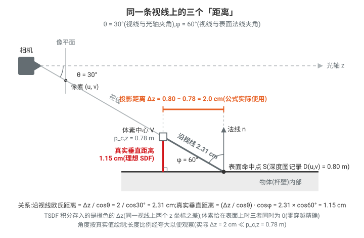
>
> 视线越斜、表面被照得越斜,偏差越大——这是 KinectFusion 以来所有 projective TSDF 的固有近似。**为什么可接受(四道保险)**:
>
> 1. **零穿越点精确**:体素恰在表面上时无论角度如何 $d=0$ 严格成立,三种距离在表面处重合——**表面位置不会被近似移动**,被扭曲的只是截断带内离开表面处的坡度;
> 2. **截断封顶**:数值本就被 clamp 在 ±4 cm 内,坡度失真的绝对影响有限;
> 3. **多帧多视角融合**:正对表面的观测(最准)与斜视观测加权平均,偏差被摊薄;
> 4. **最重要:ESDF 阶段重算真欧氏距离**——§5.4 只从 TSDF 提取零穿越附近的体素作 surface site(用的正是精确的表面位置),PBA+ 再对每个 cell 计算到最近 site 的**精确欧氏距离**。规划器最终查询的距离场不继承截断带内的坡度失真。
>
> 准确的说法:**TSDF 阶段用"同一视线上的 z 坐标差"作为廉价的表面定位手段,ESDF 阶段再从定位好的表面出发算真正的欧氏距离**——两级设计各取所长。

**观测权重**:多个图像像素可能映射到同一近处体素,因此按体素**投影面积(像素数)**放大权重:

$$
c = \frac{f_x\, v_{\text{tsdf}}}{z}\cdot\frac{f_y\, v_{\text{tsdf}}}{z}, \qquad
w = w_{\text{base}}(z)\cdot \max(c,\ 1)
$$

其中 $v_{\text{tsdf}}$ 是体素边长、$z$ 是相机系深度,$\max(c,1)$ 保证至少单位权重(与论文式 $w=\max(c,1)$ 一致)。代码:`coverage = (fx*VOXEL_SIZE/z)*(fy*VOXEL_SIZE/z)`、`weight = base_weight * wp.max(coverage, 1.0)` — `builder_camera_integrate.py:546-548`。$w_{\text{base}}$ 在 `kernel/wp_integrate_common.py:61`(`compute_tsdf_weight`,当前实现固定为 1 并 clamp 到 [0.001, 1000],历史上的 $1/z^2$ 深度加权被注释掉了)。

**TSDF 融合(运行加权平均)**:体素存 $(S, W)$ 两个 fp16 累加器,融合是纯加法:

$$
S \leftarrow S + \sum_{\text{cam}} \bar d\, w, \qquad
W \leftarrow W + \sum_{\text{cam}} w, \qquad
\phi_{\text{depth}} = \frac{S}{W}\ \ (W > w_{\min})
$$

代码:累加 `builder_camera_integrate.py:550-557`(先在寄存器里对所有相机求和,最后一次读改写,单线程所有权所以无原子);读出时的除法在 `wp_tsdf_sample.py:46-52`。$w_{\min}$ = `minimum_tsdf_weight`(默认 0.1,`integrator_esdf.py:148`)。这等价于经典 KinectFusion 增量式 $\phi \leftarrow (W\phi + w\bar d)/(W+w)$,但存"和"而非"均值",使写入无需读-改-写平均,也让权重衰减(5.3)可以对整个张量做一次乘法。

#### 5.2.2 Primitive 直接写入(stamping)

论文:长方体与网格被直接"盖章"进几何通道。对每个 primitive:计算体素坐标下的 AABB → 选出解析 SDF 落在截断带内的候选 block → 去重、哈希分配 → 对每个体素用**到 primitive 的最小有符号距离**更新。

**公式**:静态通道是所有 primitive 解析 SDF 的下包络,且只写截断带内、单调取 min(幂等,可重复 stamp):

$$
\phi_{\text{geom}}(\mathbf{p}) \leftarrow
\operatorname{clamp}\Bigl(\min\bigl(\phi_{\text{geom}}(\mathbf{p}),\ \min_i \operatorname{SDF}_i(T_i^{-1}\mathbf{p})\bigr),\ -\tau,\ \tau\Bigr)
\quad \text{当 } \bigl|\min_i \operatorname{SDF}_i\bigr| \le \tau
$$

**代码**(`kernel/builder/builder_stamp.py`):

- AABB → block 枚举:`enumerate_blocks_from_aabb_kernel` — `builder_stamp.py:186`;
- 候选筛选(block 中心 SDF 判据,阈值 = 截断距离 + 半块对角线):`filter_blocks_by_sdf_kernel` — `builder_stamp.py:220`,阈值定义

$$
|\operatorname{SDF}(\text{block center})| \le \tau + \frac{\sqrt3}{2}\, B\, v_{\text{tsdf}}
$$

  — `builder_stamp.py:64-65`(`MAX_SDF_THRESHOLD`);

- 预分配(CAS + free list 复用):`preallocate_unique_blocks_kernel` — `builder_stamp.py:120`;
- 逐体素 stamp(read-min-write + clamp,并原子维护 `static_block_sums` 非 inf 体素计数):`stamp_sdf_kernel` — `builder_stamp.py:266`,min/clamp 在 `builder_stamp.py:311-316`。
- primitive 的解析 SDF(cuboid/mesh 的 `compute_local_sdf` 重载)在 `kernel/wp_stamp_obstacles.py`,入口 `update_static_obstacles` — `integrator_esdf.py:965`。

> **一个具体例子:桌面 + 货架立柱,四个体素的"盖章"记账**(τ = 4 cm)。设两个 primitive:桌面 cuboid(顶面 z = 0.75 m)与立在桌上的货架立柱 cuboid(5 cm × 5 cm 截面,前表面在 x = 0.60 m),两者贴得很近。静态通道所有体素初始为 +inf("无障碍")。stamp kernel 对每个体素先算 $\min_i \operatorname{SDF}_i$,再与已有值取 min、clamp 到 ±τ:
>
> | 体素 | 到桌面 SDF | 到立柱 SDF | $\min_i \operatorname{SDF}_i$ | 写入 $\phi_{\text{geom}}$ |
> |---|---|---|---|---|
> | V₁:只在桌面带内(桌上 3 cm,距立柱 30 cm) | +3 cm | +30 cm | +3 cm | min(+inf, +3) = **+3 cm**(\|3\| ≤ τ,截断不动它) |
> | V₂:夹在两者之间(桌上 2.5 cm,距立柱面 1.2 cm) | +2.5 cm | +1.2 cm | **min(+2.5, +1.2) = +1.2 cm** | **+1.2 cm**(下包络取更近者) |
> | V₃:立柱内部(离最近面 0.8 cm) | +15 cm | −0.8 cm | −0.8 cm | **−0.8 cm**(负 = 内部) |
> | V₄:桌上 7 cm 高处 | +7 cm | +30 cm | +7 cm | \|7\| > τ → **不写**,保持 +inf |
>
> 三个机制在数字上的体现:
>
> - **min 下包络**:V₂ 处两个 primitive 的截断带重叠,留下的是更小的 +1.2 cm——"离最近障碍多远"天然是并集语义,对碰撞避障保守正确;
> - **截断 ±τ**:V₄ 的 +7 cm 被 $|\min \operatorname{SDF}| \le \tau$ 的门槛挡在写入之外(`builder_stamp.py:311`);若整个 block 都在带外,连 block 都不会分配(`builder_stamp.py:64-65` 的筛选阈值)。同理厚物体内部深过 −τ 处也不写——这正是 §5.4 seeding 要把负截断边界当 site 的原因。于是通道内实际存的值恒在 [−4, +4] cm,公式里的 clamp 是防御性保证;
> - **重复 stamp 幂等**:同一批 primitive 再盖一次章,V₂ 处 min(+1.2, +1.2) = +1.2 分毫不变;`static_block_sums` 的非 inf 体素计数也只在体素第一次从 +inf 变有限值时自增(`was_infinite` 判断,`builder_stamp.py:315-318`),不会重复计数。盖章顺序同样无关:min(min(+inf, +2.5), +1.2) = min(min(+inf, +1.2), +2.5) = +1.2。
>
> 注意 min 的单调性:stamp 只能让值变小(加障碍),不能变大——挪走一个 primitive 无法靠"再盖一次章"撤销,需要清空静态通道重建。这与动态通道靠权重衰减(§5.3)自然遗忘形成对照:"图纸"改版是显式操作,"实测"过期是自动的。

---

### 5.3 Frustum-Aware 衰减与 Block 回收

**论文公式(式 18)**:每次积分后做两级乘法权重衰减。时间衰减 $\alpha_t$(如 0.99)作用于所有已分配 block,慢慢淡出旧观测;视锥衰减 $\alpha_f$(如 0.5)**额外**作用于当前相机视锥内的 block,让视野内移走/消失的物体被迅速清除:

$$
w \leftarrow
\begin{cases}
w\,\alpha_t\,\alpha_f, & \text{block 在视锥内}\\[2pt]
w\,\alpha_t, & \text{否则}
\end{cases}
\tag{18}
$$

要点:

- **视锥判定在 block 粒度**做保守包围球测试(每 block 一个线程),精度 ±半块;
- 衰减本身是对 block 数据张量的**一次融合乘法,零原子操作**;
- 衰减后用 PyTorch reduction 求每 block 权重和;总权重低于阈值的 block 被回收:哈希槽写墓碑(tombstone),block 下标压入 free list 复用。

> **一个具体例子:马克杯被拿走之后**。TSDF 是持久记忆,但世界会变——问题是怎么删得**恰到好处**:不能太慢(机器人绕着"幽灵杯子"走),也不能一刀切(相机没看着 ≠ 东西没了)。"视锥(frustum)"即相机的可视金字塔。设 15 Hz 深度相机,代码默认 $\alpha_t = 1.0$(视锥外不衰减)、$\alpha_f = 0.5$(视锥内每帧减半),观察三个区域的 block:**A 区** = 桌上原放杯子的位置(视锥内,杯子刚被拿走);**B 区** = 旁边的水壶(视锥内,还在);**C 区** = 机器人身后的货架(一分钟前建过图,现在视锥外)。杯子在位时被观测 30 帧,权重累到 $w \approx 30$,$t=0$ 杯子被拿走:
>
> | 帧 | A 区(视锥内,杯子没了) | B 区(视锥内,水壶还在) | C 区(视锥外,货架) |
> |---|---|---|---|
> | 0 | 30 | 30 | 30 |
> | 1 | $30\times0.5 = 15$ | $30\times0.5 + 1 = 16$ | 30 |
> | 2 | 7.5 | 9 | 30 |
> | 3 | 3.75 | 5.5 | 30 |
> | 5 | 0.94 | 2.9 → 收敛到 2 | 30 |
> | 7 | **0.23 → 低于阈值,block 回收** | ≈ 2(稳态) | 30 |
>
> - **A 区:该看见却看不见 → 快速遗忘**。深度射线现在穿过原杯子位置打到后面的桌面,不再补充权重,只剩每帧减半;约 7 帧(**半秒**)后跌破阈值、block 回收,幽灵杯子消失。
> - **B 区:看得见且确实在 → 新证据对抗衰减**。每帧积分补回约 +1 权重,递推 $w \leftarrow 0.5w + 1$ 收敛到稳态 $w^* = w_{\text{new}}/(1-\alpha_t\alpha_f) = 2$:持续存在的物体永远活着,置信度维持适中(对"物体挪动几厘米"响应更快)。
> - **C 区:看不见 → 不动它的记忆**。$\alpha_t = 1.0$,权重原封不动。关键取舍:机械臂转身作业时身后货架的地图必须完整保留,否则单相机系统的世界模型会随视线移动不断"蒸发"。
>
> **对照两种失败的替代方案**:只用慢速全局衰减($\alpha_t = 0.99$,无 $\alpha_f$)→ A 区从 30 衰到 0.3 需 $\ln(0.01)/\ln(0.99)\approx 460$ 帧 ≈ **30 秒**,机器人对着空气绕行半分钟;全局快速衰减($\alpha_t = 0.5$ 一刀切)→ A 区半秒清除 ✓,但货架也半秒忘光 ✗。视锥衰减的本质是一条贝叶斯式直觉:**只降级"我此刻应该看得见、却没有得到确认"的记忆**,看不见的地方保持原判。
>
> 一个诚实的边界情况:视锥测试只看几何、不做可见性推理——一只手**暂时挡住**还在桌上的水壶时,水壶 block 仍在视锥内、照样被衰减("该被看见却没被确认")。好在手移开后几帧内权重即恢复,代价是遮挡期间它短暂变成"未知"区域——这是为反应式场景(宁快勿旧)刻意选择的保守方向。另外静态通道不受衰减影响,盖章进去的桌子 CAD 不会被误回收(回收要求动态权重与静态计数**同时**为零,见下)。
>
> 三个区域的几何位置与权重曲线如下图(曲线为上表的真实递推数值,纵轴取对数刻度,A 区在帧 7 跌破回收阈值):
>
> 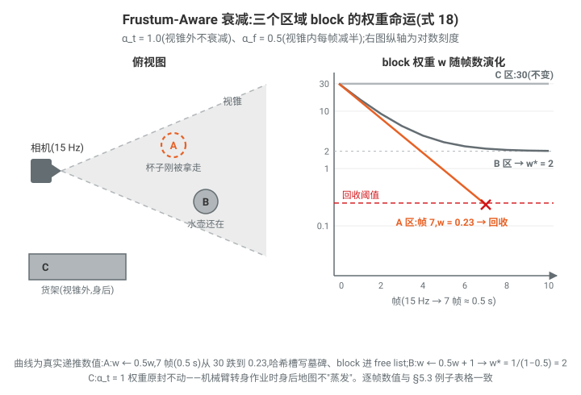

**代码对照**(`kernel/wp_decay.py` + `kernel/builder/builder_decay.py`):

1. **视锥标记**:`mark_blocks_in_frustum_kernel` — `builder_decay.py:112`。包围球半径 $r = \frac{\sqrt3}{2} B v \approx 0.866\,B v$(`builder_decay.py:168`),先按 $z_c \pm r$ 与 $[z_{\min}, z_{\max}]$ 深度裁剪(`builder_decay.py:186-188`),再把球投影成像素半径 $r_u = f_x r / z_c,\ r_v = f_y r / z_c$ 与图像边界比较(`builder_decay.py:203-212`)——这正是"±半块精度的保守包围球测试"。LiDAR 版本 `mark_lidar_blocks_in_frustum_kernel` — `builder_decay.py:218`(按 range/仰角做同样的保守角半径测试)。
2. **式 (18) 的实现**:`apply_decay_from_frustum_flags` — `wp_decay.py:111`。逐 block 系数向量:

   ```python
   factor.fill_(time_decay)                                        # w·αt
   factor.masked_fill_(frustum_flags[:n] > 0, time_decay*frustum_decay)  # w·αt·αf
   tsdf.data.block_data[:n].mul_(factor.view(n, 1, 1))             # 一次融合乘法
   ```

   — `wp_decay.py:136-145`。注意乘的是整个 `(S, W)` 张量:分子分母同乘不改变均值 $S/W$,只衰减置信度 $W$,这就是"存和不存均值"的第二个好处。
3. **权重和 + 回收**:`block_sums = block_data[:,:,1].sum(dim=1)`(PyTorch reduction,`wp_decay.py:147`)→ `recycle_empty_blocks_kernel` — `builder_decay.py:323`:当 `block_sums[tid] < block_empty_threshold` **且** `static_block_sums[tid] == 0`(静态通道也空)时,`hash_table[slot] = HASH_TOMBSTONE; free_list_push(...)`(`builder_decay.py:355-363`)。静态 primitive 不受深度衰减影响,不会被误回收。
4. 顶层入口:`decay_frustum_aware_multi_sensor` — `wp_decay.py:152`(相机+LiDAR 视锥取并集后一次衰减);默认参数 `time_decay=1.0, frustum_decay=0.5` 见 `integrator_esdf.py:146-147`。

---

### 5.4 按需 ESDF 与符号恢复

**动机与分辨率解耦**:机器人要在任意点查询到最近表面的有符号距离 → 需要**覆盖整个工作空间的 dense ESDF**(内存原因只能较粗)。又因机器人被碰撞球近似,把 ESDF 精化到远小于最小球半径没有收益——三线性插值误差已是球半径的小份额,碰撞检查依旧可靠。所以 **ESDF 分辨率按任务选,通常比 TSDF 粗**:操作任务(球 1–5 cm)用 5 mm ESDF;移动底盘(球 ~50 cm)用更粗。这个解耦同时利好性能:**细 TSDF 减少积分时的原子竞争,粗 ESDF 减少内存与计算**。给定工作空间范围与分辨率后,分三个阶段生成 dense ESDF,支持 O(1) 三线性查询。

> **"dense ESDF 覆盖全工作空间" vs "只在已分配 block 内有距离"的区别与意义**:块稀疏 TSDF 只在表面附近 ±τ 的截断带内有有效距离,截断带之外、未分配 block 处根本没有数据——直接在 TSDF 上查询,自由空间大部分点得不到"离最近障碍还有多远"。而轨迹优化需要在**整个工作空间的任意点**(尤其是远离表面的自由空间)拿到真实欧氏距离及其梯度来推开轨迹。nvblox 等增量 ESDF 方案通常只在已分配 block 内维护距离(brushfire/wavefront 限制在 allocated blocks),自由空间未分配处依旧无值;cuRoboV2 则把稀疏 TSDF 一次性"展开"为覆盖 bounds 的稠密网格(≤1024³,packed 坐标限制见 `integrator_esdf.py:391-396`),每个 cell 都持有到最近 surface site 的**精确**欧氏距离。代价是稠密缓冲(`site_index` int32 + `dist_field` fp16,内存核算 `integrator_esdf.py:949-951`),这正是"ESDF 用粗分辨率"的原因。

流水线(论文 Fig. 6;代码 `_compute_esdf_impl` — `integrator_esdf.py:755-765`:seed → PBA → distance/sign,整条链固定 launch 维度,可整体捕获为**单个 CUDA graph**,`integrator_esdf.py:503-517`):

#### Stage 1:Site Seeding(表面种子)

找出稀疏 TSDF 中的 **surface sites**(零穿越附近的体素,$|\phi| < 0.9\, v_{\text{tsdf}}$),写入稠密 `site_index`。这是稀疏→稠密传输,是 ESDF 生成的计算瓶颈。两种策略:

- **Scatter**:遍历已分配 TSDF block($O(B\cdot 8^3)$),把每个表面体素投影到 ESDF 坐标写 site。缺点:ESDF 比 TSDF 粗时多个 TSDF 体素写同一 ESDF cell,需要原子写;工作维度依赖每帧变化的 $B$,**不能 CUDA graph 捕获**。
  代码:`seed_esdf_sites_from_block_sparse_kernel` — `kernel/builder/builder_esdf.py:192`,launch `(num_allocated, BS³)`。种子条件(`builder_esdf.py:258-261`):

  $$
  |\phi| \le 0.9\, v_{\text{tsdf}}
  \quad\text{或}\quad
  \phi < -(\tau - 1.1\, v_{\text{tsdf}})
  $$

  第二个条件把**负截断边界**(深入物体内部、TSDF 饱和处)也作为 site,保证内部距离场不塌缩。
- **Gather**(默认,`seeding_method="gather"`,`integrator_esdf.py:177`):反转映射——每个 ESDF cell 用 $O(1)$ 哈希查找探测稀疏 TSDF。每 cell 采样 **7 个位置**(中心 + 6 个面心,各偏移 $\tfrac12 v_{\text{esdf}}$),任一采样满足 $|\phi| < 0.9\, v_{\text{tsdf}}$ 即标记该 cell 为 site。每 cell 恰一个线程写,**无原子、写合并**;工作维度固定为 $|\mathcal G_{\text{esdf}}| = D\times H\times W$ 与场景无关 → **CUDA graph 安全**,使 seed→PBA→sign 整条流水线跑在一张捕获图里。代价是覆盖率:$v_{\text{esdf}} \gg v_{\text{tsdf}}$ 时落在 7 采样点之间的薄面可能漏检;典型分辨率比(2–4×)下 7 点 stencil 足够。
  代码:`seed_esdf_sites_gather_kernel` — `builder_esdf.py:308`(7 次 `_check_seed_at_world_pos` 调用即 7 点 stencil,`builder_esdf.py:338-406`);单点判定 `_check_seed_at_world_pos` — `builder_esdf.py:267`(同样含 surface + 截断边界两个条件,`builder_esdf.py:302-305`);哈希查找 `_hash_lookup_at_global_coords` — `builder_esdf.py:81`。
  另外代码注释指出 gather 的膨胀种子带(~1.5 voxel 厚)反而给 PBA 更多近表面 site,碰撞召回略高(`integrator_esdf.py:694-708`)。

site 以 packed 10bit×3 坐标写入(`pack_site_coords`,ESDF 每轴 ≤1024 的来源):`site_index[tid] = pack_site_coords(x, y, z)`。

#### Stage 2:距离传播(PBA+,精确 EDT)

用 **Parallel Banding Algorithm (PBA+)** 计算每个 cell 的**精确最近 site 指派**。利用平方欧氏距离的可分性,把 3D Voronoi 图分解为三个轴对齐 pass:

- **Phase 1(Z 轴双向 flood)**:每线程负责一条 Z 列,先前向 sweep 传播"最近见过的 site",再后向 sweep 保留前向/后向候选中 Z 距离更近者 → 得到每体素**仅沿 Z** 的最近 site(部分 Voronoi 图)。
  代码:`kernel_flood_z` — `curobo/_src/curobolib/kernels/parallel_banding/pba3d_kernel.cuh:65`(前向 `pba3d_kernel.cuh:79-84`,后向 `pba3d_kernel.cuh:91-103`)。
- **Phase 2 / Phase 3(Y 轴、X 轴 Maurer 扫描)**:每 pass 沿扫描轴对候选 site 应用 **Maurer 抛物线相交判据**:候选 site $A, B, C$ 沿扫描轴排列($a_y < b_y < c_y$),当抛物线 $d^2(A,\cdot)$ 与 $d^2(C,\cdot)$ 的交点落在 $B$ 的位置之前时,$B$ 被支配(dominated)、其 Voronoi 胞为空,可从栈中弹出:

  $$
  B \text{ dominated} \iff \operatorname{Intersect}\bigl(d^2(A,\cdot),\, d^2(C,\cdot)\bigr) < b_y
  $$

  代码里展开为整数不等式(全 64 位防溢出),对查询列 $(q_x, q_z)$:

  $$
  \Bigl[(a_y{+}b_y)(b_y{-}a_y) + (b_x{-}a_x)(a_x{+}b_x{-}2q_x) + (b_z{-}a_z)(a_z{+}b_z{-}2q_z)\Bigr](c_y{-}b_y)
  \;>\;
  \Bigl[(b_y{+}c_y)(c_y{-}b_y) + (c_x{-}b_x)(b_x{+}c_x{-}2q_x) + (c_z{-}b_z)(b_z{+}c_z{-}2q_z)\Bigr](b_y{-}a_y)
  $$

  — `is_voronoi_dominated` — `pba3d_kernel.cuh:118-138`。每列一遍线性 pass 构建压缩栈(`kernel_maurer_axis` — `pba3d_kernel.cuh:155`),再回走栈给每个体素着色最近 site(`kernel_color_axis` — `pba3d_kernel.cuh:233`,经 shared-memory tile 做 X↔Y 转置写出,使 Phase 3 直接复用同两个 kernel 处理 X 轴)→ 每轴 $O(N)$ 工作量、$O(1)$ 误差(即精确)的距离变换。

> **一个具体例子:三个 site、一条查询列,B 为什么被弹出**。设扫描轴为 y,查询列 $(q_x, q_z) = (0, 0)$,栈中依序有三个 site(坐标 $(x, y, z)$):$A = (0, 2, 0)$、$B = (5, 6, 0)$、$C = (0, 9, 0)$——A、C 就在这条列上(横向偏移 0),B 在 5 个体素之外。对列上的点 $y$,各 site 的平方距离是抛物线:
>
> $$
> d^2(A, y) = (y-2)^2, \qquad d^2(B, y) = (y-6)^2 + 25, \qquad d^2(C, y) = (y-9)^2
> $$
>
> B 离列远,抛物线整体被抬高 $\Delta^2 = 25$。三条抛物线两两的交点:
>
> - $y_{AB} = \dfrac{(36+25)-4}{2(6-2)} = \dfrac{57}{8} = 7.125$:B 要到这里才开始赢过 A;
> - $y_{BC} = \dfrac{81-(36+25)}{2(9-6)} = \dfrac{20}{6} \approx 4.83$:C 从这里起就已赢过 B;
> - A、C 交点 $y^* = \dfrac{81-4}{2\times 7} = 5.5$(落在 $b_y = 6$ 之前),该处 $d^2 = 12.25$,而 B 还高悬在 $(5.5-6)^2 + 25 = 25.25$。
>
> B 只可能在"赢过 A 之后、被 C 赶超之前"胜出,即区间 $(7.125,\ 4.83)$——**为空**:C 在 B 还没来得及接管下包络前就已压过 A,B 的 Voronoi 胞为空,从栈中弹出。代入整数不等式(纯整数乘加,无浮点):
>
> $$
> \underbrace{\bigl[(2{+}6)(6{-}2) + 5\times 5\bigr]}_{=\,57}\times(9-6) = 171
> \;>\;
> \underbrace{\bigl[(6{+}9)(9{-}6) - 5\times 5\bigr]}_{=\,20}\times(6-2) = 80
> \quad\Rightarrow\quad \text{pop } B
> $$
>
> 两个方括号恰是 $2(b_y{-}a_y)\,y_{AB} = 57$ 与 $2(c_y{-}b_y)\,y_{BC} = 20$,整式就是 $y_{AB} > y_{BC}$ 的去分母形式——这解释了代码为什么只用 64 位整数就能做**精确**判断(JFA 的近似误差在这里根本不存在)。逐点验算:列上任意整数 $y$ 的最近 site,$y \le 5$ 时都是 A、$y \ge 6$ 时都是 C,B 一次也轮不到:
>
> 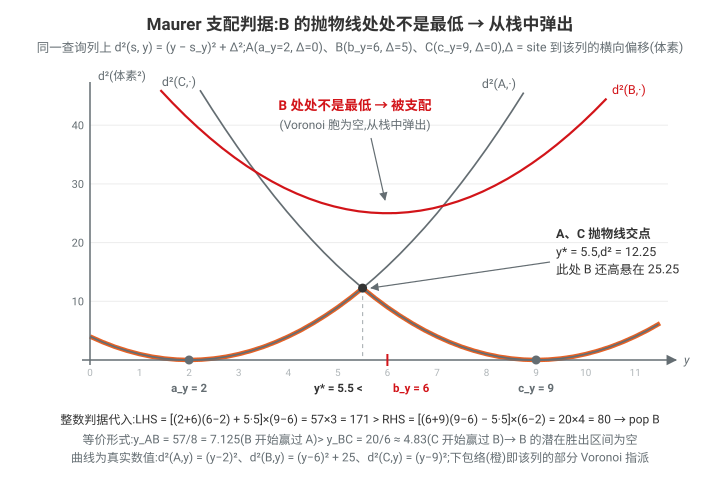

整个传播 = **5 次固定 kernel launch(3 个唯一 kernel)**:FloodZ → Maurer → Color → Maurer → Color,与场景内容无关 → CUDA graph 兼容;结果是**精确** Euclidean Voronoi 图,不像 JFA 那样需要 $\lceil\log_2 N\rceil + 3$ 轮且在对抗构型下会漏 site。Python 封装:`ParallelBandingEDT.propagate` — `perception/mapper/esdf/edt_parallel_banding.py:62-78`(JFA 备选:`esdf/edt_jump_flooding.py`,由 `edt_solver` 配置切换,`integrator_esdf.py:178, 472-483`)。传播完成后由存储的 site 坐标计算欧氏距离(见 Stage 3 kernel)。

#### Stage 3:Sign Recovery(符号恢复)

PBA+ 只给**无符号**距离;难点是给截断带之外的体素恢复符号。规则:

- **深度 TSDF**:深度只看到前表面(open surface),截断带外假定为正(外部);
- **水密解析 primitive**:surface site 恰在零穿越处,TSDF 符号不明确。解法是采一个 **adjacent voxel**——从 site 沿 site→query 方向偏移若干体素的点。它与 query 在表面同侧,其 TSDF 符号无歧义:负 → 内部,正 → 外部。**关键:adjacent 查找只采样静态(geometry)通道**,因为只有水密 primitive 在离开表面处有可靠符号;深度融合的面是开放的、截断带外符号未定义。adjacent 查找失败(如落在未分配 block)则回退到 query 体素自身的 combined SDF;完全无观测的体素默认正(外部)。

**距离与符号公式**(设 query cell $\mathbf q$,其最近 site $\mathbf s$,$k$=`adjacent_skip_steps`,默认 1.0):

$$
d_{\text{EDT}}(\mathbf q) = \|\mathbf q - \mathbf s\|\; v_{\text{esdf}},
\qquad
\mathbf a = \mathbf s + \operatorname{round}\!\Bigl(k\,\frac{\mathbf q - \mathbf s}{\|\mathbf q - \mathbf s\|}\Bigr)
$$

$$
\operatorname{ESDF}(\mathbf q) =
\begin{cases}
\operatorname{sign}\bigl(\phi_{\text{geom}}(\mathbf a)\bigr)\, d_{\text{EDT}}, & \phi_{\text{geom}}(\mathbf a) \text{ 有效(adjacent,静态通道)}\\[2pt]
\operatorname{sign}\bigl(\phi(\mathbf q)\bigr)\, d_{\text{EDT}}, & \text{否则若 } \phi(\mathbf q)=\min(\phi_{\text{depth}},\phi_{\text{geom}}) \text{ 有效(fallback)}\\[2pt]
+\, d_{\text{EDT}}, & \text{无观测(默认外部)}
\end{cases}
$$

代码:`compute_esdf_from_min_tsdf_kernel` — `builder_esdf.py:412`:

- 解 packed site 坐标(10bit/轴):`builder_esdf.py:437-439`;
- 欧氏距离 `dist_voxels * esdf_vs`:`builder_esdf.py:441-446`;
- adjacent 采样(`round(d̂ · skip_steps)` 偏移,**只查静态通道** `lookup_static_sdf_at_esdf_coords`):`builder_esdf.py:450-471`;
- fallback 到 query 处 combined SDF(`lookup_combined_sdf_at_esdf_coords`):`builder_esdf.py:473-482`;
- 符号翻转 `if tsdf_sdf < 0: edt_dist = -edt_dist`:`builder_esdf.py:488-491`;无 site 的 cell 写 1e4(远距):`builder_esdf.py:433-435`。
- `adjacent_skip_steps` 配置:`integrator_esdf.py:174-176`。

> **一个具体例子:水密箱体内外各一个查询**(2D 切片,$v_{\text{esdf}} = 5$ mm,$k = 1$)。箱体被 stamp 进静态通道,壁上一圈体素是 surface site:
>
> - **内部查询** $\mathbf q = (10, 4)$:PBA 给出最近 site $\mathbf s = (10, 8)$(正上方箱壁上),$d_{\text{EDT}} = \|\mathbf q - \mathbf s\|\, v_{\text{esdf}} = 4 \times 5\text{ mm} = 2$ cm。方向 $(\mathbf q - \mathbf s)/\|\cdot\| = (0, -1)$,adjacent $\mathbf a = \mathbf s + \operatorname{round}\bigl(1.0 \times (0,-1)\bigr) = (10, 7)$——从壁上向 q 一侧退一个体素,仍在截断带内、静态通道有值。查符号:$\phi_{\text{geom}}(10,7) < 0$(壁内侧)→ $\operatorname{ESDF}(\mathbf q) = -2$ cm。
> - **外部查询对照** $\mathbf q' = (10, 12)$:最近 site 同为 $\mathbf s$,方向 $(0, +1)$,$\mathbf a' = (10, 9)$ 在壁外侧,$\phi_{\text{geom}}(10,9) > 0$ → $\operatorname{ESDF}(\mathbf q') = +2$ cm。**同一个 site、同样 4 体素距离,符号完全由 adjacent 落在表面哪一侧决定**——这就是"adjacent 与 query 同侧、符号无歧义"的含义。$k = 1$ 的偏移刻意很小,保证 $\mathbf a$ 不越出 ±τ 截断带(带外静态通道无数据,见 §5.2.2 的"带外不写")。若 $\mathbf a$ 仍落在未分配 block,则 fallback 到 q 自身 combined SDF 的符号;q 附近完全无观测则默认正(外部)。
>
> 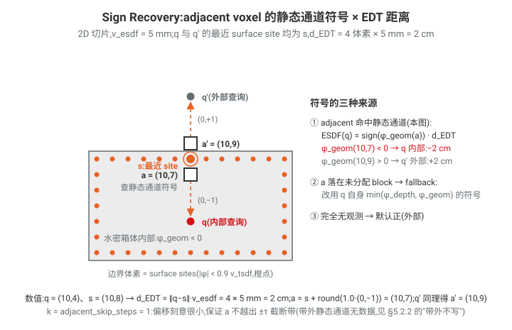
>
> **顺带:查询端三线性插值的小例**。设 query 落在 8 个 ESDF 角点围成的 cell 内,小数部 $(f_x, f_y, f_z) = (0.5, 0.25, 0.5)$,角点值 $s_{ijk} = 10 + 5i + 4j + 2k$(mm,即沿 x/y/z 相邻角点差 5/4/2 mm)。角点差恒定时插值场是仿射的,代入插值公式得 $\phi(\mathbf q) = 10 + 5(0.5) + 4(0.25) + 2(0.5) = 14.5$ mm;解析梯度 $\partial\phi/\partial x = \sum_{jk}(s_{1jk} - s_{0jk})\, w_{jk} \big/ v_{\text{esdf}} = 5\text{ mm} / 5\text{ mm} = 1.0$(双线性权重 $w_{jk}$ 和为 1)——真欧氏距离场沿最近表面方向的梯度模长恰为 1,角点值正是按此构造的。角点差不同时,梯度随 $(f_y, f_z)$ 连续变化,且与插值场严格一致(非有限差分近似)。

#### 查询:三线性插值与解析梯度

生成的 `dist_field`(fp16,`(nx,ny,nz)` X-slowest 布局,与碰撞 kernel 内存布局一致、免转置)经 `get_voxel_grid()` 包装成 `VoxelGrid` 直接供碰撞检查(`integrator_esdf.py:894-922`)。查询端(碰撞代价)在 `curobo/_src/geom/data/data_voxel.py:796` 的 `sample_voxel_sdf_with_grad`:

设连续体素坐标小数部 $(f_x, f_y, f_z)$、8 个角点值 $s_{ijk}$,**三线性插值**:

$$
\phi(\mathbf q) = \sum_{i,j,k \in \{0,1\}} s_{ijk}\;
\bigl[(1{-}i) + (2i{-}1)f_x\bigr]
\bigl[(1{-}j) + (2j{-}1)f_y\bigr]
\bigl[(1{-}k) + (2k{-}1)f_z\bigr]
$$

(展开式在 `data_voxel.py:887-897`)。**解析梯度 = 沿该轴差分的双线性插值**(与插值场严格一致,非有限差分近似):

$$
\frac{\partial \phi}{\partial x} = \frac{1}{v_{\text{esdf}}}\sum_{j,k} \bigl(s_{1jk} - s_{0jk}\bigr)\, w_{jk}(f_y, f_z),
\qquad w_{jk} \text{ 为双线性权重}
$$

(`data_voxel.py:899-920`,y/z 同理;边界体素用 validity 加权的慢路径 `data_voxel.py:924` 起)。这正是论文说的 "$O(1)$ trilinear distance queries"。拿到 ESDF 后,碰撞约束按有符号距离步进做时步间近似 swept-volume 检查,代价用 CHOMP speed metric(梯度按速度缩放,加速逃离碰撞)——这一段属于代价函数一侧,不在 mapper 目录内。

#### 补充:碰撞代价怎么"用"ESDF——swept-sphere 与 CHOMP speed metric(代码考察)

上面只回答了"距离怎么查",这里补上"距离怎么变成代价与梯度"。调用链:`SceneCollisionCost.forward`(`use_sweep=True` 时走 `_sweep_fn`,`cost_scene_collision.py:81-91`)→ `get_swept_sphere_distance` → 自定义 autograd `SweptSphereObstacleCollision`(`wp_autograd.py:124-226`)→ Warp kernel `swept_sphere_obstacle_collision_kernel`(每个 (球, 时刻, 障碍物) 组合一个线程,2D 并行,`wp_sweep_collision_kernel.py:84`)+ 可选的 `apply_speed_metric` 后处理(`wp_speed_metric.py:10`)。三种障碍表示(cuboid/mesh/voxel-ESDF)靠 Warp 函数重载共用同一个 kernel——mapper 产出的 `VoxelGrid` 走的就是 §5.4 的三线性插值重载。

**单点代价:activation 分段函数**。定义穿透量 $p = (r + \eta) - \phi(\mathbf x)$,其中 $r$ 是机器人球半径、$\eta$ 是 `activation_distance`(`load_sphere_query` 里 `radius_adjusted = r + η`,`wp_collision_common.py:80`;kernel 中 `penetration = -sdf + radius_adjusted`,`wp_sweep_collision_kernel.py:181`)。代价是**近距二次、穿透线性**的 C¹ 分段函数(`apply_collision_activation`,`wp_collision_common.py:26-38`):

$$
c(p) = \begin{cases}
0, & p \le 0 \\[2pt]
\dfrac{p^2}{2\eta}, & 0 < p \le \eta \\[6pt]
p - \dfrac{\eta}{2}, & p > \eta
\end{cases}
\qquad
\frac{dc}{dp} = \begin{cases} 0 \\ p/\eta \\ 1 \end{cases}
$$

两支在 $p = \eta$ 处值($\eta/2$)与斜率($1$)都连续。分段的几何含义很干净:$p \in (0, \eta]$ ⇔ 球面离障碍表面还有 $0\ldots\eta$ 的余隙——**还没碰上就已经产生排斥梯度**,且从 0 光滑启动(二次段);$p > \eta$ ⇔ $\phi < r$,真穿透,转为线性(梯度饱和为常数,避免深穿透时梯度爆炸)。这就是 `activation_distance` 的全部作用:提前 $\eta$ 排斥,既让优化器学会绕行而不是贴着表面擦过,也保证优化后按更细时间步重插值时不会撞上(cfg 注释,`cost_scene_collision_cfg.py:34-36`)。B-spline trajopt 配置取 $\eta = 2.5$ mm、weight $= 10^5$(`lbfgs_bspline_trajopt.yml:41-45`)——与 §5 mapper 的毫米级 ESDF 精度是配套的。

梯度方向:SDF 重载返回**归一化的 $-\nabla\phi$**(指向障碍内部;voxel 版 `data_voxel.py:1213-1218`,cuboid 版 `data_cuboid.py:604-631`),buffer 里累加的是 $\partial c/\partial\mathbf x = \tfrac{dc}{dp}\,(-\widehat{\nabla\phi})$,梯度下降沿其反方向即把球心推离障碍。注意 kernel 声明 `enable_backward=False`(`wp_sweep_collision_kernel.py:83`):梯度在前向就解析算好存进 buffer,backward 只是把它取出来乘上游梯度(`wp_autograd.py:228-236`)——和 §4.6 B-spline kernel 一样的"手写融合"套路,不走 autograd 图。

**swept 检查:沿球心连线的自适应 sphere-marching**。离散时步之间机器人可能"跳过"薄障碍,所以每个时刻的球除查自身位置外,还沿球心连线向前一时刻、后一时刻各行进采样最多 `SWEEP_STEPS = 3` 个点(`wp_sweep_collision_kernel.py:75,188-254`),且**只扫到连线中点**(`half_dist`,`:197,203`)为止——另一半归邻居时刻自己的 sweep 负责,恰好无缝拼接不重复。采样间距不是均匀的,而是标准的 sphere marching:

- 无接触($p \le 0$)时前进 $\max(-p,\; r+\eta)$(`:222`):$-p$ 是球面到激活面的余隙,而 ESDF 的语义保证"以查询点为球心、半径 $\phi$ 的球内无障碍",这段路程可以**安全跳过**——这正是碰撞检查要用 ESDF 而不是布尔占据的核心理由;$\phi$ 为远距哨兵值(≥1000)时保守前进 $r+\eta$(`:219-221`);
- 接触($p > 0$)时记入代价与梯度后前进 $p$(`:217`):穿透越深步子越大,浅穿透处采样自动加密;
- 插值参数 $t = 1 - \tfrac{\text{jump}}{2\,\text{half\_dist}}$(`:203`),`jump` 即沿连线累计前进的欧氏距离;每个方向的首个采样落在当前球心自身($\text{jump}=0 \Rightarrow t=1$),接触中的球会被主查询+两方向首采样计 3 次——等效于给"当前时刻正在碰撞"更高权重。

注意 sweep 本身**纯几何**(位置空间采样,与 dt 无关);速度从下面的后处理进来。

**CHOMP speed metric**(`apply_speed_metric`,`wp_speed_metric.py:10-92`;开关 `use_speed_metric`,思想即 CHOMP ICRA'09,cfg 注释 `cost_scene_collision_cfg.py:29-32`)。所有障碍物的代价/梯度原子累加完毕后,再对每个 (球, 时刻) 跑一遍后处理:中央差分估计球心速度 $\dot{\mathbf x} = \tfrac{\mathbf x_{h+1} - \mathbf x_{h-1}}{2\,dt}$(`:63`)与加速度 $\ddot{\mathbf x} = \tfrac{\mathbf x_{h+1} + \mathbf x_{h-1} - 2\mathbf x_h}{dt^2}$(`:76`),记投影算子 $P = I - \hat v\hat v^\top$($\hat v = \dot{\mathbf x}/\|\dot{\mathbf x}\|$),则

$$
\tilde c = \|\dot{\mathbf x}\|\, c,
\qquad
\tilde{\mathbf g} = \|\dot{\mathbf x}\| \Bigl[ P\,\nabla c \;-\; c\,\boldsymbol\kappa \Bigr],
\qquad
\boldsymbol\kappa = \frac{P\,\ddot{\mathbf x}}{\|\dot{\mathbf x}\|^2}
$$

(`:78-86` 逐项对应:`orth_g`、`orth_curv`、`new_g = sph_vel * (orth_g - d * orth_curv)`)。这正是 CHOMP 障碍泛函 $\int c(\mathbf x)\,\|\dot{\mathbf x}\|\,dt$(**弧长积分**)的泛函梯度。三个因子各有明确的物理意义:

- $c\,\|\dot{\mathbf x}\|$ 把"每时刻代价"变成"每米代价"。不乘速度的话,时间离散求和的碰撞代价可以靠**加速冲过障碍区**来稀释(落在障碍附近的时步变少);乘上 $\|\dot{\mathbf x}\|$ 后代价对重新参数化不变,冲得越快罚得越重,优化器只能选择**空间上绕行**——这就是"梯度按速度缩放,加速逃离碰撞"的准确含义;
- $P$ 投影掉梯度沿运动方向的分量:沿切向挪动球心只改变时间参数化、不改变几何路径,对拉开障碍距离毫无贡献,留着只会与平滑/时间项打架;
- $-c\,\boldsymbol\kappa$ 是曲率修正:轨迹在障碍附近弯曲时,横向移动同时改变弧长,该项补齐弧长变化的贡献,使 $\tilde{\mathbf g}$ 严格是弧长泛函的最速下降方向。

边界时刻($h = 0$、$h = H{-}1$)无中央差分邻居,跳过(`:46-47`);无接触($d \le 0$)提前返回(`:71`);`speed_dt` 就是该批次轨迹的 dt(`cost_manager_robot.py:278-282` 传入 `state.joint_state.dt`)。

> **数值例(一个球、三个相邻时刻,python3 验证)**。障碍:球形,中心 $(0.40, 0, 0.10)$、$R_{\text{obs}} = 8$ cm(ESDF 为 $\phi(\mathbf x) = \|\mathbf x - \mathbf o\| - R_{\text{obs}}$);机器人球 $r = 4$ cm、$\eta = 1$ cm(便于手算;真实配置 2.5 mm),$r + \eta = 5$ cm;球心轨迹沿 $x$ 匀速直线:$\mathbf x_{h-1} = (0.30, 0, 0.20)$、$\mathbf x_h = (0.40, 0, 0.20)$、$\mathbf x_{h+1} = (0.50, 0, 0.20)$,$dt = 0.05$ s。weight 取 1(真实值再整体乘 $10^5$)。
>
> **主查询**($\mathbf x_h$,恰在障碍正上方):$\phi = 0.10 - 0.08 = 2$ cm,$p = 5 - 2 = 3$ cm $> \eta$ → 线性段,$c = 0.03 - 0.005 = 0.025$,$\tfrac{dc}{dp} = 1$,$-\widehat{\nabla\phi} = (0, 0, -1)$(指向正下方的障碍)。对照二次段:若 $\phi = 4.7$ cm 则 $p = 3$ mm $\in (0, \eta]$,$c = \tfrac{0.003^2}{2 \times 0.01} = 4.5\times10^{-4}$、斜率 $0.3$——缓冲带内代价从零软启动。
>
> **向 $h{+}1$ sweep**:$\text{half\_dist} = 5$ cm。样本 1:$\text{jump} = 0$ → 球心自身,再记 $c = 0.025$,$\text{jump} \mathrel{+}= p = 3$ cm。样本 2:$t = 1 - \tfrac{0.03}{0.10} = 0.7$ → $(0.43, 0, 0.20)$,$\phi = \sqrt{0.03^2 + 0.10^2} - 0.08 = 2.440$ cm,$p = 2.560$ cm → $c = 0.02060$、梯度贡献 $(-0.287, 0, -0.958)$;$\text{jump} = 5.56$ cm $\ge \text{half\_dist}$ → 终止(3 步上限没用完,自适应提前收工)。向 $h{-}1$ 完全对称($x$ 分量反号)。
>
> **累加**(该球该时刻):$d = 0.025 \times 3 + 0.0206 \times 2 = 0.1162$,$\mathbf g = (0, 0, -4.916)$——两个 sweep 样本的 $x$ 分量对称抵消,合梯度垂直指向障碍。
>
> **speed metric**:$\dot{\mathbf x} = \tfrac{(0.50,0,0.20)-(0.30,0,0.20)}{2 \times 0.05} = (2, 0, 0)$ m/s,$\|\dot{\mathbf x}\| = 2$;三点等距共线 → $\ddot{\mathbf x} = 0$、曲率项为零;$\mathbf g \perp \hat v$ → 投影不变。于是 $\tilde c = 2 \times 0.1162 = 0.2324$、$\tilde{\mathbf g} = (0, 0, -9.831)$。**同样的几何,速度翻倍则代价与推力翻倍**:下降方向 $-\tilde{\mathbf g} = (0,0,+)$ 把快速掠过障碍顶的球更用力地向上推开。若轨迹在此处拐弯(三点不共线),$-c\boldsymbol\kappa$ 项还会把弯的外侧推离障碍。

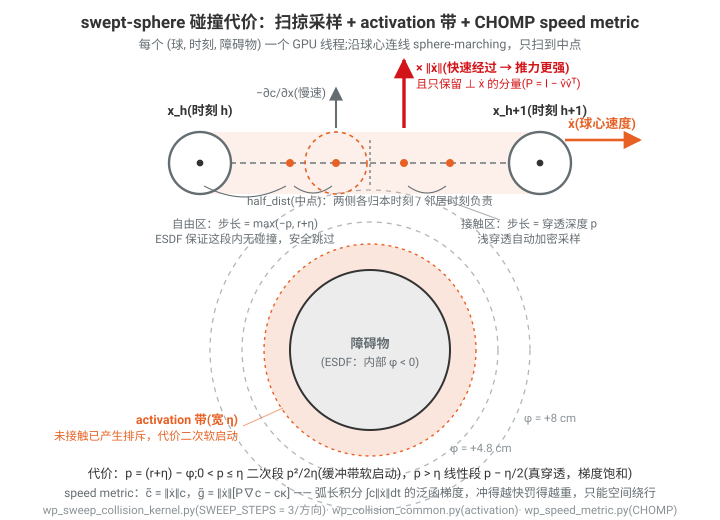

整条链路每次优化迭代对(球 × 时刻 × 障碍物)全并行,每线程至多 $1 + 3 + 3 = 7$ 次 SDF 调用——§7.2 Table 4 里 swept-sphere 占 kernel 时间 11.1%,mapper 侧把 ESDF 查询做成 $O(1)$ 三线性插值,正是为了喂饱这里的吞吐。

---

### 5.x 本节小结(论文主张 ↔ 代码证据)

| 论文主张                                                  | 代码证据                                                                                  |
| --------------------------------------------------------- | ----------------------------------------------------------------------------------------- |
| 8³ block + CAS 哈希 + free list,峰值内存有界             | `storage.py:82,118,506-559`;`builder_hash.py:86-380`;`builder_decay.py:323-363`     |
| 每体素 fp16 双通道,查询取 min                             | `storage.py:526,534`;`wp_tsdf_sample.py:78-101`                                       |
| Voxel-Project 4 阶段、零原子积分、面积权重$w=\max(c,1)$ | `wp_integrate_camera_project.py:27-216,534-763`;`builder_camera_integrate.py:471-557` |
| primitive AABB→筛选→stamp min-SDF                       | `builder_stamp.py:64-65,186,220,266-318`                                                |
| 式(18) 两级衰减 + 包围球视锥测试 + 墓碑回收               | `wp_decay.py:111-149,152-291`;`builder_decay.py:112-212,323-363`                      |
| gather 7 点 stencil、固定 launch、全流水线单 CUDA graph   | `builder_esdf.py:308-406`;`integrator_esdf.py:503-517,755-765`                        |
| PBA+ 5 launch 精确 EDT(Maurer 判据)                       | `pba3d_kernel.cuh:65,118,155,233`;`edt_parallel_banding.py:62-78`                     |
| adjacent-voxel 符号恢复(只用静态通道)+ fallback           | `builder_esdf.py:412-491`;`integrator_esdf.py:174-176`                                |
| O(1) 三线性查询 + 解析梯度                                | `data_voxel.py:796-1019`;`integrator_esdf.py:894-922`                                 |

一个值得注意的实现细节(论文未展开):scatter seeding 除表面体素外还把**负截断边界**($\phi < -(\tau - 1.1v)$)作为 site(`builder_esdf.py:260`),配合 Stage 3 的符号恢复,才能让厚物体内部的负距离随深入递增(而不是停留在 $-\tau$),得到真正 watertight 的内部距离场。

### 5.y 补充:障碍物建模方式与动态注入 API(代码考察)

> 本小节是对代码库的补充考察(论文未集中讨论),回答两个实用问题:**cuRoboV2 如何对障碍物建模?能否在运行时动态注入障碍物?** 结论:三条建模路线并存,动态注入有三个粒度的接口。

#### 三条障碍物建模路线

**1. 参数化几何基元(解析 SDF)** —— 公共 API 在 `curobo/scene.py`:

```python
from curobo.scene import Scene, Cuboid, Mesh, Sphere

scene = Scene(
    cuboid=[Cuboid(name="table", dims=[1.0, 1.0, 0.1], pose=[0, 0, 0.5, 1, 0, 0, 0])],
    sphere=[Sphere(name="ball", radius=0.1, pose=[...])],
    mesh=[Mesh(name="object", file_path="model.obj", pose=[...])],
)
```

支持类型:`Cuboid / Sphere / Capsule / Cylinder / Mesh / VoxelGrid`(`curobo/_src/geom/types.py`)。碰撞检查即附录 A.2 的**类型泛化 Warp kernel**:每种类型注册三个函数重载(`is_obs_enabled` / `load_obstacle_transform` / `compute_local_sdf_with_grad`),统一 kernel 在(机器人球 × 障碍物)对上并行,输出有符号距离 + 解析梯度;轨迹用 swept-sphere 做时步间扫掠检查。新增障碍物类型只需实现这三个函数,不改任何既有 kernel。

**2. 感知路线(TSDF → ESDF,本章主线)**:深度图/LiDAR 连续融合进块稀疏 TSDF,按需生成覆盖全工作空间的稠密 ESDF,经 `get_voxel_grid()` 包装成 **VoxelGrid 障碍物**接入上面同一套碰撞框架——查询变成 O(1) 三线性插值。已知几何(桌子 CAD)也可直接"盖章"进 TSDF 静态通道(`update_static_obstacles`,§5.2.2),混合"图纸 + 实测"。

**3. 抓取物挂载**:`AttachmentManager.attach() / attach_from_scene() / detach()`(`curobo/_src/collision/attachment_manager.py:182,226,284`)——抓起的物体从"环境障碍"转为"机器人的一部分"(挂到手部 link,参与自碰撞与场景避碰)。

#### 动态注入:三个粒度

**粒度 1:增删障碍物(结构变化,较重)**

```python
scene.add_obstacle(Sphere(name="new_ball", radius=0.2, pose=[...]))  # types.py:1347
scene.remove_obstacle("old_ball")                                     # types.py:1416
planner.update_world(scene)   # 重载碰撞模型
```

`MotionPlanner.update_world()`(`_src/motion/motion_planner.py:606`)重载 collision model 并重置 graph planner 缓冲;IK 求解器有同名接口(`solver_ik.py:757`)。适合"换场景",不适合每个控制周期调。

**粒度 2:改已有障碍物(轻量,控制频率可用)** —— 不重载模型,直接改 GPU 缓冲:

- `update_obstacle_pose(name, pose)`(`_src/geom/collision/collision_scene.py:390`)——传送带工件、被推走的箱子;
- `enable_obstacle(name, enable)`(`collision_scene.py:405`)——瞬间启用/禁用某个障碍(如抓取目标在接近阶段临时排除出避障列表)。

缓冲区预分配、兼容 CUDA graph,可放进 MPC 循环。

**粒度 3:感知流(完全非结构化的动态障碍)** —— 即 §7.7 真机演示的做法:人手伸进工作空间,深度相机 15 Hz 连续积分,毫秒级 TSDF 更新 + frustum decay(§5.3)自动清除移走的物体,MPC 每周期查询最新 ESDF 实时绕开。**不需要"告诉"系统有什么障碍——看见什么躲什么**。

另外支持**批量环境**:碰撞查询带 `env_query_idx` 参数(`collision_robot_scene.py`),同一批次不同轨迹可对不同环境做检查(并行规划多场景)。

#### 选型建议

| 场景 | 推荐路线 |
|---|---|
| 已知静态工作站(围栏、货架) | 基元 Scene,或 stamp 进 TSDF 静态通道换 O(1) 查询(规划提速 19%,§7.6) |
| 位姿已知但会动的刚体(AGV 送来的料箱) | 基元 + `update_obstacle_pose` |
| 未知/非结构化动态障碍(人、杂物) | 深度相机 → TSDF/ESDF 流 |
| 抓着东西运动 | `AttachmentManager.attach` |

实践注意:粒度 1 的 `update_world` 受初始分配的缓存容量约束(障碍物数超过 cache 时需 `clear_scene_cache()` 重建),若预期频繁增删,应提前开大 cache,之后尽量走 enable/disable + pose 更新的轻量路径。

---

## 6. 面向高自由度机器人的扩展（Scaling to High-DoF Robots）

> 论文位置：cuRoboV2 第 13–19 页，Section 6。代码对照基于仓库 `/home/mujin/MotionPlanning/curobo`（官方 cuRobo 源码，kernel 位于 `curobo/_src/curobolib/kernels/`，Python 调度位于 `curobo/_src/curobolib/cuda_ops/` 与 `curobo/_src/curobolib/backends/`）。

### 6.0 问题背景与五项关键创新

把运动优化扩展到人形机器人（48-DoF）这类高自由度系统，会遇到简单机械臂上不存在的四类困难：

1. **分支运动学树（branching kinematic trees）**：多个末端执行器（双手、双脚、头）的 Jacobian 必须并行计算（论文 Fig. 7c）；
2. **自碰撞对数量随连杆数二次增长**：Franka 7-DoF 只有 818 对球-球检查，而 48-DoF 的 G1 人形有 **162k 对**，朴素的逐对查询变成 memory-bound 并被串行化；
3. **执行器力矩限制（actuator torque limits）**：要求在优化循环内部运行**可微逆动力学**；
4. **Mimic 关节**：一个执行器机械耦合多个连杆（Fig. 7b，如 $\theta_2=\alpha_2\theta_1+\beta_2$）。

论文提出五项创新（与本节小节一一对应）：

| # | 创新                                                                          | 论文小节 | 核心代码                                                                    |
| - | ----------------------------------------------------------------------------- | -------- | --------------------------------------------------------------------------- |
| 1 | FK 的自适应 kernel 派发（简单机器人单融合 kernel / 复杂机器人两 kernel 拆分） | 6.1.1    | `kernels/kinematics/kinematics_forward_kernel.cuh`                        |
| 2 | 预计算拓扑缓存（topology cache）实现并行梯度反传                              | 6.1.2    | `kernels/kinematics/kinematics_backward_kernel.cuh`                       |
| 3 | 两级过滤的稀疏 Jacobian（支持分支树与 mimic 关节）                            | 6.1.3    | `kernels/kinematics/kinematics_forward_helper.cuh:45`                     |
| 4 | 融合 map-reduce 自碰撞 kernel（memory-bound → compute-bound）                | 6.2      | `kernels/geometry/self_collision/self_collision_kernel.cuh`               |
| 5 | 可微逆动力学引擎（RNEA），在优化内部直接施加力矩限制                          | 6.3      | `kernels/dynamics/rnea_forward_kernel.cuh` / `rnea_backward_kernel.cuh` |

---

### 6.1 运动学改进（Kinematics Improvements）

#### 6.1.1 前向运动学：自适应 kernel 派发

一次 FK 调用需要产出五种量：**帧变换（frame transforms）、工具位姿（tool poses）、碰撞球位置、质心（CoM）、Jacobian**。cuRobo v1 用一个融合 kernel 一次算完帧变换和球位置，但每个 batch 元素只用 4 个线程并行，且不支持 CoM 与 Jacobian。

cuRoboV2 按机器人复杂度自适应派发（论文 Fig. 8）：

- **简单机器人（碰撞球 ≤ 100）**：单融合 kernel 内在同一次 launch 中依次完成「初始化基座 → 帧变换 → 球变换 → 工具位姿 → CoM → Jacobian」；
- **复杂机器人（球 > 100，如双臂/人形）**：拆成两个 kernel。**Kernel 1** 由关节角计算帧变换并写入全局显存；**Kernel 2** 读回这些变换，用**远多于 4 个的线程**并行计算球位置、工具位姿、CoM 与 Jacobian。融合 kernel 中所有阶段被 4 线程串行化，而拆分后第二个 kernel 的线程数可以随球数和连杆数扩展，大幅缩短计算时间。

**代码对照**（本仓库快照中「拆分」体现为 kernel 内的多相位结构 + 可扩展的输出线程数 + 保存到全局显存的帧变换契约）：

- 三个 FK kernel 变体：
  - `curobo/_src/curobolib/kernels/kinematics/kinematics_forward_kernel.cuh:21` `kinematics_forward_kernel<N_LINKS, COMPUTE_COM>`（无球，只算帧变换/工具位姿/CoM）；
  - 同文件 `:131` `kinematics_forward_spheres_kernel<N_LINKS, OUTPUT_THREADS_PER_BATCH, WRITE_GLOBAL_CUMUL, COMPUTE_COM>`；
  - 同文件 `:268` `kinematics_forward_spheres_jacobian_kernel<...>`（额外输出 Jacobian）。
- kernel 内两相位结构（对应论文的 Kernel 1 / Kernel 2 职责划分）：
  - **相位 1**：`kinematics_forward_helper.cuh:396` `compute_local_link_transforms` —— block 内**全部线程**并行计算每个连杆的局部变换 $T_k^{local}(q)$（每线程一个 link，跨 batch 条带化）；
  - **相位 2**：`kinematics_forward_helper.cuh:488` `compute_cumulative_transforms_halfwarp` —— 每个 batch 用 **16 线程（半 warp）**沿 `linkMap`（父连杆索引表）串行地做累积乘 $T_k = T_{\text{parent}(k)}\cdot T_k^{local}$，其中 12 个线程各负责 3×4 矩阵的 1 个元素（`compose_link_transform_halfwarp`，`:437`）：每个元素是一次 float4 点积；
  - **输出阶段**：`transform_robot_spheres`（`:218`）、`write_link_poses`（`:270`）、`write_center_of_mass_tile`（`:539`，warp shuffle 归约质量加权 CoM）、`write_kinematic_jacobian`（`:45`）以 `OUTPUT_THREADS_PER_BATCH ∈ {32, 64, 128}` 个线程并行——这正是"随球数扩展线程数"的实现（`backends/cuda_core_backend/kinematics.py:121` 校验该参数）。
- 帧变换写入全局显存供后续 kernel 复用：`write_cumul_to_global_mem` / `write_cumulative_transforms_active`（forward 写 `global_cumul_mat`），**反向 kernel 直接读回**（"saved-cumul contract"，见 `kinematics_backward_kernel.cuh:26` 注释），避免反向重算 FK——这就是"第一个 kernel 算变换、第二个 kernel 读变换"的另一处体现。
- Python 侧派发：`curobo/_src/curobolib/cuda_ops/kinematics.py:159-237` 按 `compute_jacobian` / `num_spheres > 0` 三路选择 kernel；`backends/cuda_core_backend/kinematics.py:137-141` 按 `num_links` 做 **C++ 模板实例化**（编译期展开循环），即论文所说 runtime 绑定 + 编译期特化的折中。

#### 6.1.2 并行梯度反传（Algorithm 1：Backprop with Topology Cache）

自适应派发加速了前向，但**反传仍是瓶颈**：每个连杆上的梯度必须推回其**所有祖先关节**。人形右手上的梯度只影响右臂和躯干的关节——利用这种**运动学稀疏性**，cuRoboV2 在 link 级并行：warp 内每个线程负责一部分 link，借助预计算的**拓扑缓存**以 $O(1)$ 取得任意 link 的有序祖先表，只遍历相关链。

**Algorithm 1 逐行抄录与解释**（输入：link 梯度 $\nabla_{p_\ell}\mathcal{L}, \nabla_{q_\ell}\mathcal{L}$ 与帧变换 $T_\ell$；输出：关节梯度 $\nabla_q\mathcal{L}$）：

$$
\begin{aligned}
&1:\ \texttt{local\_grad} \leftarrow 0 &&\triangleright\ \text{每线程私有的全关节梯度累加器}\\
&2:\ \textbf{for each } \text{link } \ell\ (\text{warp 内并行线程})\ \textbf{do}\\
&3:\quad \textbf{if } \text{link 梯度非零 } \textbf{then} &&\triangleright\ \text{稀疏性早退}\\
&4:\qquad \textbf{for each } j_{\text{link}} \in \texttt{linkChain}[\ell]\ \textit{逆序}\ \textbf{do} &&\triangleright\ \text{只沿拓扑缓存中的祖先链}\\
&5:\qquad\quad j \leftarrow \texttt{jointMap}[j_{\text{link}}] &&\triangleright\ \text{link}\to\text{被驱动关节（处理 mimic）}\\
&6:\qquad\quad g \leftarrow B(\nabla_{p_\ell}\mathcal{L},\ T_\ell) &&\triangleright\ \text{用帧变换与关节模型投影 link 梯度}\\
&7:\qquad\quad \texttt{local\_grad}[j]\ {+}{=}\ g &&\triangleright\ \text{累加（mimic 关节共享同一 } j\text{）}\\
&8:\ \nabla_q \leftarrow \texttt{WarpReduceSum}(\texttt{local\_grad})
\end{aligned}
$$

投影算子 $B(\cdot)$ 的具体形式：设关节 $j$ 的世界系旋转轴为 $\omega_j$（从累积变换 $T_j$ 的对应旋转列读出，乘符号/mimic 系数 $\alpha_j$）、关节原点为 $p_j$，被求导点（球心/工具原点）为 $p_s$，则

$$
\text{revolute:}\quad \frac{\partial p_s}{\partial q_j} = \omega_j \times (p_s - p_j),\qquad
g = \nabla_{p_s}\mathcal{L} \cdot \big(\omega_j \times (p_s - p_j)\big);
$$

$$
\text{prismatic:}\quad \frac{\partial p_s}{\partial q_j} = d_j,\qquad g = \nabla_{p_s}\mathcal{L} \cdot d_j .
$$

姿态梯度先经四元数→角速度的转换 $\nabla_\omega = G(\bar q)\,\nabla_{\bar q}$（代码 `common/quaternion_util.cuh:86` `quaternion_gradient_to_angular_velocity`），再对旋转关节加上 $\nabla_\omega\cdot\omega_j$ 项。

> **数值例子（2-link 平面臂）：投影算子与 Jacobian 列的具体值**
>
> 平面 2-link 臂，两关节转轴均为世界系 $z$ 轴（$\omega_1=\omega_2=(0,0,1)$），杆长 $L_1=0.4$ m、$L_2=0.3$ m，关节角 $q_1=30°$、$q_2=45°$。FK 给出关节原点与末端位置：
>
> $$
> p_1=(0,0,0),\qquad
> p_2=(L_1\cos 30°,\ L_1\sin 30°,\ 0)=(0.3464,\ 0.2000,\ 0),
> $$
>
> $$
> p_e=p_2+\big(L_2\cos 75°,\ L_2\sin 75°,\ 0\big)=(0.4241,\ 0.4898,\ 0).
> $$
>
> 两个关节的 Jacobian 列（即 6.1.3 单列解析式的位置部分）：
>
> $$
> \frac{\partial p_e}{\partial q_1}=\omega_1\times(p_e-p_1)=(0,0,1)\times(0.4241,\ 0.4898,\ 0)=(-0.4898,\ 0.4241,\ 0),
> $$
>
> $$
> \frac{\partial p_e}{\partial q_2}=\omega_2\times(p_e-p_2)=(0,0,1)\times(0.0777,\ 0.2898,\ 0)=(-0.2898,\ 0.0777,\ 0).
> $$
>
> 两列模长分别为 $\|p_e-p_1\|=0.648$ 与 $\|p_e-p_2\|=0.300$：**离末端越远的关节杠杆越长**（列向量垂直于连线 $p_j\to p_e$，长度就是杠杆半径）。设上游梯度 $\nabla_{p_e}\mathcal{L}=(1,0,0)$（代价想增大末端 $x$），投影算子 $B(\cdot)$ 给出的关节梯度就是两个点积：
>
> $$
> g_1=\nabla_{p_e}\mathcal{L}\cdot\big(\omega_1\times(p_e-p_1)\big)=-0.4898,\qquad
> g_2=\nabla_{p_e}\mathcal{L}\cdot\big(\omega_2\times(p_e-p_2)\big)=-0.2898 .
> $$
>
> 与解析 FK 求导对照：$x_e=L_1\cos q_1+L_2\cos(q_1{+}q_2)$，故 $\partial x_e/\partial q_1=-L_1\sin 30°-L_2\sin 75°=-0.4898$、$\partial x_e/\partial q_2=-L_2\sin 75°=-0.2898$，完全一致。负号的物理含义：正转任一关节都会让末端 $x$ 减小。
>
> 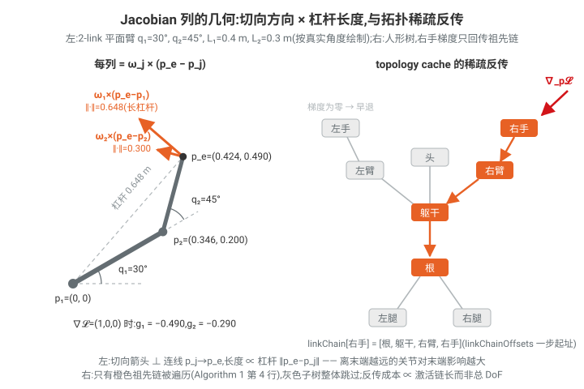
>
> **拓扑稀疏性**：这个小例子里两个关节都恰好在末端的祖先链上，而 48-DoF 人形上情况完全不同——右手球心上的一个梯度只应回传到右腕→右肘→右肩→躯干→根这一条链上的十来个关节，左臂、双腿、头部的 30 多个关节偏导恒为零。Algorithm 1 的 topology cache 把每个 link 的有序祖先表预打包成 CSR：`linkChainOffsets[ℓ]` 一步取到链的起止地址，线程拿到右手梯度后只遍历这条短链，而不是对全部 48 个关节逐个判断"是否祖先"。配合第 3 行的零梯度早退，反传成本正比于"被激活的链长"而非机器人总 DoF。

**代码对照**：

- 主 kernel：`kernels/kinematics/kinematics_backward_kernel.cuh:34` `kinematics_backward_kernel<scalar_t, psum_t, MAX_JOINTS, USE_WARP_REDUCE, COMPUTE_COM, COMPUTE_JACOBIAN_GRAD>`。结构与 Algorithm 1 完全对应：

  - `:83-89` 每线程寄存器数组 `psum_grad[MAX_JOINTS]` 清零（第 1 行）；
  - `:92-96` `compute_sphere_gradients`（球梯度）、`:98-102` `compute_link_gradients`（工具位姿梯度）、`:104-114` `compute_center_of_mass_gradients`（CoM 梯度）——三者都是"warp 内按元素分线程"的第 2 行并行；
  - `:128-140` `warp_reduce_sum(psum_grad[j], threads_per_batch)` 即第 8 行 `WarpReduceSum`。
- 拓扑缓存遍历（第 4 行）：`kinematics_backward_helper.cuh:64-71`

  ```cpp
  const int16_t chain_start = linkChainOffsets[read_cumul_idx];
  const int16_t chain_end   = linkChainOffsets[read_cumul_idx + 1];
  for (int chain_idx = chain_end - 1; chain_idx >= chain_start; chain_idx--) {
      const int j = linkChainData[chain_idx];   // 实际祖先 link 索引
  ```

  `linkChainData`/`linkChainOffsets` 是 CSR 打包的祖先表（`robot/types/kinematics_params.py:53-56`），构建时预计算，kernel 中 $O(1)$ 起址、只遍历相关链——即论文的 topology cache。
- 稀疏性早退（第 3 行）：`kinematics_backward_helper.cuh:48-52`（梯度全零则 `continue`）。
- mimic 处理（第 5 行 `jointMap`）：`kinematics_backward_helper.cuh:76-77` `jointMap[j]` 把 link 映射到被驱动关节列，`jointOffset[j*2]`（即 $\alpha$，含符号）作为倍乘系数进入 `xyz_rot_backward_translation`（`kinematics_joint_util.cuh:32`）；多个 mimic link 的贡献自然累加到同一 `psum_grad[j_idx]`（第 7 行）。

#### 6.1.3 稀疏 Jacobian 计算（Algorithm 2）与 LM 求解器（Algorithm 3）

对 Levenberg–Marquardt 这类求解器需要**完整 Jacobian 矩阵**。cuRoboV2 按列并行（每线程负责一个关节 $j$ 的一列），并用**两级过滤**：

$$
\begin{aligned}
&1:\ \textbf{for each } j \in \{1,\dots,n_{joints}\}\ \textit{并行}\ \textbf{do} &&\triangleright\ \text{每线程一列}\\
&2:\quad \texttt{jac\_col} \leftarrow 0\\
&3:\quad \textbf{if } \texttt{affects}[j,e] \textbf{ then} &&\triangleright\ \textbf{粗过滤}\text{：关节 } j \text{ 是否影响目标 link } e\text{？} O(1)\\
&4:\qquad \textbf{for each } \ell \in \texttt{connectedLinks}[j] \textbf{ do} &&\triangleright\ \text{一个关节可驱动多个 link（mimic）}\\
&5:\qquad\quad \textbf{if } \ell \in \texttt{linkChain}[e] \textbf{ then} &&\triangleright\ \textbf{细过滤}\text{：该 link 是否在到 } e \text{ 的链上？}\\
&6:\qquad\qquad \texttt{jac\_col}\ {+}{=}\ \text{link } \ell \text{ 的 Jacobian 贡献}\\
&7:\quad J^e[:,j] \leftarrow \texttt{jac\_col}
\end{aligned}
$$

单列的解析形式（revolute / prismatic）：

$$
J^e_{:,j} \;=\; \sum_{\ell \in \texttt{connectedLinks}[j]\cap\texttt{linkChain}[e]}
\begin{cases}
\begin{bmatrix} \omega_\ell \times (p_e - p_\ell) \\ \omega_\ell \end{bmatrix}, & \text{revolute}\\[2ex]
\begin{bmatrix} d_\ell \\ 0 \end{bmatrix}, & \text{prismatic}
\end{cases}
$$

求和体现 mimic 耦合：同一关节列累加其驱动的所有 link 的贡献。

**代码对照**：

- 前向 Jacobian：`kernels/kinematics/kinematics_forward_helper.cuh:45` `write_kinematic_jacobian`。
  - 粗过滤（第 3 行）：`:93` `if (ee_idx >= 0 && !joint_affects_endeffector[joint_idx * n_tool_frames + ee_idx])` → 直接写零列并 `continue`；布尔缓存 `joint_affects_endeffector` 定义于 `robot/types/kinematics_params.py:73-76`；
  - 细过滤（第 4–5 行）：遍历 `jointLinksData[jointLinksOffsets[j] .. ]`（关节→link 表）并检查是否在 `linkChainData[linkChainOffsets[e] .. ]`（link e 的祖先链）中；
  - 贡献累加（第 6 行）：`jac_col[0..5] += cross(scaled_axis, ee_pos - joint_pos) / scaled_axis`，与上式一致；每线程独占一列，**无需 atomicAdd**。
- Jacobian 的**反向**（对 $\partial\mathcal{L}/\partial J$ 再对 $q$ 求导，即 $dJ/dq$ 的 VJP）：`kernels/kinematics/kinematics_jacobian_backward_helper.cuh:24` `compute_jacobian_derivatives`——同样按关节分线程 + `joint_affects_endeffector` 早退（`:68`），内部实现了 revolute-revolute（$d\omega_k = \omega_{idx}\times\omega_k$ 等，`:209-231`）与 revolute-prismatic 交叉项。

**Algorithm 3：带信赖域的 LM**。IK 本质是非线性最小二乘：最小化 $\|r\|^2$，残差 $r = T_{goal} \ominus \mathrm{FwdKin}(q)$。LM 用 $J^\top J$ 近似 Hessian：

$$
\begin{aligned}
&1:\ H \leftarrow J_k^\top J_k &&\triangleright\ \text{Gauss–Newton Hessian 近似}\\
&2:\ A \leftarrow H + \lambda_k I &&\triangleright\ \text{阻尼}\\
&3:\ \text{解 } A\,\boldsymbol\delta = -g_k &&\triangleright\ g_k=J_k^\top r_k \text{，求更新步}\\
&4:\ q^+ \leftarrow q_k + \boldsymbol\delta\\
&5:\ \text{在 } q^+ \text{ 处评估 } r^+, E^+, J^+, g^+\\
&6:\ \rho_{\text{pred}} \leftarrow \tfrac12 \boldsymbol\delta^\top(\lambda_k\boldsymbol\delta - g_k) &&\triangleright\ \text{模型预测的下降量}\\
&7:\ \rho_{\text{trust}} \leftarrow (E_k - E^+) / (\rho_{\text{pred}} + \epsilon) &&\triangleright\ \text{实际/预测 之比}\\
&8\text{–}13:\ \rho_{\text{trust}} \ge \rho_{\min} \Rightarrow \text{接受步，} \lambda_{k+1}=\mathrm{clamp}(\lambda_k/\gamma);\ \text{否则拒绝，} \lambda_{k+1}=\mathrm{clamp}(\lambda_k\gamma)\\
&14:\ \text{按位置/姿态容差判收敛}
\end{aligned}
$$

在这种最小二乘结构上 LM 比 L-BFGS 等一阶法收敛更快。**无碰撞 IK 采用两阶段策略**：先用 LM 收敛到目标位姿（不带碰撞约束），再用 L-BFGS 在自碰撞+环境约束下精修——LM 提供了目标附近的良好种子，L-BFGS 只需小幅调整而非从头搜索。（LM 求解器在 Python 优化栈 `curobo/_src/optim/` 与 `curobo/_src/solver/` 中，基于 Newton/Warp 的实现改造以使用上述稀疏 Jacobian。）

---

### 6.2 Map-Reduce 自碰撞（Self-Collision via Map-Reduce）

**问题**：cuRobo v1 在**单个 thread block** 内算自碰撞代价（把所有球载入 shared memory）。高自由度机器人下碰撞对二次增长——Franka 818 对 → 48-DoF 人形 **162k 对**——单 block 至多约 1024 线程，每线程被迫循环上百个 pair，计算被串行化且受显存带宽限制（memory-bound）。

**方案：两级 map-reduce**（论文 Fig. 9）：

1. **Map（Kernel 1）**：把碰撞对**分区到多个 block**。每个 block 把全部球载入 shared memory，对自己分到的 pair 子集算距离，block 内归约得到**局部最深穿透对**，写出（最大值 + 球对索引）；
2. **Reduce（Kernel 2）**：跨 block 归约各局部最大值，找出**全局最大穿透**，据此计算代价与梯度。

碰撞对少（≤ 1000）时退化为单 kernel 单 block 路径，避免两次 launch 的开销。

**球-球距离（融合平方形式，省一次开方）**：对球 $i,j$（球心 $c$、半径 $r$，半径已含 per-link padding offset）：

$$
f_{ij} \;=\; (r_i + r_j)^2 \;-\; \|c_i - c_j\|^2, \qquad
f_{ij} > 0 \iff \text{穿透}.
$$

**代价与梯度**（只取最深穿透对 $(i^*, j^*) = \arg\max f_{ij}$）：

$$
\mathcal{C}_{sc} = \tfrac12\, w\, \max_{ij} f_{ij},\qquad
\frac{\partial \mathcal{C}_{sc}}{\partial c_{i^*}} = w\,(c_{j^*} - c_{i^*}),\quad
\frac{\partial \mathcal{C}_{sc}}{\partial c_{j^*}} = w\,(c_{i^*} - c_{j^*}).
$$

（由 $\tfrac{\partial}{\partial c_i}\big[\tfrac12 w\,((r_i{+}r_j)^2 - \|c_i - c_j\|^2)\big] = -w\,(c_i - c_j)$ 直接得到。）该球心梯度随后经 6.1.2 的 Algorithm 1 反传到关节。

> **数值例子：前臂球 × 躯干球的一次穿透检查**
>
> 取前臂碰撞球 $c_i=(0.30,\ 0.10,\ 0.50)$、$r_i=0.05$，躯干球 $c_j=(0.30,\ 0.14,\ 0.55)$、$r_j=0.04$（单位 m，半径已含 padding）。球心距的**平方**由一次 `dot(Δ,Δ)` 直接得到：
>
> $$
> \|c_i-c_j\|^2 = 0^2+0.04^2+0.05^2 = 0.0041,\qquad
> (r_i+r_j)^2 = 0.09^2 = 0.0081,
> $$
>
> $$
> f_{ij} = 0.0081 - 0.0041 = 0.0040 > 0 \;\Rightarrow\; \text{穿透}.
> $$
>
> （对照真实几何：球心距 $\|c_i-c_j\|=0.0640 < 0.09$，穿透深度 $0.09-0.0640\approx 2.6$ cm。）若此对恰为全局最深穿透，取 $w=1000$：
>
> $$
> \mathcal{C}_{sc}=\tfrac12\times 1000\times 0.0040 = 2.0,\qquad
> \frac{\partial\mathcal{C}_{sc}}{\partial c_i}=w(c_j-c_i)=(0,\ 40,\ 50),\quad
> \frac{\partial\mathcal{C}_{sc}}{\partial c_j}=(0,\ -40,\ -50).
> $$
>
> 优化器沿**负梯度**更新：$c_i$ 朝 $(0,-40,-50)$ 方向、$c_j$ 朝 $(0,40,50)$ 方向移动——两球心沿连线被反向推开。**为什么用平方形式**：判穿透只需比较 $\|\Delta\|^2$ 与 $(r_i+r_j)^2$，每对省一次 `sqrt`（162k 对就是 162k 次开方）；且 $f$ 对球心的梯度是线性的 $\pm w\,\Delta$，不必像真距离那样再除以 $\|\Delta\|$（后者多一次开方加除法，且在 $\Delta\to 0$ 处奇异）。
>
> 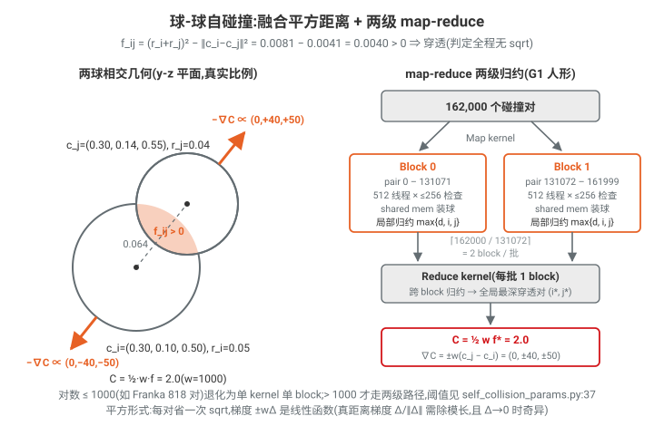
>
> **放进 map-reduce 语境**：G1 的 162k 对按每 block「512 线程 × 每线程 256 次检查」$=131072$ 对/block 切分，$\lceil 162000/131072\rceil = 2$ 个 block/批元素。上面这次 $f_{ij}=0.0040$ 的计算只是某个线程 256 次条带扫描中的一次：它与线程内当前最大值做 `max` 保成 `{d,i,j}` 三元组，先在 block 内 shuffle 归约出局部最深穿透对，再由 reduce kernel 跨 block 取全局最大——只有最终胜出的那一对才写出上式的代价与梯度。

**碰撞对枚举（离线预计算）**：`robot/types/self_collision_params.py`

- `:127` `compute_sphere_pair_distance_with_link_pair_ignores`：按 link 对生成球对，剔除 URDF 中声明忽略的 link 对（相邻 link 等），并注入 per-link padding；
- `:62` `create_from_sphere_pair_distances`：把上三角有效对打包成 `collision_pairs: int16 [P, 2]`（`:91-107`）；
- **map 分块参数**：`:37-59`

  ```python
  if num_collision_pairs > 1000:   # 大规模：512 线程/block，每线程 256 次检查
      ...
  num_blocks = ceil(P / (num_checks_per_thread * max_threads_per_block))
  ```

  即 **`num_blocks_per_batch > 1` ⇔ 走两 kernel map-reduce 路径**；阈值恰为论文 Fig. 9 的 "Pairs > 1000"。

**Kernel 实现**：`kernels/geometry/self_collision/`

- 距离原语：`self_collision_helper.cuh:61` `sphere_squared_distance_fused`——逐字实现上式 $f_{ij}$（`r_diff = sph1.w + sph2.w; f_diff = r_diff² − dot(Δ,Δ)`）；无效球（半径 < 0）用 `valid_mask` 置零（`self_collision_helper.cuh:259-260`）；
- **单 kernel 路径**（Pairs ≤ 1000，每 batch 1 block）：`self_collision_kernel.cuh:20` `self_collision_max_distance_kernel`——
  `load_spheres_and_zero_gradients`（球进 shared memory，`helper:151`，float4 向量化 + `__ballot_sync` 稀疏清零）→ `compute_max_collision_distance`（`helper:227`：每线程条带扫描 pair、`read_indices` 用 `short2` 单指令读球对索引、`max_d = max(max_d, new)` 保存 `{d, i, j}` 三元组 `CollisionPair`，`collision_pair.cuh:13`）→ `block_reduce_max`（`common/block_warp_reductions.cuh:166`，warp shuffle + shared memory 两级最大值归约）→ 线程 0 调 `finalize_collision_results<true>`（`helper:280`）写出 $\tfrac12 w f$、$\pm w(c_j - c_i)$ 梯度与稀疏索引；
- **两 kernel 路径**（Pairs > 1000）：
  - **Map**：`self_collision_kernel.cuh:114` `self_collision_max_block_kernel`——`blockIdx.x` 拆成 `(batch_horizon_idx, local_block_idx)`；每 block 处理 `ceil(P / num_blocks_per_batch)` 个 pair（`start_index = local_block_idx * pairs_per_block`，`:165`），block 内归约后把局部最大值与球对索引写到 `block_batch_max_value` / `block_batch_max_index`（`:186-189`，索引用 `short2` 打包写出）；
  - **Reduce**：`self_collision_kernel.cuh:197` `self_collision_max_reduce_kernel`——每 batch 一个 block，各线程条带读取本 batch 的所有 block 局部最大值（`:248-270`），再 `block_reduce_max` 得全局最大，线程 0 `finalize_collision_results<false>`（此时球从全局显存读回并补 offset，`helper:319-322`）；
- launch 派发：`backends/pybind/self_collision_kernel_launch.cu:112`（`num_blocks_per_batch == 1` → 单 kernel）与 `:154-186`（两 kernel：先 `batch*horizon*num_blocks_per_batch` 个 block 的 map，再每 batch 一个 block 的 reduce）；cuda-core 后端等价逻辑在 `backends/cuda_core_backend/geometry.py:98,149,193`；
- autograd 封装：`curobolib/cuda_ops/geometry.py:17` `SelfCollisionDistance`——forward 存下球心梯度 `out_vec`，backward（`:95`）直接返回缓存梯度（`once_differentiable`），零额外计算。

**为什么从 memory-bound 变 compute-bound**：单 block 方案中 162k 对 ÷ 1024 线程 ≈ 每线程 158 次串行迭代，且所有 pair 的球读都挤在一个 SM；map 阶段把 pair 摊到 `num_blocks_per_batch`（162k/(512×256) ≈ 2+ 个 block，每 block 独立占用一个 SM，球数据在各自 shared memory 中复用），全局显存流量只剩每 block 一次球加载 + 一条 `{max, i, j}` 记录，归约本身是纯计算（shuffle/共享内存），于是瓶颈从带宽转为算力，且随 SM 数扩展。

---

### 6.3 力矩限制与可微逆动力学（Torque Limits via Differentiable Inverse Dynamics）

**动机**：违反执行器限制的轨迹无法执行。多数规划器把力矩约束当作事后检查；cuRoboV2 用基于 **RNEA（递推牛顿-欧拉）** 的可微逆动力学引擎，在优化循环内直接施加力矩约束。

#### 6.3.1 RNEA 回顾与 Featherstone 空间代数记号

RNEA 以 $O(n)$ 计算产生给定运动 $(q,\dot q,\ddot q)$ 所需的关节力矩 $\tau$，分三趟遍历运动学树：(1) 基座→末端的前向趟，传播连杆速度与加速度；(2) 力趟，由惯量与运动计算每个连杆上的净 wrench；(3) 末端→基座的后向趟，把力聚合为关节力矩。$O(n)$ 使其成为逆动力学标准算法，但**串行的树遍历对 GPU 并行化是挑战**。

记号（Featherstone，空间向量为 $[\omega;v]$，角在前）：

- $X_k$：父→子帧的 6×6 空间变换。cuRoboV2 **不显式存 6×6**，而用因式形式 $R+p$（3×3 旋转 + 平移，12 floats）并按恒等式即时展开：

$$
X\cdot\begin{bmatrix}\omega\\ v\end{bmatrix} = \begin{bmatrix} R^\top\omega \\ R^\top(v + \omega\times p)\end{bmatrix},\qquad
X^\top\!\cdot\!\begin{bmatrix}n\\ f\end{bmatrix} = \begin{bmatrix} R\,n + p\times(R f) \\ R\,f\end{bmatrix};
$$

- $I_k$：空间惯量，紧凑 12-float 表示（质量、CoM、转动惯量张量），乘积解析计算而非 6×6 矩阵乘：

$$
I = \begin{bmatrix} I_c + m\,c^\times c^{\times\top} & m\,c^\times \\ m\,c^{\times\top} & m\,\mathbf 1_3\end{bmatrix};
$$

- $S_k$：关节运动子空间（1-DoF 关节为单位 6 向量，仅一个非零分量，索引 $s_k$）；
- $\mathrm{crm}(v)=v\times_m$（motion 叉乘矩阵）、$\mathrm{crf}(v)=v\times^*$（force 叉乘矩阵），且 $\mathrm{crf}(v) = -\mathrm{crm}(v)^\top$；
- $m_k$：**mimic 倍数**，$j_k$：link $k$ 映射到的被驱动关节索引（$q^{\text{eff}}_k = m_k q_{j_k} + b_k$）；
- 上标横线（$\bar v, \bar f$）表示伴随变量（对该量的梯度）。

#### 6.3.2 Algorithm 4：RNEA 前向（按树深度分层并行）

$$
\textbf{输入: } q,\dot q,\ddot q, f_{\text{ext}};\quad \textbf{输出: } \tau,\ \text{缓存 } \{v,a,f\}
$$

**Pass 1（基座→末端，逐层）**，对第 $\ell$ 层的每个 link $k$ **并行**：

$$
R_k, p_k \leftarrow \mathrm{localRp}(T_k^{\text{fixed}},\, q) \quad\triangleright\ \text{为省显存即时重算变换}
$$

$$
k \text{ 为根:}\quad v_k = S_k \dot q_k^{\text{eff}},\qquad a_k = X_k\, g + S_k \ddot q_k^{\text{eff}};
$$

$$
k \text{ 非根:}\quad v_k = X_k v_{\text{pa}} + S_k \dot q_k^{\text{eff}},\qquad
a_k = X_k a_{\text{pa}} + S_k \ddot q_k^{\text{eff}} + v_k \times_m S_k \dot q_k^{\text{eff}}.
$$

解释：速度沿链向下变换并叠加本关节速度；加速度还多出 Coriolis 项 $v_k\times_m S_k\dot q_k$（因为 $S_k$ 在运动坐标系中随 $v_k$ 旋转）。重力以"基座在重力场中加速"的标准技巧进入 $a_{\text{root}}$。

**Pass 2（各 link 独立并行）**：

$$
f_k = I_k a_k + v_k \times^* (I_k v_k) - f_{\text{ext},k}.
$$

即牛顿-欧拉方程的空间形式：惯性力 + 陀螺力项，再减去外部 wrench（外力**减小**所需力矩）。

**Pass 3（末端→基座，逐层）**：

$$
\tau_{j_k} \mathrel{+}= m_k\, S_k^\top f_k \quad(\text{"+=" 处理 mimic 关节的贡献累加}),\qquad
f_{\text{pa}} \mathrel{+}= X_k^\top f_k .
$$

每层之间 `syncwarp()` 同步；同层各 link 无父子依赖，可由 warp 内不同线程并行处理（**tree-level parallelism**）。

**代码对照**（`kernels/dynamics/rnea_forward_kernel.cuh:54`，模板 `rnea_forward_kernel<N_LINKS, N_DOF, TPB, HAS_EXTERNAL_FORCES>`）：

| 论文                                                   | 代码                                                                                                                                                                                               |
| ------------------------------------------------------ | -------------------------------------------------------------------------------------------------------------------------------------------------------------------------------------------------- |
| 逐层循环`for level ℓ`                               | `:116` `for (level...) { start=level_starts[level]; end=level_starts[level+1]; }`；层内 `for (idx = start + worker; idx < end; idx += TPB)` 即 warp 内 TPB 个 worker 分担同层 link           |
| $\mathrm{localRp}$                                   | `:138` `compute_local_Rp(&fixed_transforms[k*12], j_type, q_eff, R, p)`（`rnea_helpers.cuh:55`，约 48 条指令换 12 floats 的全局带宽）                                                        |
| mimic：$q^{\text{eff}} = m\,q + b$                   | `:130-134` `joint_offset_map[k*2]` 读出 `(multiplier, offset)`，`q_eff = mult*q + off; qd_eff = mult*qd; qdd_eff = mult*qdd`                                                               |
| $v_k, a_k$ 递推                                      | `:143-165` `spatial_Xv(R,p,·)` + `v_k[s_idx] += qd_eff`（$S$ 只有一个非零分量，直接下标写入）                                                                                             |
| Coriolis 项                                            | `:167-172` `motion_cross_S(v_k, s_idx, qd_eff, coriolis)`（`spatial_algebra.cuh:136`）                                                                                                       |
| $f_k = I a + v\times^*(Iv) - f_{ext}$                | `:188-220` `spatial_inertia_times_vec`（紧凑惯量解析乘）+ `force_cross` + 条件减 `f_ext`                                                                                                   |
| $\tau {+}{=} m S^\top f$；$f_{pa} {+}{=} X^\top f$ | `:242-271`：`tau_k = j_off.x * f_k[s_idx]`，TPB>1 时 `atomicAdd`（同层多子链可能写同一 mimic 关节/父 link）；`spatial_XTf`                                                                 |
| 层间同步                                               | `:177,222,275` `__syncwarp(batch_mask)`（**warp 级**而非 block 级 `__syncthreads()`，同步开销更低）                                                                                    |
| 缓存$\{v,a,f\}$                                      | `:194-197` `cache_save_va`（v+a 紧凑 12 floats）与 `:286` `cache_save_f`（f 补齐到 8 floats 对齐），共 **20 floats/link** 写入 `forward_cache` 供反向复用（论文 Memory layout 段） |

**层缓存的构建**：`robot/types/kinematics_params.py:250` `_compute_link_level_order`——CPU 上按 `link_map`（父表）BFS 求每个 link 的深度，按深度分组打包成 CSR（`link_level_data` / `link_level_offsets`），并记录 `max_level_width`。**TPB 的选择**：`robot/dynamics/dynamics.py:26` `_compute_threads_per_batch`——`max_level_width ≥ 4` 时取 ≥ 宽度的最小 2 的幂（上限 32，即一个 warp）；窄树（串行链）退化 TPB=1，免去同步开销。

> **数值例子：单连杆摆上手走一遍 Algorithm 4**
>
> 1-DoF 摆：revolute 关节在世界原点、绕 $z$ 轴，重力 $g_{\text{vec}}=(0,-9.81,0)$。约定 $q=0$ 为连杆沿 $-y$ 自然下垂，$q$ 从下垂位置起逆时针量。参数：$m=2$ kg，质心在连杆系 $(0,-0.25,0)$（离轴 $c=0.25$ m），绕质心惯量 $I_c=0.02$ kg·m²；状态 $q=30°$、$\dot q=1$ rad/s、$\ddot q=2$ rad/s²。空间向量按 $[\omega;v]$（角在前），全部在连杆系中计算，$S=(0,0,1,0,0,0)$，$R=R_z(30°)$、$p=0$。
>
> **Pass 1（重力技巧）**：根加速度注入 $-g_{\text{vec}}$，即 $a_0=[\,0;\ (0,+9.81,0)\,]$（"基座在重力场中向上加速"）：
>
> $$
> v_1 = S\dot q = [\,(0,0,1);\ 0\,],\qquad
> X a_0 = [\,0;\ R^\top(0,9.81,0)\,] = [\,0;\ (4.905,\ 8.496,\ 0)\,],
> $$
>
> $$
> a_1 = X a_0 + S\ddot q + v_1\times_m S\dot q = [\,(0,0,2);\ (4.905,\ 8.496,\ 0)\,]
> $$
>
> （Coriolis 项 $v_1\times_m S\dot q = 0$：$v_1$ 与 $S\dot q$ 平行，叉乘为零）。
>
> **Pass 2**：绕关节原点的 $zz$ 惯量 $I_o = I_c + mc^2 = 0.02 + 2\times 0.25^2 = 0.145$：
>
> $$
> I v_1 = [\,(0,0,0.145);\ (0.5,0,0)\,],\qquad
> v_1\times^*(Iv_1) = [\,0;\ (0,\ 0.5,\ 0)\,]\ \text{（纯离心力，无 } z \text{ 力矩）},
> $$
>
> $$
> f_1 = I a_1 + v_1\times^*(Iv_1) = [\,(0,\ 0,\ 2.7425);\ (10.81,\ 17.49,\ 0)\,].
> $$
>
> 角部 $z$ 分量 $2.7425$ 中，$0.29$ 来自 $I_o\ddot q$，$2.4525$ 来自重力项 $m\,c_{\text{vec}}\times(Xa_0)_{\text{lin}}$。
>
> **Pass 3**：$\tau = S^\top f_1 = 2.7425$ N·m。与闭式解对照（$q$ 从下垂量起）：
>
> $$
> \tau = (I_c+mc^2)\,\ddot q + mgc\sin q = 0.145\times 2 + 2\times 9.81\times 0.25\times \sin 30° = 0.29 + 2.4525 = 2.7425\ \checkmark
> $$
>
> 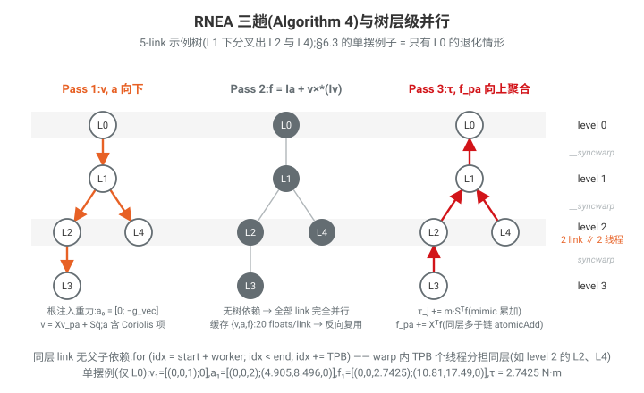
>
> **48-DoF 树上的分层并行**：单摆只有一层；G1 的运动学树按深度分层后同一层可有多个 link（双臂、双腿在同一深度各贡献一个），Pass 1/3 的层内 link 无父子依赖，由 warp 内 TPB 个线程同时处理（`for (idx = start + worker; idx < end; idx += TPB)`），层与层之间只需一次 `__syncwarp`；Pass 2 没有任何树依赖，48 个 link 完全并行。上面手算的 $\{v_1, a_1, f_1\}$ 正是每 link 写入 forward cache 的那 20 floats（$v{+}a$ 紧凑 12 + $f$ 对齐 8），反向 kernel 直接读回而不重算前向。

#### 6.3.3 Algorithm 5：RNEA 反向（VJP，反向模式自动微分的手写伴随）

给定上游梯度 $\bar\tau = \partial\mathcal{L}/\partial\tau$，直接计算 $\bar q, \bar{\dot q}, \bar{\ddot q}$（以及可选的 $\bar f_{\text{ext}}$），**全程 $O(n)$**，不物化任何 Jacobian。

**Pass 1（基座→末端）——"RNEA 后向趟"的伴随**。前向的 Pass 3 是 $\tau_{j_k} = m_k S_k^\top f_k$、$f_{\text{pa}} \mathrel{+}= X_k^\top f_k$，其伴随为：

$$
\bar f_k \leftarrow S_k\,(m_k \bar\tau_{j_k}) \qquad\triangleright\ \tau = m S^\top f \ \text{的伴随}
$$

$$
k \ne \text{root}:\quad \bar f_k \mathrel{+}= X_k \bar f_{\text{pa}},\qquad
\bar q_{j_k} \mathrel{+}= m_k\, (X_k \bar f_{\text{pa}})^\top\, \mathrm{crf}(S_k)\, f_k .
$$

解释：$f_{\text{pa}} \mathrel{+}= X_k^\top f_k$ 中 $X_k$ 依赖 $q_{j_k}$，故除了把 $\bar f$ 沿树向下推（$X\bar f_{\text{pa}}$），还产生对 $q$ 的项——利用 $\partial X_k/\partial q = X_k\,\mathrm{crm}(S_k)$（1-DoF 关节），转置后得 $\mathrm{crf}(S_k)$ 形式。

**Pass 2（各 link 独立）——外力伴随**。由 $f_k = \cdots - f_{\text{ext},k}$：

$$
\bar f_{\text{ext},k} = -\bar f_k .
$$

这使梯度可以流经接触/交互力（如带载荷规划）。

**Pass 3（末端→基座）——"RNEA 前向趟"的伴随**（初始化 $\bar a_k = \bar v_k = 0$）：

**[3]′** $f = I a + \mathrm{crf}(v)\,I v$ 的伴随：

$$
\bar a_k \mathrel{+}= I_k \bar f_k,\qquad
\bar v_k \mathrel{-}= \mathrm{crf}(\bar f_k)\, I_k v_k \;+\; I_k\, \mathrm{crm}(v_k)\, \bar f_k .
$$

（第一项来自 $\partial[\mathrm{crf}(v)Iv]/\partial v$ 的 $\mathrm{crf}$ 一侧，第二项来自 $Iv$ 一侧，符号由 $\mathrm{crf} = -\mathrm{crm}^\top$ 决定。）

**[2]′** $a = X a_{\text{pa}} + S\ddot q + \mathrm{crm}(v) S \dot q$ 的伴随：

$$
\bar{\ddot q}_{j_k} \mathrel{+}= m_k\, S_k^\top \bar a_k,\qquad
\bar{\dot q}_{j_k} \mathrel{-}= m_k\, \big(\mathrm{crf}(v_k)\, \bar a_k\big)_{s_k},\qquad
\bar v_k \mathrel{+}= \mathrm{crf}(S_k \dot q_k)\, \bar a_k,
$$

$$
k\ne\text{root}:\quad \bar a_{\text{pa}} \mathrel{+}= X_k^\top \bar a_k,\qquad
\bar q_{j_k} \mathrel{-}= m_k\, \bar a_k^\top\, \mathrm{crm}(S_k)\, X_k a_{\text{pa}} ;
$$

$$
k=\text{root}:\quad \bar q_{j_k} \mathrel{-}= m_k\, \bar a_k^\top\, \mathrm{crm}(S_k)\, X_k\, g \quad(\text{重力经 } X_k g \text{ 进入根加速度}).
$$

**[1]′** $v = X v_{\text{pa}} + S\dot q$ 的伴随：

$$
\bar{\dot q}_{j_k} \mathrel{+}= m_k\, S_k^\top \bar v_k,\qquad
k\ne\text{root}:\ \bar v_{\text{pa}} \mathrel{+}= X_k^\top \bar v_k,\qquad
\bar q_{j_k} \mathrel{-}= m_k\, \bar v_k^\top\, \mathrm{crm}(S_k)\, X_k v_{\text{pa}} .
$$

所有 $\bar q$ 项都源于同一个模式：递推中出现 $X_k(\cdot)$ 的地方，对 $q_{j_k}$ 求导产生 $\mathrm{crm}(S_k) X_k(\cdot)$，与相应伴随向量做内积。

**代码对照**（`kernels/dynamics/rnea_backward_kernel.cuh:65`，`rnea_backward_kernel<N_LINKS, N_DOF, TPB, HAS_EXTERNAL_FORCES>`）：

| 论文 Algorithm 5                                                                                                               | 代码位置                                                                                                                                        |
| ------------------------------------------------------------------------------------------------------------------------------ | ----------------------------------------------------------------------------------------------------------------------------------------------- |
| 惯量参数进**block 级** shared memory（整个 block 只载一份，省 80% 全局读）                                               | `:146-161`（float4 向量化 load 后 `__syncthreads()`）                                                                                       |
| 从`forward_cache` 载入 $\{v,a,f\}$（**取代前向重算**）                                                               | `:168-177` `cache_load_va` / `cache_load_f`                                                                                               |
| Pass 1：$\bar f_k = S m\bar\tau$；$\bar f_k {+}{=} X\bar f_{pa}$；$\bar q {+}{=} m(X\bar f_{pa})^\top \mathrm{crf}(S) f$ | `:205-243`（`dot_crf_S`，`spatial_algebra.cuh:315`；$\bar f$ **就地覆盖** sf 中的 $f$，故先把 $f_k$ 拷入寄存器 `:201-202`） |
| Pass 2：$\bar f_{ext} = -\bar f$                                                                                             | `:261-272`（`if constexpr (HAS_EXTERNAL_FORCES)`）                                                                                          |
| [3]′：$\bar a {+}{=} I\bar f$；$\bar v {-}{=} \mathrm{crf}(\bar f)Iv + I\,\mathrm{crm}(v)\bar f$                          | `:327-341`（仅两个 6 维临时数组复用，注释说明省 72 字节寄存器压力）                                                                           |
| [2]′：$\bar{\ddot q}, \bar{\dot q}, \bar v$ 与父传播、$\bar q$ 的 $X a_{pa}$/重力项                                     | `:344-421`（`force_cross_extract_s`：`spatial_algebra.cuh:390`；`force_cross_S_add`：`:357`；`dot_crm_S`：`:335`）                |
| [1]′                                                                                                                          | `:423-459`                                                                                                                                    |
| 层同步 / TPB>1 原子累加                                                                                                        | 每层尾`__syncwarp(batch_mask)`；父 link 与 mimic 关节累加用 `atomicAdd`                                                                     |

autograd 接线：`curobolib/cuda_ops/dynamics.py` 的 `RNEAForwardFunction`（forward 调 `launch_rnea_forward`、backward 调 `launch_rnea_backward`）；kernel 按 `(N_LINKS, N_DOF, TPB, HAS_EXTERNAL_FORCES)` **运行期模板实例化 + JIT 编译缓存**（`backends/cuda_core_backend/dynamics.py:85-99, 201-215`）——这正是 Table 2 中 "Robot binding: Runtime" 的实现方式：单一编译产物覆盖任意 URDF 机器人，同时保留编译期循环展开。

#### 6.3.4 力矩限制如何进入优化

数据流（每次 rollout 评估）：

1. **计算力矩**：`transition/robot_state_transition.py:380-382` —— 轨迹优化的状态转移阶段（拿到 $q,\dot q,\ddot q$ 后）在独立 CUDA stream 上调用
   `joint_torque = self.robot_dynamics.compute_inverse_dynamics(state_seq)`，入口为 `robot/dynamics/dynamics.py:141`（`Dynamics.compute_inverse_dynamics`，内部 `RNEAForwardFunction.apply`，`:224`）；
2. **力矩上下界代价**：`cost/wp_cspace_state.py:142-143` 读出 `effort_limit`（形状 `(2, dof)`，来自 URDF effort 限制），`:209-216` 对每个 `(b,h,d)` 施加

   $$
   \mathcal{C}_\tau = \tfrac12\, w_\tau\, \Delta^2,\qquad
   \Delta = \begin{cases}\tau - \tau_{\min}, & \tau < \tau_{\min}\\ \tau - \tau_{\max}, & \tau > \tau_{\max}\\ 0, & \text{否则}\end{cases}
   $$

   （`cost/warp_bound_util.py:24` `aggregate_bound_cost`，界内零代价零梯度；`shrink_bounds_with_activation_distance` 先按激活距离内缩界限，提前产生排斥梯度）；梯度写入 `out_gtau`（`wp_cspace_state.py:280-285` `out_grad_tau[b_addrs] = gradient_effort`）；
3. **梯度回传**：$\partial\mathcal{C}/\partial\tau$ 经 PyTorch autograd 触发 `RNEAForwardFunction.backward` → Algorithm 5 VJP → 得到 $\partial\mathcal{C}/\partial q,\ \partial\mathcal{C}/\partial\dot q,\ \partial\mathcal{C}/\partial\ddot q$，与其它代价梯度一起进入 L-BFGS/MPPI 优化器更新轨迹。

即：**力矩限制不是事后检查，而是一个可微软约束项，其梯度通过解析 RNEA-VJP 流回轨迹参数**。论文指出 RNEA 只占轨迹优化时间的 24%、整个 motion planning 时间的 29%，端到端开销可控。

#### 6.3.5 与已有 GPU RNEA 实现的对比（Table 2）及其失败原因

| 维度                                             | Newton [49]    | GRiD [58]            | cuRoboV2               |
| ------------------------------------------------ | -------------- | -------------------- | ---------------------- |
| 机器人绑定                                       | 运行时         | 代码生成（需重编译） | 运行时（模板参数化）   |
| 空间变换                                         | 6×6（36 fl.） | 6×6                 | $R{+}p$（12 fl.）    |
| 空间惯量                                         | 6×6           | 6×6                 | 紧凑 12 fl.            |
| 反向                                             | 重算前向       | Jacobian$O(n^2)$   | 缓存 + VJP$O(n)$     |
| 并行 / 同步                                      | 无 / 无        | 向量分量 / block     | 树层级 /**warp** |
| 运行时载荷修改 / mimic / 高 DoF / PyTorch 互操作 | ✓/–/✓/✓    | ✗/✗/✗/✗          | ✓/✓/✓/✓            |

- **Newton**：模块化架构导致每次调用 launch **6 个 kernel**，反传时重算前向量，在轨迹优化的 batch 规模下成为瓶颈（7-DoF batch 256 下 400 μs vs cuRoboV2 29.3 μs，**14×**；48-DoF 人形 1712.9 μs vs 96.2 μs，**18×**）。
- **GRiD**：为每个机器人生成完全展开、硬编码索引的 CUDA 代码，小 batch 吞吐高（简单臂上比 cuRoboV2 快 1.5–2×），但 (a) 换机器人要重编译，(b) 不支持运行时惯性参数修改（无法做载荷变化），(c) 每 link 36 floats 的 6×6 变换+惯量 shared memory 占用在 48-DoF 人形上**超过 SM 上限，直接无法运行**；反向还按 Carpentier 公式物化 $n\times n$ 的 $\partial\tau/\partial q, \partial\tau/\partial\dot q$，$O(n^2)$。
- **cuRoboV2 的三个设计决策**（论文"Our RNEA Implementation"）：
  1. **紧凑空间表示**：$R{+}p$ 12 floats（vs 72 floats/link），乘积按恒等式 $X\cdot[\omega;v]=[R^\top\omega;\,R^\top(v+\omega\times p)]$ 即时展开（`spatial_algebra.cuh:40,80`）；变换甚至不缓存而是从 $q$ **重算**（每 link 约 48 条算术指令换 12 floats 全局带宽，`rnea_backward_kernel.cuh:31-33` 注释）；
  2. **VJP 反向**：给定 $\bar\tau$ 直接以 $O(n)$ 得 $\bar q,\bar{\dot q},\bar{\ddot q}$（梯度优化只需要 VJP，不需要整块 Jacobian）；
  3. **树层级并行 + warp 同步**：同层 link 由 warp 内线程协作，`__syncwarp()` 代替 `__syncthreads()`；全局读写全部 float4 向量化保证合并访问；forward cache 每 link 仅 20 floats。

---

### 6.4 61× 加速从哪里来？为什么以前的 GPU 实现在 48-DoF 人形上失败？

**61× 的出处**（论文摘要 + Sec. 7.4 "Fast Kinematics and Self-Collision"）：在**带自碰撞的 kinematics 前向+反向基准（batch 1000）**上，cuRoboV2 对 G1 人形（hu100）相比 cuRobo v1 达 **61× 加速**（对 PyRoki 42×），并使 hu100 上的 IK 与 retargeting 整体加速 61×。分解其来源：

1. **自碰撞 map-reduce（最大头）**：G1 有 162k 碰撞对（Franka 只有 818）。cuRobo v1 单 block 方案把 162k 对塞进一个 block，每线程串行循环几百次且 memory-bound；map-reduce 把 pair 分摊到多个 block（每块 512 线程 × 256 检查），穿透最大值以 `{d, i, j}` 三元组做两级 block 归约，变成 compute-bound 且随 GPU SM 数扩展（Sec. 6.2）。
2. **FK 输出阶段的线程扩展**：v1 融合 kernel 每 batch 只有 4 线程串行做完所有输出；v2 帧变换与输出解耦，输出线程随球/连杆数扩展（32–128 线程/batch），并新增 CoM 与 Jacobian 的原生并行计算——不带自碰撞时已有 3–5×（对 cuRobo）、62–86×（对 PyRoki）的提升，且**机器人越复杂差距越大**（并行分支运动学避免了串行树遍历）。
3. **拓扑缓存反传**：反传不再让每个 link 梯度盲目扫过全部 link×link 祖先矩阵，而是 CSR 拓扑缓存 $O(1)$ 索引 + 只遍历相关链 + warp 归约，运动学稀疏性（右手梯度只碰右臂关节）被显式利用。

**为什么之前的 GPU 实现在 humanoid（48-DoF）上失败**：

- **GRiD（逆动力学）**：代码生成的 kernel 把每 link 的 6×6 空间变换和 6×6 惯量（36 floats/link）全放 shared memory，48-DoF 人形的 link 数使 shared memory 需求**超过 SM 硬件上限**，kernel 无法 launch——"fails entirely"（Sec. 7.3）。cuRoboV2 的 12-float 紧凑表示 + 变换即时重算把每 link 常驻 shared memory 压到前向 12 floats、反向 30 floats（+块级共享的 12 floats 惯量），在 96.2 μs（batch 256）内完成 48-DoF 前反向。
- **cuRobo v1（自碰撞与 FK）**：架构假设"单 block 装下问题"——自碰撞单 block 遍历所有 pair、FK 每 batch 4 线程——这在 818 对/7-DoF 时成立，在 162k 对/48-DoF 时导致串行化和带宽瓶颈；且不支持 CoM/Jacobian/分支多末端，多工具帧的 Jacobian 无法并行计算。
- **PyRoki 等**：无碰撞感知的 retargeting 约束满足率只有 61.2%（cuRoboV2-IK 89.5%），且吞吐差 42–86×。

---

### 6.5 论文 ↔ 代码速查表

| 论文对象                                                          | 代码位置                                                                                                                                                                                                                         |
| ----------------------------------------------------------------- | -------------------------------------------------------------------------------------------------------------------------------------------------------------------------------------------------------------------------------- |
| Fig. 8 FK 融合/拆分 kernel                                        | `curobo/_src/curobolib/kernels/kinematics/kinematics_forward_kernel.cuh:21,131,268`；派发 `curobo/_src/curobolib/cuda_ops/kinematics.py:159-237`                                                                             |
| 半 warp 链式累积变换                                              | `curobo/_src/curobolib/kernels/kinematics/kinematics_forward_helper.cuh:437,488`                                                                                                                                               |
| Algorithm 1（拓扑缓存反传）                                       | `curobo/_src/curobolib/kernels/kinematics/kinematics_backward_kernel.cuh:34`；链遍历 `kinematics_backward_helper.cuh:64-96`；warp 归约 `:128-140`                                                                          |
| topology cache（祖先链 CSR）                                      | `curobo/_src/robot/types/kinematics_params.py:53-76`（link_chain / joint_links / joint_affects_endeffector）                                                                                                                   |
| Algorithm 2（两级过滤 Jacobian）                                  | 前向`kinematics_forward_helper.cuh:45`（粗过滤 `:93`）；$dJ/dq$ VJP `kinematics_jacobian_backward_helper.cuh:24`                                                                                                         |
| Algorithm 3（LM 信赖域）                                          | Python 优化栈`curobo/_src/optim/`、`curobo/_src/solver/seed_ik/`（LM + L-BFGS 两阶段）                                                                                                                                       |
| Fig. 9 自碰撞 map-reduce                                          | 单 kernel`self_collision_kernel.cuh:20`；map `:114`；reduce `:197`；距离 `self_collision_helper.cuh:61`；归约 `common/block_warp_reductions.cuh:166`                                                                   |
| Pairs>1000 阈值 / 分块                                            | `curobo/_src/robot/types/self_collision_params.py:37-59`；launch 分支 `backends/pybind/self_collision_kernel_launch.cu:112,154`                                                                                              |
| Algorithm 4（RNEA 前向）                                          | `curobo/_src/curobolib/kernels/dynamics/rnea_forward_kernel.cuh:54`（三趟：`:116,188,228`）                                                                                                                                  |
| Algorithm 5（RNEA VJP）                                           | `curobo/_src/curobolib/kernels/dynamics/rnea_backward_kernel.cuh:65`（Pass1 `:189`、$\bar f_{ext}$ `:261`、Pass3 `:297`）                                                                                              |
| Featherstone 恒等式$X\cdot[\omega;v]$ / $X^\top f$ / 紧凑惯量 | `curobo/_src/curobolib/kernels/dynamics/spatial_algebra.cuh:40,80`（文件头注释即论文公式）                                                                                                                                     |
| 树层级缓存 level_starts/level_links                               | `curobo/_src/robot/types/kinematics_params.py:250` `_compute_link_level_order`                                                                                                                                               |
| TPB（树宽→warp 线程数）启发式                                    | `curobo/_src/robot/dynamics/dynamics.py:26`                                                                                                                                                                                    |
| RNEA autograd / 运行时模板实例化                                  | `curobo/_src/curobolib/cuda_ops/dynamics.py`；`backends/cuda_core_backend/dynamics.py:85-99,201-215`                                                                                                                         |
| 力矩进优化（Sec. 6.3 落地）                                       | 计算`curobo/_src/transition/robot_state_transition.py:380-382`；边界代价 `curobo/_src/cost/wp_cspace_state.py:142-216` + `curobo/_src/cost/warp_bound_util.py:24`；模型入口 `curobo/_src/robot/dynamics/dynamics.py:141` |

**代码快照与论文的差异说明（诚实备注）**：论文 Fig. 8 以"球 ≤100 单 kernel / >100 两 kernel"描述自适应派发；本仓库快照中未见显式的 100 球阈值分支，对应机制体现为：(a) 三个按输出需求分级的 kernel 变体 + `OUTPUT_THREADS_PER_BATCH∈{32,64,128}` 的输出线程扩展；(b) 前向把帧变换写入 `global_cumul_mat`、反向 kernel（相当于"第二个 kernel"）读回复用的 saved-cumul 契约。自碰撞的 "Pairs>1000" 阈值与 RNEA 的全部细节（层并行、20-float 缓存、warp 同步、块级共享惯量、mimic 倍数）则与论文逐条吻合。

---

## 7. 实验结果

本节评估 cuRoboV2 的完整能力栈：动力学感知运动规划(7.1–7.2)、核心计算组件基准(逆动力学 7.3、高自由度 IK 7.4、ESDF 生成 7.6)，以及两个应用(人形动作重定向与运动策略训练 7.5、带实时深度融合的真机操作 7.7)。除特别说明外，所有实验均在 **NVIDIA RTX 4090 GPU** 上运行。

> 仓库对应基准脚本：`/home/mujin/MotionPlanning/curobo/benchmark/` 下的 `motion_plan_benchmark.py`(7.1)、`inverse_dynamics_kernel_benchmark.py`(7.3)、`ik_benchmark.py`(7.4)、`cost_gradient_benchmark.py`。

### 7.1 动力学感知规划（Dynamics-Aware Planning）

**实验设置**

- **Benchmark**：MotionBenchMaker + MπNets 数据集，共 **2600 个**杂乱环境规划问题。
- **机器人**：Franka Panda（7-DoF）。
- **Baseline**：VAMP（SOTA 采样式规划器，RRT-Connect 与渐近最优 AORRTC 两个变体，带后置时间最优参数化）、cuRobo（GPU 轨迹优化器）、cuRobo+NewtonDyn（cuRobo 扩展逆动力学约束）。
- **指标**：三级成功率——运动学成功（无碰撞 + 位置/速度/加速度限制）、零负载动力学成功（额外检查力矩限制）、**满负载动力学成功（末端 3 kg 负载下检查力矩限制）**；另有规划时间、运动时间、能量、路径长度（75 百分位）。

**关键数据（Fig. 11，75th percentile）**

| 方法               | 零负载成功率 (%) | 3kg 满负载成功率 (%) | 规划时间 (s) | 运动时间 (s) | 能量 (J)      | 路径长度 (rad) |
| ------------------ | ---------------- | -------------------- | ------------ | ------------ | ------------- | -------------- |
| VAMP-RRTC          | 95.5             | 71.5                 | 0.004        | 5.79         | 160           | 6.67           |
| VAMP-AORRTC        | 95.8             | 75.4                 | 0.57         | 4.94         | 131           | 4.83           |
| cuRobo             | 98.0             | 77.1                 | 0.036        | 1.37         | 116           | 3.78           |
| cuRobo+NewtonDyn   | 97.1             | 97.1                 | 0.34         | 1.57         | 119           | 4.06           |
| **cuRoboV2** | **99.7**   | **99.7**       | 0.048        | 1.55         | **106** | 3.84           |

**结论与分析**

- 所有优化式方法的运动学成功率都 >99%，差距出现在检查动力学时：即使零负载，cuRobo 从 99.8% 掉到 97.9%，采样式方法从 98.9% 掉到 95.5–95.8%，而 cuRoboV2 保持 99.7%。
- **满负载（3 kg）差距悬殊：cuRoboV2 维持 99.7%，cuRobo 跌至 77.1%，采样式方法跌至 72–75%**。验证了核心论点：不带动力学约束规划的轨迹在真实负载下不可行。
- 轨迹质量：cuRoboV2 能量最低（106 J vs cuRobo 116 J、VAMP 131–160 J），因 B 样条公式天然平滑且优化器显式最小化能量代价。规划时间 48 ms（vs cuRobo 36 ms），换来可保证执行的轨迹，免去执行期昂贵的重规划。
- 相对 cuRobo+NewtonDyn 多解出 66 个满负载问题（2591 vs 2525 / 2600），说明 B 样条的隐式平滑性带来比逐时间步参数化更良态的优化地形。
- Fig. 12 定性对比：cuRobo 逐时间步优化产生不连续的加速度/加加速度曲线，cuRoboV2 的 B 样条优化则按构造给出光滑连续的导数，适合真机执行。

### 7.2 运行时间分解（Runtime Breakdown）

**实验设置**：在 RTX 4090 上（开启 `torch.compile`）剖析规划管线，对比有/无动力学约束的各阶段 kernel 时间与端到端墙钟时间（含 Python 与 CUDA graph 启动开销）。

**分阶段时间（Table 3）**

| 阶段                     | 无动力学 Time      | 无动力学 %Total | 有动力学 Time      | 有动力学 %Total | Δ                 |
| ------------------------ | ------------------ | --------------- | ------------------ | --------------- | ------------------ |
| Seed IK (LM)             | 0.74 ms            | 2.1             | 0.74 ms            | 1.8             | —                 |
| IK Solver (L-BFGS)       | 4.87 ms            | 13.9            | 8.57 ms            | 20.4            | +3.70 ms           |
| TrajOpt (MPPI+L-BFGS)    | 15.82 ms           | 45.2            | 21.51 ms           | 51.2            | +5.69 ms           |
| **Kernel 合计**    | **21.44 ms** | 61.3            | **30.83 ms** | 73.4            | **+9.38 ms** |
| **端到端（墙钟）** | **35 ms**    | 100             | **42 ms**    | 100             | **+7 ms**    |

**Kernel 级分解（Table 4，含动力学，TrajOpt 162 次迭代、132.8 µs/iter）**

| Kernel                      | TrajOpt/Iter | IK+TrajOpt 合计    | %Kernel |
| --------------------------- | ------------ | ------------------ | ------- |
| RNEA (fwd + bwd)            | 31.6 µs     | 8.82 ms            | 28.6    |
| Swept-sphere collision      | 21.0 µs     | 3.41 ms            | 11.1    |
| L-BFGS + line search        | 15.2 µs     | 3.31 ms            | 10.7    |
| Kinematics (fwd + bwd)      | 14.4 µs     | 4.03 ms            | 13.1    |
| Cspace + pose + speed costs | 9.5 µs      | 2.07 ms            | 6.7     |
| Self-collision              | 5.1 µs      | 0.83 ms            | 2.7     |
| B-spline                    | 3.6 µs      | 0.58 ms            | 1.9     |
| Elementwise + reduce        | 23.3 µs     | 5.07 ms            | 16.4    |
| Other                       | 9.1 µs      | 1.97 ms            | 6.4     |
| **Kernel Total**      | —           | **30.83 ms** | 100     |

**结论与分析**

- 开启动力学使 kernel 时间增加 9.38 ms（+44%），分布在 IK（+3.70 ms）和 TrajOpt（+5.69 ms）上；RNEA kernel 为 TrajOpt 增加 5.12 ms（占其 23.8%）。
- 但**端到端仅增加 +7 ms（35 ms → 42 ms）**：CUDA streams 让独立 kernel（代价/运动学/动力学）并行重叠，CUDA graphs 把启动开销批处理为固定成本——动力学增加 GPU 工作量后，更大比例的固定开销被计算隐藏。
- RNEA 占完整管线的 29%（8.82 ms），单次迭代成本从 97.7 µs 升至 132.8 µs（+36%）。总规划时间 30.83 ms（kernel）/ 42 ms（端到端）支持 **>30 Hz 实时运动生成**，让动力学感知规划可用于反应式操作。
- 核心结论：+7 ms 的适度代价，避免了无动力学方法在负载下 22–27% 的成功率损失。

### 7.3 逆动力学对比（Inverse Dynamics Comparison）

**实验设置**

- **Baseline**：GRiD（对每种机器人做代码合成、生成专用 CUDA kernel）、Newton（通用 GPU 仿真库）。（注：本文对比对象为 GRiD 与 Newton，而非 CPU 库 Pinocchio。）
- **机器人**：7-DoF 单臂、12-DoF 双臂系统、48-DoF 人形。
- **指标**：前向+反向传播时间，batch size 1–8192（Fig. 13，重点报告 TrajOpt 常用的 batch 256）。

**关键数据（batch size 256，fwd+bwd）**

| 机器人        | GRiD                           | Newton     | cuRoboV2 | vs GRiD  | vs Newton                   |
| ------------- | ------------------------------ | ---------- | -------- | -------- | --------------------------- |
| 单臂 (7-DoF)  | 18.8 µs                       | 400.0 µs  | 29.3 µs | 慢 1.5× | **快 14×（13.7×）** |
| 双臂 (12-DoF) | 21.5 µs                       | 661.2 µs  | 45.0 µs | 慢 2×   | **快 15×（14.7×）** |
| 人形 (48-DoF) | **失败（共享内存超限）** | 1712.9 µs | 96.2 µs | —       | **快 18×（17.8×）** |

**结论与分析**

- 在简单机械臂上，GRiD 的代码生成 kernel 快 1.5–2×，但其代码生成方式在 48-DoF 人形上因共享内存限制**完全失败**；cuRoboV2 则从单臂到全人形优雅扩展，是高自由度系统上唯一可行的选项。
- 相对通用物理引擎 Newton 快 14–18×。同时 cuRoboV2 支持运行时负载变更、PyTorch 互操作与人形级机器人（GRiD 不支持），且 RNEA 只占轨迹优化时间的 24%、总规划时间的 29%，端到端开销可控。

### 7.4 高自由度逆运动学（High-DoF Inverse Kinematics）

**实验设置**

- **机器人**：7-DoF Franka Panda、12-DoF 双 UR10e、48-DoF Unitree G1 人形。
- **Baseline**：cuRobo、Newton、PyRoki。
- **指标**：运动学/自碰撞前反向耗时（batch 1000）；IK 成功率、耗时、位置误差（batch 100），分标准 IK 与自碰撞无碰 IK 两组。

**运动学 + 自碰撞速度（Fig. 14，batch 1000）**

- 纯前反向运动学：cuRoboV2 相对 cuRobo 加速 3–5×、Newton 16–19×、PyRoki 62–86×；优势随机器人复杂度增长（并行分支运动学避免了串行树遍历）。
- 加自碰撞后差距放大：G1 人形有 **162k 碰撞对**（Franka 仅 818），map-reduce 方案在人形上比 cuRobo 快 **61×**、比 PyRoki 快 **42×**（0.30 ms vs 18.25 / 12.45 ms）。

**IK 结果（Fig. 15，batch 100）**

| 场景                       | 指标        | PyRoki    | Newton   | cuRobo | cuRoboV2                           |
| -------------------------- | ----------- | --------- | -------- | ------ | ---------------------------------- |
| 标准 IK，人形 48-DoF       | 成功率      | 49.8%     | 98.4%    | 0.0%   | **100%**                     |
|                            | 耗时        | 1123.5 ms | 317.0 ms | —     | **33.9 ms**                  |
|                            | 位置误差    | 18.3 µm  | 10.0 µm | —     | **1.0 µm（正文 0.96 µm）** |
| 自碰撞无碰 IK，人形 48-DoF | 成功率      | 0%        | —       | 0%     | **99.6%**                    |
|                            | 耗时 / 误差 | —        | —       | —     | 532.5 ms / 2.4 µm                 |

**结论与分析**

- 标准 IK：单臂上各方法都近乎完美，但 cuRoboV2 位置误差更低（0.13 µm vs PyRoki 0.43 µm、cuRobo 3.9 µm），得益于高效 Jacobian 支撑的 Levenberg-Marquardt 优化。48-DoF 人形上 cuRoboV2 100% 成功、误差 0.96 µm、耗时 34 ms；Newton 98.4%/10 µm/317 ms（慢 9×）、PyRoki 仅 49.8%/18 µm/1123 ms（慢 33×）。注：PyRoki 论文的结果未验证关节限制满足。
- **自碰撞无碰 IK：cuRoboV2 在人形上 99.6% 成功，cuRobo 与 PyRoki 全部失败（0%）**。关键在两阶段策略：LM 先解位姿目标（非线性最小二乘）提供目标附近的良好初始化，L-BFGS 再在碰撞约束下精化（发挥其处理非凸目标的强项）。可扩展的运动学与自碰撞实现使这一 seeding 策略在高自由度下计算可行。

### 7.5 人形动作重定向（Humanoid Retargeting）

#### 7.5.0 重定向流水线是怎么工作的(原理与代码考察)

> 本小节是对 §7.5 实验背后机制的补充解释(结合论文原文 p25-30 与仓库 `MotionRetargeter` 实现)。
>
> **问题本质:病态的"跨身体映射"**。把人的动作(LaFan mocap,70k+ 帧)搬到 Unitree G1 上天生是病态问题:机器人的连杆比例/关节数/活动范围与人不同,很多人体姿态不在机器人可达空间内。求解器必须在"跟得像"(tracking fidelity)与"做得到"(feasibility)之间权衡——目标不可达时要**优雅退化**而不是发散。
>
> **流水线分工:GMR 做映射,cuRoboV2 做 IK**:
>
> 1. **GMR 负责"人体 → 机器人目标"的几何映射**:把每帧 mocap 的人体关键 link(骨盆、双手、双脚、头等)缩放/映射成机器人对应 link 的**目标位姿集合**——这一步不解 IK,只产生任务空间目标;
> 2. **IK 求解器负责"目标位姿 → 关节角"**:GMR 默认用 mink 做逐帧局部 IK(仅关节极限);论文把 cuRoboV2-IK 作为 **drop-in 替换**塞进同一条 GMR 流水线,**不重调任何代价权重**(权重本来是为 mink 调的)——刻意让对比只反映求解器的算法性质(碰撞感知、全局 seeding、约束处理),而非调参功力。
>
> 对应到式 (6),这是**多 link 同时给目标**的 IK 特例:$\|X_g^m - \mathrm{FwdKin}(\theta)\| < \eta_m$,$m$ 遍历骨盆/双手/双脚等,每 link 有各自的位置/姿态权重。代码接口(`curobo/motion_retargeter.py` docstring):
>
> ```python
> cfg = MotionRetargeterCfg.create(
>     robot="unitree_g1_29dof_retarget.yml",
>     tool_pose_criteria={
>         "pelvis":     ToolPoseCriteria.track_position_and_orientation(xyz=[1,1,1], rpy=[0.5,0.5,0.5]),
>         "left_hand":  ToolPoseCriteria.track_position_and_orientation(xyz=[1,1,1], rpy=[0.3,0.3,0.3]),
>         "right_hand": ToolPoseCriteria.track_position_and_orientation(xyz=[1,1,1], rpy=[0.3,0.3,0.3]),
>     },
> )
> result = retargeter.solve_sequence(tool_poses)   # (num_frames, num_envs, num_links, ...)
> ```
>
> 约束一个不少:关节极限(式 3)、自碰撞(式 5,`self_collision_check=True`)、地面/场景碰撞(式 4,`scene_model` 传入地面)。
>
> **代码级机制:三种求解模式的调度**。`MotionRetargeter.solve_frame()`(`_src/motion/motion_retargeter.py:122`)按帧调度,策略是"**第一帧全局、后续帧局部**":
>
> | 模式 | 何时 | 机制 | 代码 |
> |---|---|---|---|
> | **全局 IK** | 第 0 帧 | **64 种子**(`num_seeds_global=64`)全局搜索,两阶段:LM 先解位姿目标(NLLS 快速收敛到目标附近)→ L-BFGS 在自碰撞+场景约束下精修(擅长非凸) | `_solve_global_ik`,`:224` |
> | **局部 IK** | 第 1 帧起 | 用上一帧解 **warm start**(单种子),`optimization_dt=0.05` 施加速度限制 + 速度/加速度正则保证帧间连续;关闭 LM seeding(`use_lm_seed=False`) | `_solve_local_ik`,`:246` |
> | **MPC(可选)** | 第 1 帧起 | 在 B-spline 轨迹空间优化动作序列,每目标帧内部走 `steps_per_target=8` 步;独特价值是**检查帧与帧之间的碰撞**(IK 只约束离散帧,30→120 fps 插值出的中间姿态可能互穿,这类失败全算 IK 的) | `_solve_mpc_frame`,`:277` |
>
> **读表时的两个要点**(对照 7.5.1 数据):GMR 位置误差最小(24 mm)是因为它根本不管碰撞——跟得最像但 46% 的帧自穿,这种"精度"是虚的;MPC 96.6% 约束满足但误差 157 mm,因为它解的是更难的问题(全 horizon 同时满足平滑+碰撞、且没有 LM 帮它初始化),故论文最终**推荐 cuRoboV2-IK**,MPC 的帧间检查留作未来工作。
>
> **为什么这事以前做不到(与 §6 的关系)**:每帧两阶段 IK 需要 48-DoF 分支树的并行 FK + 稀疏 Jacobian(LM 要完整 J),且 G1 的 **162k 自碰撞对**每次迭代都要查。没有 §6 的拓扑感知运动学与 map-reduce 自碰撞(合计 61× 加速),64 种子 × 两阶段 × 70k 帧在计算上不可行——这正是 PyRoki(不收敛、在接触边界附近失败使双手无法交叉)与 cuRobo v1(自碰撞 kernel 装不下)失败的地方。
>
> 一句话:**GMR 出目标、cuRoboV2 出关节角;第一帧 64 种子 LM+L-BFGS 全局解,后续帧 warm-start 局部解加速度限;赢在"贴着接触边界仍能找到无碰解",而这靠 §6 把每帧两阶段优化的成本压到可行**。

#### 7.5.1 重定向质量

**实验设置**

- 用 GMR 库把 LaFan 数据集 **70k+ 帧**人体动作映射到 Unitree G1 人形；轨迹从 30 fps 插值到 120 fps 后验证关节限制、自碰撞、地面接触。
- **Baseline**：GMR（默认用 mink 做逐帧局部 IK、仅关节限制约束）、mink 单独启用自碰撞+地面碰撞、PyRoki、cuRoboV2-IK（作为 GMR 管线的 drop-in 替换，不重调任何方法的代价权重，隔离算法差异）。

**约束满足率（Fig. 17）**

| 方法                  | 全约束满足 (%) | 关节限制内 (%) | 无自碰撞 (%) | 无世界碰撞 (%) | 位置误差 (mm) | 旋转误差 (deg) |
| --------------------- | -------------- | -------------- | ------------ | -------------- | ------------- | -------------- |
| GMR                   | 40.6           | 88.9           | 53.8         | 80.3           | **24**  | **1.36** |
| mink                  | 54.5           | 100.0          | 70.4         | 76.1           | 28            | 1.56           |
| PyRoki-IK             | 61.2           | 68.0           | 76.8         | 99.6           | 99            | 1.83           |
| **cuRoboV2-IK** | **89.5** | 100.0          | 89.7         | 99.8           | 30            | 1.71           |
| cuRoboV2-MPC          | **96.6** | 100.0          | 96.6         | 100.0          | 157           | 9.48           |

**结论与分析**

- **cuRoboV2-IK 达到 89.5% 约束满足率，对比 PyRoki 61.2%、mink 54.5%、GMR 40.6%**，归功于 LM+L-BFGS seeding 找无碰解。MPC 通过轨迹表示检查**帧间**碰撞进一步到 96.6%（IK 只在离散帧上施加约束，插值引发的碰撞会导致 IK 失败），但 MPC 跟踪精度较差（位置误差 157 mm），故推荐 cuRoboV2-IK 作为重定向方法。
- 定性案例（Fig. 16，爬行序列需双手交叉）：GMR 无碰撞检查产生自碰撞；PyRoki 避碰但在接触边界附近失败、双手无法交叉；cuRoboV2 优雅解决自碰撞完成精确重定向。

#### 7.5.2 运动策略训练（Locomotion Policy Training）

**实验设置**：用 MimicKit（DeepMimic 实现）在 Newton 的 MuJoCo-Warp 仿真器上为 Unitree G1 训练策略。重定向两段动作（20 s 跑步、30 s 爬行），每种配置训练 **20 亿样本 × 5 个随机种子**。指标：根速度误差、MPJPE（平均逐关节位置误差）、存活率（alive rate）、回合重置数。

**关键结果**

- **跑步**：cuRoboV2、GMR、mink 均 >99.7% 存活、零重置（跑步自碰撞风险小）；PyRoki 的违反约束的参考动作（61.2% 约束满足率）使策略反复摔倒，平均回合长度仅 31%（cuRoboV2 65%、GMR 70%），PSR 停在 59%，累计 13.8 次重置、MPJPE 高 33%（185.8 mm）——即 **cuRoboV2 比 PyRoki 在跑步上 MPJPE 低约 25%**。
- **爬行**（肢体需交叉、自碰撞处理关键）：训练曲线上 cuRoboV2/GMR/mink 几乎一样（return 60%/60%/58%），但评估揭示显著差异——**cuRoboV2 MPJPE 151.4±4.5 mm，GMR 178.0±58.3 mm，跨种子方差高 12×（论文图注亦写作 13×）**。GMR 的参考动作含肢体互穿姿态，RL 损失驱使策略模仿这些不可行构型，触发重置；某个种子能否收敛取决于优化器是否找到绕开最坏约束违反的路径。mink 启用碰撞检查后方差大幅下降（MPJPE 156.7±9.5 mm、3.4 次重置），印证碰撞感知重定向提升策略一致性。PyRoki 重置数为 cuRoboV2 的两倍（4.6 vs 2.2）。
- **综合两段动作：cuRoboV2 策略最优——MPJPE 最低 145.5 mm、存活率最高 99.6%、重置最少 1.1 次**；其后依次为 mink（153.0 mm、1.7 次）、GMR（158.5 mm、1.8 次）、PyRoki（177.6 mm、9.2 次）。
- 方法论要点：标准训练指标（return、episode length、PSR）**必要但不充分**——三者都可能"看起来健康"而策略实际在追踪物理不可行的参考姿态；下游位姿精度与跨种子一致性才能揭示参考动作质量的真实影响。所有实验共用同一 RL 框架与策略结构，唯一变量是重定向 IK 求解器，因此结果隔离了重定向质量对策略性能的影响。

> 说明：任务简报中的"locomotion policy tracking error 降 21%"在论文原文中未出现该确切数字，最接近的表述是跑步任务上相对 PyRoki 的 MPJPE 低 25%（185.8 mm vs 139.6 mm 附近水平）；跨种子方差降低为 12×（正文）/13×（Fig. 19 图注）。

### 7.6 毫米级分辨率下的快速安全 ESDF

**实验设置**

- **Baseline**：nvblox（GPU 加速 TSDF/ESDF 库）。数据：Redwood bedroom 场景的相同深度图序列。
- cuRoboV2 固定 20 mm ESDF 体素（TSDF 体素超过 20 mm 时 ESDF 随之匹配）；nvblox 要求 TSDF 与 ESDF 分辨率必须一致。
- **指标**：深度图到 ESDF 的生成时间、GPU 显存、碰撞召回率（仅在 nvblox 产生有效距离的区域上计算，保证公平）。两个工作空间覆盖：8×8×8 m（100%）与 4×4×4 m（50%）。

**关键数据（Fig. 20 及正文，100% 覆盖 8 m³ 工作空间）**

| TSDF 分辨率 | 方法               | 总时间 (ms)              | 显存 (GB)                | 碰撞召回 (%)   |
| ----------- | ------------------ | ------------------------ | ------------------------ | -------------- |
| 10 mm       | nvblox             | 12.68                    | 11.87                    | 92.0           |
| 10 mm       | **cuRoboV2** | **1.69**（快 7×） | **1.63**（省 7×） | **92.5** |
| 20 mm       | nvblox             | 2.97                     | 2.55                     | 85.4           |
| 20 mm       | **cuRoboV2** | **1.52**           | **0.82**（省 3×） | **97.0** |
| 5 mm        | nvblox             | OOM                      | OOM                      | —             |
| 5 mm        | cuRoboV2           | 2.4                      | 4.8                      | 79             |

**结论与分析**

- 总体上 cuRoboV2 相比 nvblox **总时间低 2–10×、显存少 2–8×**，且召回率更高；nvblox 在 5 mm 分辨率直接 OOM。
- TSDF 集成时间两者相当（cuRoboV2 0.50–0.55 ms vs nvblox 0.30–0.76 ms），加速完全来自 ESDF 生成：10 mm/100% 覆盖下 **PBA+ 传播 1.15 ms vs nvblox 迭代 block 式 ESDF 更新 11.93 ms，快 10×**。尽管稠密 PBA+ 每帧重算完整距离场，但计算完全可分离、kernel 启动次数固定、兼容 CUDA graph，反而快于增量方法。
- 召回差距部分源于 TSDF 权重阈值：nvblox 基于距离的加权把噪声抑制与表面保真耦合到单一难调参数，而 cuRoboV2 基于像素计数投票的方案将二者解耦。
- **Scatter vs Gather 两种 seeding（Fig. 21）**：gather 的 ESDF 阶段 0.30 ms vs scatter 0.45 ms（10 mm、50% 覆盖，消除原子操作竞争降 1.5×）；全覆盖时 gather 升至 1.54 ms（vs scatter 1.15 ms，因 gather 遍历全部 ESDF 体素而 scatter 只访问已分配 TSDF block），但 gather 总时间仍有竞争力（2.08 vs 1.69 ms）且支持整条 ESDF 管线的 CUDA graph 捕获——对实时控制回路的确定性延迟至关重要。召回率上：TSDF 远细于 ESDF 时（r≥4）scatter 略高（+2.5%），分辨率相近时（r≈1）gather 采样更密占优（+2–4%），交叉点约在 r≈2。
- **异构分辨率**是与 nvblox 的关键差异：可用 5 mm 细 TSDF 保重建保真度、同时按任务需求生成 10–20 mm ESDF（机器人用 1–5 cm 碰撞球近似，10 mm ESDF 已足够）；nvblox 被迫让 5 mm TSDF 拉出 5 mm ESDF，显存与计算同时膨胀。
- 已知几何（桌子、货架等）stamp 进 TSDF 后，碰撞查询变为 O(1) 三线性插值查表而非逐立方体解析 SDF：在运动规划 benchmark 上**平均规划时间降 19%（47 ms → 38 ms），成功率几乎无损（Δ = −0.12%）**。
- 定性（Fig. 22）：nvblox 只在已分配 block 内给出带符号距离，未观测区域留空洞；cuRoboV2 经 PBA+ 生成覆盖全工作空间的稠密 ESDF，处处提供 O(1) 距离查询，与真值 SDF 高度吻合（残留少量表面误差需权重阈值权衡噪声抑制与表面保留）。

### 7.7 真机操作（Real-World Manipulation）

**实验设置**

- **硬件**：I2RT YAM 机器人 + 标定的 ZED Mini 立体相机。
- **感知管线**（Fig. 23）：ZED Neural Plus 模型生成深度（1080p、15 Hz，更高帧率会带来神经深度估计的过高延迟）→ 将运动学球模型投影到图像空间以从深度图中分割去除机器人本体 → 分割后深度融合进 **2.5 mm TSDF** → 生成 **2 cm ESDF**。
- **控制**：ESDF 驱动 MPC 轨迹优化器中的实时避碰，机器人在跟踪位姿指令的同时躲避动态观测到的障碍物。

**结果与分析**

- 深度集成、ESDF 生成、轨迹优化的完整管线运行在**单个控制回路内**，展示 GPU 原生架构的收益。
- 演示（Fig. 24）：机器人从左到右规划运动，cuRoboV2 的 MPC 借助 ZED Mini 的实时 ESDF 更新动态避开人手/障碍物，验证了 7.6 节 ESDF 管线在真实闭环操作中的实用性。

---

## 8. LLM 辅助开发

核心假设:**结构良好的代码库是高效 LLM 辅助开发的前提,且这项投资本身是值得的**。通过为"可发现性"(discoverability)重构 cuRoboV2,作者让 LLM 编码助手(Cursor IDE + Claude 系列模型)编写了最终代码库中的大量代码——从高层 API wrapper 到手工优化级别的 CUDA kernel。

### 8.1 代码库可发现性(Codebase Discoverability)

早期在 v1 代码库上使用 LLM 助手暴露出系统性失败模式,每一种都对应一条设计原则(修复后 LLM 生成代码即变得可靠):

1. **配置藏在 YAML → 配置在代码中可见**。v1 的配置放在运行时通过 dict 变异加载的 YAML 中,LLM 无法发现 API 表面。改为带文档化默认值的类型化 dataclass(如 `IKSolverCfg.create(num_seeds=32)`),使每个参数都能在源码中检查到。
2. **不透明命名 → 名字能预测位置**。v1 深路径(`curobo.wrap.reacher.ik_solver.IKSolver`)和晦涩类名(`CudaRobotModel`)导致 LLM 幻觉 import。v2 采用短而稳定的 import(`from curobo import IKSolver`)、领域名词(`Robot`、`Kinematics`)、一致约定(`*Cfg`/`*Result`、`.create()`)、每个公共模块都有 `__all__`。
3. **大文件 → 文件放得进一个上下文窗口**。v1 平均 460 行/文件(最大 4,427 行)且 docstring 稀疏;v2 降到平均 254 行(最大 1,643 行),带 docstring 和内联用法示例,LLM 可一次读完整个模块。
4. **不透明测试 → 测试即可执行文档**。v1 的 264 个测试放在无 docstring 的扁平目录;v2 有 3,978 个测试,按源码镜像布局组织,813 个带文档的测试类为每个公共 API 提供具体输入/输出示例。
5. **模糊签名 → 自文档化接口**。v1 的 `start_state: JointState` 不提供 shape/batch 语义,导致 LLM 生成形状错误的张量。v2 在每个公共方法的 docstring 中记录 shape、dtype 与索引方式,例如:
   ```
   start_state:     Shape (-1, dof). Indexed as start_state[start_state_idx[batch_idx]].
   start_state_idx: Shape (batch_size,). dtype: torch.int32.
   ```

作者强调:这些改动对人类研究者同样有益,但对 LLM 是**必需的**——LLM 无法用直觉或 IDE 工具补偿。

**投入成本**(Fig. 25,不含空行):

- 代码行数:v1 39.2k(Python 24.5k / CUDA C++ 9.7k / Warp 5.0k)→ v2 59.0k(Python 38.3k / CUDA 8.9k / Warp 11.8k),框架代码增长 **1.5×**;
- 内联文档:10.3k → 27.5k,增长 **2.7×**(体现可发现性投资);
- 测试:6.6k 行 → 66k 行,测试数 264 → 3,978(**15×**);
- 文件数(不含测试):121(Python 98 / CUDA 16 / Warp 7)→ 390(Python 297 / CUDA 53 / Warp 40),体现单一职责模块分解;
- CUDA C++ 几乎持平,场景碰撞迁移到 Warp 后,Warp 占 GPU 代码份额从 **34% 升到 57%**。

### 8.2 量化 LLM 贡献

按六个开发阶段统计 LLM 撰写代码占新增代码的百分比(Fig. 26):

- **R1–R3(重构阶段)**:主力模型为 Claude Sonnet;此时代码库结构尚不足以让 LLM 大量产出,LLM 贡献仅占新增的 **6–18%**,研究者写了大部分代码并进行可发现性重构。
- **N1–N3(新功能阶段)**:从 N1 起切换到 Claude Opus,LLM 贡献陡升——**N1 达 50%,N2 达 73%**。两个驱动因素:可发现性重构让代码库对 LLM"可读",能承担越来越复杂的任务;更强的模型能更好地利用改进后的结构。
- **整个开发周期上,LLM 与研究者贡献约五五开(50/50)**。

### 8.3 案例研究:RNEA、场景碰撞迁移、PBA ESDF

三个由 LLM 深度参与开发的模块,展示人-LLM 协作分工模式。

#### (1) 逆动力学(RNEA)CUDA 实现与优化

任务:把 Featherstone 递归牛顿-欧拉算法实现为带解析反向传播的 CUDA kernel(涉及刚体物理、反向模式微分、底层 GPU 优化)。采用**分阶段工作流**(Fig. 27),人类提供参考实现作为"规格",LLM 完成后续每个翻译/优化步骤:

1. 人类写 NumPy 前向 RNEA(约 400 行),在简单 2-DoF 机器人上测试;
2. LLM 从前向参考推导**解析反向传播**——即两遍 RNEA 的反向模式伴随(VJP),产出 NumPy 实现,并写测试对照 Pinocchio 验证前后两遍;
3. LLM 阅读 cuRobo 运动学 dataclass 的 docstring 理解机器人参数存储方式,把前后向都翻译成 CUDA kernel(前向+反向约 800 行,另加约 300 行空间代数辅助函数),并接入 CUDA Python 后端、写 PyTorch autograd wrapper(约 330 行);
4. **迭代优化循环**:LLM 对编译出的 cubin 做 profiling,报告寄存器占用、内存事务、各阶段计算量;人类提出优化建议(分叉机器人的树级并行、block 共享惯性参数、避免反向重算的前向缓存),LLM 逐一实现并重新 profile 确认收益。

**两个失败案例揭示该循环的边界**:LLM 曾试图优化前向运动学里的 `sincos` 调用——在人类指示下检查 PTX 才发现编译器早已把它降为多项式近似;后来 LLM 又执着于根据 PTX 中虚拟寄存器计数降低寄存器压力,而 cubin profile 显示物理寄存器占用已经很低。两例中 LLM 都**误读了编译器中间表示**,无法区分虚拟产物与真实硬件行为——这种判断需要人类介入。

#### (2) 场景碰撞检测迁移到 Warp

v1 现状:碰撞检查分裂在两个 kernel 后端——cuboid/voxel 用一个约 2,600 行的巨型 CUDA kernel(每类型独立代码路径、模板特化、手写四元数运算),三角 mesh 用单独的 Warp kernel;四个 Python wrapper 类(约 2,400 行)通过深继承链(`WorldCollision → WorldPrimitiveCollision → WorldMeshCollision → WorldVoxelCollision`)桥接,新增一种障碍物类型需要改动每一层和两个后端。LLM 辅助迁移后,替换为**统一的类型泛化 Warp kernel 系统,总量约 2,600 行,较原约 5,000 行减少约 50%**(Fig. 28)。

迁移分四阶段(Fig. 29),三段插曲刻画人-LLM 分工:

- **Phase 1(cuboid)**:人类提供 cuboid CUDA 源码,LLM 移植为 Warp SDF + 碰撞 kernel,并对照 CUDA 验证(含 swept collision);
- **Phase 2(泛化加 mesh)**:LLM 用 Warp 函数重载泛化 cuboid kernel,但生成的代码同时使用了重载函数**和**重载 kernel,触发 Warp 的一个静默缓存 bug。LLM 无法诊断该故障;人类追溯到根因(Warp 限制:重载 kernel 或重载函数只能二选一),并指示 LLM 改用仅 kernel 重载重写,得到统一障碍物结构;
- **Phase 3(简化)**:人类提出用单个零填充缓冲区 + 原子累加取代按类型分缓冲区;LLM 评估成本权衡(零填充 vs 稀疏写)、确认可行后实现,并删除旧的缓冲区管理逻辑——人类提供设计洞察、LLM 承担机械性重构的典型案例;
- **Phase 4(扩展)**:重载架构开始回报——让 LLM 添加 ESDF voxel grid 障碍物类型,它照既有重载模式直接实现;随后让它复用新结构简化 TSDF stamping,LLM 重写 stamping 逻辑复用同一套数据重载,**免费获得多类型 stamp 支持**。

#### (3) 从 JFA 基线到 PBA ESDF

ESDF 传播最初实现了 Jump Flooding(JFA),因为 Parallel Banding Algorithm(PBA)需要非平凡的索引和与 mapper 的直接 CUDA 集成。在用 JFA 基线稳定接口之后,让 LLM **端到端实现 PBA**:LLM 生成了 banded 索引与 kernel 接线,把 PBA 集成进 mapper,并适配到既有的 site pack/unpack 表示。与常见假设 2 的幂次均匀网格的 PBA 实现不同,该版本支持**非均匀网格尺寸与任意维度**。结果:**比 JFA 基线快约 2×,且产生精确的有符号距离**。分工模式与前两例互补:人类选择分阶段策略(先 JFA 后 PBA),LLM 承担底层实现与系统集成。

---

## 9. 结论

**核心论点**:GPU 原生计算使"强制执行以往方法所跳过的约束"变得可行,且这些约束在整个栈上层层复合:

- 快速逆动力学 → 力矩感知的 B-spline 优化,使轨迹在负载下仍可执行(基线方法在此失败);
- 稠密 ESDF(通过解耦 TSDF 与 ESDF 分辨率变得可行)→ **O(1)** 碰撞查询,加速规划,并支持真实机器人上带实时深度融合的反应式 MPC;
- 可扩展运动学 + map-reduce 自碰撞 → 48-DoF 人形机器人上的无碰撞运动优化,产出物理有效的参考动作,直接传递到下游 locomotion 策略。

各能力自下而上支撑:B-spline 提供力矩约束良态的平滑轨迹空间;快速 RNEA 让评估力矩约束可行;稠密 ESDF 支持实时深度驱动避障;可扩展全身计算把无碰撞运动优化从 7-DoF 机械臂推到 48-DoF 人形。

**关于 LLM**:RNEA CUDA kernel、统一场景碰撞系统、PBA ESDF 流水线等模块在大量 LLM 协助下开发,而这只有在代码库为可发现性而结构化之后才可能——类型化接口、可预测命名、小的单一职责模块、测试即可执行文档。这些是标准软件工程实践,但**对 LLM 是必需的,对人类却不是**;作者相信任何采用这些实践的机器人代码库都能为 GPU 加速系统解锁类似的 LLM 辅助生产力。

**局限与未来工作**:

- 规划与 MPC 共享同一 B-spline 轨迹空间,用全局规划 warm-start MPC 是迈向反应式全身控制的自然下一步;MPC 也可作为学习策略的安全层,保证其执行无碰撞且动力学可行;
- 感知侧:几何式机器人分割对深度估计误差敏感,可用学习的 RGB 分割提升鲁棒性;单相机只有部分场景覆盖,多相机融合可改善重建完整性;
- LLM 侧:LLM 能生成并 profile GPU 代码,但**解读编译器中间表示**(如区分虚拟与物理寄存器压力)仍需人类判断——弥合这一差距是 LLM 辅助系统开发的开放挑战。

致谢中提及依赖工具链:PyTorch、Warp、Newton(含 Dylan Turpin 的 tile-based LM 求解器,被改造用于 IK)、CUDA Python、Viser、MimicKit、Morphit、Cursor IDE 与 Anthropic Claude 模型。

---

## 附录 A: 框架设计

背景:v1 是"封闭流水线"——用户只能配置为哪个机器人规划,核心优化、碰撞检查、代价函数都是巨型单体且不打算被修改;而用户反馈想要自定义代价函数、集成新障碍物表示、修改优化策略;且接入新机器人要手工编写配置文件(碰撞球放置、自碰撞矩阵),需要专家知识。v2 从头重设计,**优先简单性(simplicity)与可扩展性(extensibility),即使付出适度性能开销**;这些设计选择也是第 8 节 LLM 辅助开发工作流的基础。

### A.1 改善研究者体验

v1 的四个障碍:(1) 安装需匹配 CUDA/PyTorch 版本,编译约 20 分钟;(2) 加载新机器人需手写配置,专家也要再花约 30 分钟且易错;(3) 连接真实感知需要额外的、当时不存在易用形态的库;(4) 可视化规划与调试配置需要外部工具。v2 逐一消除:

- **A.1.1 简化安装**:v1 用 pybind11 C++ 扩展在安装时编译全部 GPU kernel,带来三个约束——Python 环境的 CUDA toolkit 必须与 PyTorch 编译所用版本**完全一致**;构建 import PyTorch C++ 头文件,耗时约 20 分钟;产物 .so 绑定特定 GPU 架构,无法可移植分发。这曾是最主要的支持请求来源。v2 改用 NVIDIA **CUDA Python**:首次使用时编译 kernel、自动瞄准宿主 GPU、按源码内容哈希缓存(Fig. 30);由于与 PyTorch 完全解耦,宿主 CUDA toolkit 无需匹配 PyTorch 版本,可以作为标准 Python 包 `pip install`,安装从约 20 分钟降到秒级。
- **A.1.2 RobotBuilder(机器人配置构建器)**:输入标准 URDF,四阶段自动产出可直接规划的完整优化配置(Fig. 31):解析运动学与 link mesh → 用 Warp + MorphIt 把 mesh 分解为碰撞球(每 link 球数由包围盒体积乘密度参数 `spheres_per_cm` 决定,可按 link 覆盖,如夹爪用更高密度)→ 生成自碰撞模型 → 导出。自碰撞忽略矩阵分三遍构建:① 相邻 link 无条件忽略;② 在 retract 位姿下就碰撞的对(规划无法解决的永久几何重叠)忽略;③ 基于采样的剪枝——GPU 上大批量评估 Halton 拟随机关节配置,**从不碰撞**的对加入忽略矩阵。配置可存为 cuRobo YAML 或 XRDF,可在 web 3D 查看器中检视;`RobotBuilder.from_config()` 的加载-修改-保存工作流与配套 `RobotDebugger` 类支持迭代细化。
- **A.1.3 Eye-to-Hand 工具**:① 手眼标定——受点云配准方法启发的 ICP 工具:全局 ICP 阶段把两个点云均值中心化,在 GPU 上评估一批候选姿态(机器人 mesh 采样点与用户指定场景包围盒之间的 point-to-plane 匹配)取最佳对齐,再局部细化最小化有符号距离残差(类似 DART),整个流程集成在 web 可视化器里(Fig. 32);实践中对无碰撞运动规划和抓放任务够用。② 机器人分割——用前向运动学把碰撞球摆到当前关节状态,用标定外参和相机内参把深度像素投影到 3D,掩掉到最近球的 l2 距离落在球半径内的点;比基于 mesh 的分割近似但显著更快,是 TSDF 场景重建的实用默认。
- **A.1.4 基于 Viser 的 Web 可视化**:v1 无内置可视化;v2 集成轻量 web 3D 可视化器 Viser——渲染机器人 URDF、提供 IK/MPC 目标的交互式变换控件、叠加碰撞球与场景障碍物、可视化 TSDF/ESDF 重建,任何浏览器可访问。

### A.2 软件架构

两个无需修改核心代码的扩展点:

- **A.2.1 统一场景碰撞检查**:v1 的碰撞分裂在两个 kernel 后端 + 深继承链;v2 合并为单个**类型泛化的 Warp kernel**。每种障碍物类型(cuboid、mesh、voxel)向共享模块注册三个函数重载:`is_obs_enabled`(是否激活)、`load_obstacle_transform`(世界系位姿)、`compute_local_sdf_with_grad`(障碍物局部系下的有符号距离与解析梯度)。统一 kernel 在 (sphere × obstacle) 对上并行,按类型调用相应重载,原子加累积到单个 `CollisionBuffer`。新增障碍物表示(点云、neural SDF、任意自定义几何)只需实现三个接口函数,**不需要改动任何既有 kernel 代码**。
- **A.2.2 CostManager 与 Warp 优先的 kernel**:v1 在单体 rollout 类里计算所有代价项;v2 引入 `CostManager`(Fig. 33)——每个代价是按名字注册的独立 `BaseCost` 子类,实现 `forward(state, config)` 返回代价张量,梯度经 PyTorch 反传自动获得,manager 在**独立 CUDA stream 上并行评估**所有注册代价。新增代价项(工作空间约束、学习的代价函数等)只需写一个 `BaseCost` 子类,无需改优化流水线或既有代价。
- **CUDA C++ 与 Warp 的划分原则:稳定性 vs 可修改性**。成熟且少变的算法(前向运动学、L-BFGS 优化、B-spline 求值、自碰撞)保留为经 CUDA Python 后端编译的手工调优 CUDA C++ kernel;用户可能想改的(场景碰撞、位姿距离、swept-sphere 碰撞)实现为 Warp kernel。特别是用户最常要求定制的 `PoseCost` 从 v1 的 CUDA C++ 移到了 Warp——Warp 的类 Python 语法与内置自动微分意味着定制代价**无需 C++ 经验、无需重新编译**。

### 与本仓库实际结构对照(已验证)

本仓库 `/home/mujin/MotionPlanning/curobo` 的实际布局与论文描述一致(注意包在仓库根下的 `curobo/`,并非 `src/curobo/`):

- **短而稳定的公共 API**(对应 8.1 原则 2):`/home/mujin/MotionPlanning/curobo/curobo/` 顶层是扁平模块——`motion_planner.py`、`inverse_kinematics.py`、`kinematics.py`、`model_predictive_control.py`、`trajectory_optimizer.py`、`robot_builder.py`(附录 A.1.2)、`collision_checking.py`、`perception.py`(A.1.3)、`viewer.py`(A.1.4 Viser)、`motion_retargeter.py`、`batch_motion_planner.py` 等;
- **内部实现按单一职责分解**:`/home/mujin/MotionPlanning/curobo/curobo/_src/` 下有 `cost/`、`collision/`、`optim/`、`rollout/`、`solver/`、`robot/`、`geom/`、`perception/`、`graph_planner/`、`motion/`、`curobolib/`(kernel 后端)、`types/`、`util/` 等子模块;
- **测试镜像源码布局**(8.1 原则 4):`/home/mujin/MotionPlanning/curobo/curobo/tests/_src/` 下按 `collision/`、`cost/`、`curobolib/`、`optim/` 等与 `_src/` 一一对应;
- **category-first 命名**(附录 B 的 file_naming.mdc):实际文件如 `cost_base.py`、`cost_cspace_dist.py`、`collision_robot_scene.py` 均遵循 `category_specific.py` 格式。

(注:论文 rule file 写的是 "tests should be src/curobo/tests folder",本 checkout 路径为 `curobo/tests`,布局精神一致,仅无 `src/` 前缀;v1 的 `wrap/opt/rollout` 深路径在 v2 中已不复存在,`rollout`、`opt` 变为 `_src/` 下的内部模块。)

---

## 附录 B: LLM Prompts

为一致地贯彻 8.1 节的可发现性属性,作者编写了一组 **rule files**——加载进每次 LLM 会话的持久系统提示,编码设计原则、格式约定、文件命名规则与文档标准,使 LLM 生成的代码与人写代码遵循同样的结构、命名和文档标准,**减少 review 摩擦并防止风格随时间漂移**。共四个 rule file(论文全文收录,此处摘其要点):

1. **`design_principles.mdc`(设计原则)**:以角色设定开场——"You are an expert programmer that follow the below principles very strictly",然后列出 38 条编号原则,分五组:软件开发原则(DRY、KISS、YAGNI、关注点分离、迪米特法则、组合优于继承、低耦合、契约式设计、TDD、Clean Code 等)、SOLID 五原则、领域驱动设计(DDD)原则(Entity、Value Object、Aggregate、Repository、Bounded Context、Ubiquitous Language 等)、附加原则(用 profiling 工具优化性能、虚拟环境隔离依赖、写清晰 docstring、善用现有库)、以及 Formatting 段——用 `@package_format_rules.mdc`、`@documenter.mdc`、`@file_naming.mdc` 交叉引用其余 rule file。
2. **`package_format_rules.mdc`(包格式规则)**:三段。Docstrings——遵循 `@setup.cfg` 的 flake8 规则、docstring 与 `'''` 同行、用 `:func:`/`:class:`/`:attr:` 做引用、**尽可能写出输入输出的 shape**、dataclass 属性在声明处文档化;Python——描述性命名、所有函数签名加类型注解、用 `@logging.py` 的日志函数打印/告警/报错、避免弃用函数、遵循 PEP 563;Writing Tests——测试放 `src/curobo/tests`、不为 `wp.kernel` 装饰器写单测、**gradcheck 用 float32 而非 float64**。
3. **`file_naming.mdc`(文件命名约定)**:category-first 命名——严格使用 `category_specific.py` 格式(`connector_linear.py` 而**非** `linear_connector.py`);多形容词按从一般到具体排序(`connector_cubic_spline.py`);目录结构与 import 语句遵循同一分类组织;类名保持 CamelCase 且 specific 在前(文件 `connector_linear.py` 含类 `LinearConnector`);重构或建新文件时必须审计合规。
4. **`documenter.mdc`(文档原则)**:同样以角色设定开场("You write concise and clear documentation..."),涵盖:面向新用户的受众意识、清晰简洁的语言、逻辑化内容组织(领域概念 → API 概览 → 实现细节)、reST/Sphinx 约定、分步教程、用 graphviz 图解领域概念、autodoc 生成 API 参考、解释实现与设计决策、示例与最佳实践、交叉引用、安装/排障指南、保持更新与用户反馈;格式硬约束:行宽 99,graphviz 用 `@graphviz_example.rst` 的样式。

**可提炼的 prompt 工程模式**:

- **角色 + 强约束语气**:每个 rule file 以专家角色设定开头,并用 "very strictly" 提高遵循度;
- **编号的可枚举规则**而非泛泛描述,便于 LLM 逐条对照执行;
- **`@file` 交叉引用**把 prompt 锚定到仓库真实文件(`@setup.cfg`、`@logging.py`、`@graphviz_example.rst`),规则之间也互相引用形成组合式规则体系;
- **正反例并列**(`connector_linear.py`,NOT `linear_connector.py`)消除歧义;
- **项目特定的硬性约束**直接写入(gradcheck 用 float32、不为 wp.kernel 写单测、行宽 99),把踩过的坑固化为规则;
- rule file 本质上是把 8.1 的可发现性原则(shape 文档化、category-first 命名、测试布局)**从"人的习惯"固化为"每次会话的系统提示"**,保证 LLM 产出与代码库既有风格闭环一致。

---

## 附录 C: 术语表(本笔记涉及的关键概念速查)

按主题分组;→ 指向详细讲解的小节。

**距离场与感知**

| 术语 | 含义 |
|---|---|
| SDF(Signed Distance Field) | 有符号距离场:每点存"到最近表面的距离",外正内负 |
| TSDF(Truncated SDF) | 截断 SDF:只在表面 ±τ 截断带内存距离,带外不存 → §5.1 |
| ESDF(Euclidean SDF) | 欧氏 SDF:每点到最近表面的**真实欧氏**距离,覆盖全工作空间 → §5.4 |
| 体素(voxel) | 三维像素:空间切成的小立方体,每个存一个值 → §5.1 基础概念块 |
| block(8³) | 内存分配/线程调度的最小单位:8×8×8=512 个体素一包 → §5.1 |
| 投影距离(projective distance) | 同一视线上"表面 z − 体素 z",TSDF 积分实际存的量,≠ 真实欧氏距离 → §5.2.1 |
| frustum(视锥) | 相机的可视金字塔;frustum decay = 只对"应看见却未确认"的记忆加速遗忘 → §5.3 |
| PBA+(Parallel Banding Algorithm) | 三个轴向 pass 算精确欧氏距离变换的 GPU 算法 → §5.4 Stage 2 |
| JFA(Jump Flooding) | 近似距离变换的替代算法,log 轮传播,可能漏 site → §5.4/§8.3 |
| Maurer 支配判据 | 判断某 site 的 Voronoi 胞在一列上是否为空(抛物线交点比较)→ §5.4 |
| sign recovery / adjacent voxel | 从 site 沿 site→query 方向偏移取样静态通道,恢复截断带外的符号 → §5.4 Stage 3 |
| stamping | 把解析 primitive 的 SDF 直接"盖章"写入 TSDF 静态通道 → §5.2.2 |
| CAS(Compare-And-Swap) | 原子比较交换指令,无锁哈希插入的基础 → §5.1 |
| swept-sphere | 相邻时间步间对球的运动做扫掠近似的碰撞检查 → §5.4 补充 |

**轨迹表示与优化**

| 术语 | 含义 |
|---|---|
| B-spline / 控制点 / 结点(knot) | 分段多项式曲线;控制点是优化变量;结点是分段边界 → §4 |
| $C^2$ 连续 | 位置/速度/加速度处处连续 ⇒ 力矩连续 → §3.3 引用块 |
| Cox–de Boor 递推 | B-spline 基函数的递归定义 → §4.1 |
| 局部支撑(local support) | 一个控制点只影响 degree+1 个相邻段 → §4.2/图 bspline_basis |
| 虚控制点(ghost control points) | 编码初始状态的边界控制点(式 15-17)→ §4.5 |
| VJP / 伴随(adjoint) | vector-Jacobian product:反向模式微分,梯度 = 前向线性映射的转置作用 → §4.4/§6.3.3 |
| NLLS / LM(Levenberg–Marquardt) | 非线性最小二乘 / 带阻尼的 Gauss-Newton,IK 第一阶段 → §6.1.3 Algorithm 3 |
| L-BFGS | 有限记忆拟牛顿法,处理非凸约束的精修阶段 → §3.8 |
| MPPI | 粒子式优化:采样扰动 + softmax 加权平均 → §3.8 |
| warm start | 用上一次的解初始化本次优化 → §7.5.0 局部 IK |
| seed(种子) | 一条初始轨迹/构型;cuRobo 并行跑几百个种子替代全局搜索 → §3.4/§3.7 |
| CHOMP speed metric | 碰撞梯度按球心速度缩放的度量 → §5.4 补充 |

**动力学与运动学**

| 术语 | 含义 |
|---|---|
| RNEA | 递推牛顿-欧拉:O(n) 三趟树遍历算逆动力学 τ → §6.3 |
| Featherstone 空间代数 | 6 维空间向量 [ω;v] 与空间惯量的代数体系 → §6.3.1 |
| 逆动力学(InvDyn) | 给定 (q,q̇,q̈) 求所需力矩 τ(正动力学反之)→ §6.3 |
| mimic 关节 | 一个执行器机械耦合驱动多个关节($q_2=\alpha q_1+\beta$)→ §6.0/§6.3 |
| 拓扑缓存(topology cache) | 预计算的 CSR 祖先链表,O(1) 取任意 link 的祖先 → §6.1.2 |
| Jacobian | ∂末端位姿/∂关节角 矩阵;LM 需要完整 J → §6.1.3 |
| retargeting(动作重定向) | 人体动作 → 机器人关节轨迹的映射 → §7.5.0 |
| MPJPE | Mean Per-Joint Position Error,逐关节位置误差均值 → §7.5.2 |

**GPU 术语**

| 术语 | 含义 |
|---|---|
| SIMT / warp | GPU 执行模型:32 线程一组(warp)同步执行同一指令 |
| thread block / shared memory | 线程块(≤1024 线程)与其片上共享内存(每 SM 有限) |
| 原子操作(atomic) | 不可分割的读-改-写;高并发下成为竞争瓶颈 → §5.2.1 消除原子的动机 |
| 合并访存(coalesced) | 相邻线程读相邻地址,内存事务合并 |
| warp shuffle(`__shfl_down_sync`) | warp 内寄存器间直接交换数据,免共享内存的归约原语 → §4.6.3 |
| CUDA graph | 把一串 kernel 启动录制成图、整体重放,消除逐 kernel 启动开销 → §3.7 |
| CUDA stream | 并发执行队列;不同 stream 上的 kernel 可重叠 → §7.2 |
| memory-bound / compute-bound | 瓶颈在带宽 vs 在算力;map-reduce 自碰撞的转换目标 → §6.2 |
| Warp(NVIDIA 库) | 注意与 warp(线程组)区分:Python 写 GPU kernel 的框架,cuRoboV2 用于用户可定制的 kernel → 附录 A.2 |
| CSR | Compressed Sparse Row,变长列表的紧凑打包(offsets+data)→ §6.1.2 |

---

## 附录 D: 批判性阅读——局限、软肋与开放问题

> 论文 §9 自述了三点局限(MPC warm-start、感知分割、LLM 读编译器 IR)。本附录在此之外,整理通读论文+代码后值得警惕的点——不是否定论文,而是标出"工程落地时需要自己补的功课"。

### D.1 约束是"软"的:代价惩罚 ≠ 硬保证

式 (3)–(9) 在实现里全部是**加权软约束**(cost 项,如 §6.3.4 的力矩代价 $\frac12 w_\tau \Delta^2$),不是硬约束优化(没有拉格朗日乘子/内点法/投影)。这意味着:

- **成功率是"事后验证"出来的**:99.7% 是解出来后再检查力矩/碰撞是否满足的通过率,不是求解器的可行性保证;剩下 0.3% 求解器自己不知道失败了,需要外层验证兜底;
- **权重调参仍然存在**:各 cost 权重的相对大小影响解的质量(论文靠默认权重打赢 benchmark 说明默认值不错,但换机器人/任务未必免调);
- 碰撞的 activation distance 与球近似的 padding 实际上承担了"安全裕度"的角色——**部署时的安全性来自裕度设计,不来自求解器**。

### D.2 感知链路的固有近似(每层都有,叠加需警惕)

| 层 | 近似 | 后果 |
|---|---|---|
| TSDF 积分 | 投影距离 ≠ 欧氏距离(§5.2.1) | 截断带内坡度失真(表面位置精确) |
| gather seeding | 7 点 stencil,$v_{esdf}\gg v_{tsdf}$ 时可能漏薄面(§5.4) | 薄障碍物(如挡板边缘)漏检风险 |
| ESDF 分辨率 | 按碰撞球半径选粗分辨率 | 召回率 92–99%,**不是 100%**;5 mm 高分辨率下召回反而降到 79%(§7.6 表) |
| 机器人分割 | 几何球投影法,对深度误差敏感(论文自述) | 分割残留会被当成障碍物,过保守 |
| 遮挡 | frustum decay 不做可见性推理(§5.3) | 被暂时遮挡的真实障碍会短暂"消失" |

**"99% 碰撞召回"意味着 1% 的碰撞查询漏报**——对安全关键场景,这必须用球 padding、activation distance 与速度限制共同兜底,不能只信距离场。

### D.3 动力学模型的边界

- RNEA 是**刚体逆动力学**:不含关节摩擦、执行器动态(电机带宽/电流限)、传动柔性、接触力;$\tau$ 限制满足 ≠ 电机真的能跟上;
- **负载必须已知**:力矩约束的正确性依赖惯性参数(代码支持 `update_link_inertial` 运行时改负载,但"知道抓了什么、多重、质心在哪"是用户的责任);
- retargeting 只满足**运动学**约束(关节限/自碰/地面),不检查动平衡(ZMP/质心动量)——物理可行性留给下游 RL 策略在仿真里学出来,这是刻意的分工但值得知道。

### D.4 优化范式的适用边界

- **窄通道/迷宫**:梯度 + 多种子在"梯度信息丰富"的操作场景强,极窄通道仍是采样式的主场(§3.7 已述);graph planner 种子是后手,但其覆盖能力论文未单独评测;
- **规划时间的方差**:48 ms 是 75 分位;失败重试、seed 增多时的尾部延迟论文未展开;
- **MPC 与全局规划尚未打通**:论文自述 warm-start MPC 是未来工作——当前反应式模式没有全局最优性来源,可能被局部极小困住(表现为在障碍物前"犹豫")。

### D.5 实验与叙事的注意点

- 逆动力学对比中 **GRiD 在简单臂上其实快 1.5–2×**(§7.3)——cuRoboV2 赢在通用性与高 DoF,单一 7-DoF 场景下代码生成路线仍有吞吐优势;
- retargeting 对比**未给各 baseline 重调权重**(§7.5.0)——隔离算法差异的设计合理,但也意味着"PyRoki 61.2%"是它在别人流水线里的成绩,精调后差距可能缩小(论文自己也承认 dedicated per-solver tuning could improve absolute metrics);
- §8 的 LLM 贡献度(73%)是**单团队自报的行数统计**:行数 ≠ 智力贡献占比,且高度依赖"人类先重构出可发现性"这个前提——结论应读作"结构良好的代码库 + 强模型可以大幅提效",而非"LLM 能写 73% 的机器人系统";
- 摘要中 "21% lower tracking error" 在正文未找到确切对应(§7 笔记已标注),引用论文数字时建议用正文的 25%(跑步 MPJPE vs PyRoki)与 12×(跨种子方差)。

### D.6 cuRobo v1 → v2 变化总表(散落各章,此处汇总)

| 维度 | v1 | v2 | → 详见 |
|---|---|---|---|
| 优化空间 | 逐时间步 waypoint | B-spline 控制点($C^2$ 内生) | §4 |
| 动力学 | 无(运动学限幅) | 可微 RNEA + 力矩约束进优化 | §6.3 |
| 场景碰撞 | cuboid/voxel 巨型 CUDA kernel + mesh 单独 Warp kernel + 四层继承 | 统一类型泛化 Warp kernel(三函数重载) | 附录 A.2/§8.3 |
| 感知 | 无内置建图 | 块稀疏 TSDF + 按需稠密 ESDF(§5) | §5 |
| FK | 单融合 kernel,4 线程/batch,无 CoM/Jacobian | 自适应派发 + 输出线程扩展 + 原生 CoM/Jacobian | §6.1.1 |
| 反传 | 全 link×link 扫描 | CSR 拓扑缓存 + 稀疏早退 + warp 归约 | §6.1.2 |
| 自碰撞 | 单 block 串行 | map-reduce 多 block | §6.2 |
| 求解器 | MPPI + L-BFGS | + LM(NLLS)两阶段 IK | §6.1.3/§3.8 |
| 安装 | pybind11,~20 分钟编译,版本锁死 | CUDA Python JIT,秒级 pip 安装 | 附录 A.1.1 |
| 机器人接入 | 手写配置(~30 分钟,需专家) | RobotBuilder 从 URDF 自动生成 | 附录 A.1.2 |
| 可视化 | 无 | Viser web 3D | 附录 A.1.4 |
| API | 深路径(`curobo.wrap.reacher.ik_solver`) | 扁平(`from curobo import IKSolver`)+ dataclass 配置 | §8.1 |
| 代码规模 | 39.2k 行 / 121 文件 / 264 测试 | 59.0k 行 / 390 文件 / 3,978 测试 | §8.1 |
